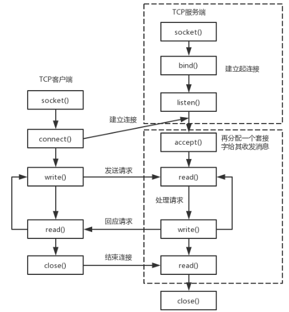
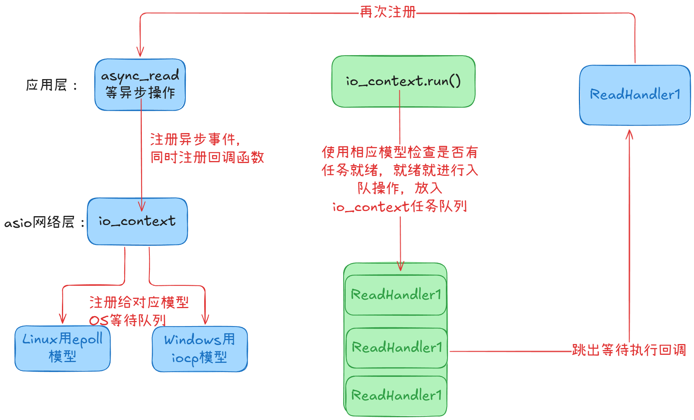

# asio基础

> 基于 `Linux` 网络编程，用C++特性对其封装，实现更高效、可维护地开发网络应用。

**学什么：**

​	boost库是 C++ 生态中最重要、最经典的第三方库之一，也是 **C++ 标准库的“孵化器”**。

​	而 `boost.Asio` 就是Boost 库中专注于网络和底层 IO 编程的核心模块。**因此学习以 `boost.Asio` 为主。**


## 网络通信基本流程



**当然常用操作系统肯定不是这么简单的模式，高并发模式对比：**

|          | Windows                          | Linux                            |
| -------- | -------------------------------- | -------------------------------- |
| 主导模式 | `IOCP` + 线程池（Proactor 模式） | `epoll` + 线程池（Reactor 模式） |

> 因此上诉流程只是最简单但也最基本的网络编程流程，由简入难。


## 环境配置

### 安装boost库

1. [boost库官网](https://www.boost.org/users/download/) ，选择指定平台即可。

2. 解压后找到 `bootstrap.bat` 文件，双击运行会生成 `b2.exe` 。

3. 直接在 `boost` 文件夹下打开cmd，执行 

   ```cpp
   .\b2.exe toolset=gcc	//linux
       
   .\b2.exe toolset=msvc	//windows
   ```

   执行后会在 `stage` 文件夹下生成 `lib` 文件夹

4. 进入 `visual studio` 创建一个 **控制台项目**，进入后
   - 右击项目名称，选择属性 - > VC++目录 - > 包含目录 - > 更改为`boost` 整个文件夹所在目录，点击确定再点击应用。
   - 相同路径，更改库目录为 `boost - > stage - > lib` 文件夹目录，点击确定再点击应用。
   
5. **注意：** `boost.asio` 库一直在更新，很多语法旧的直接不能用，注意学习新语法。


### 测试

使用以下代码替换原生的测试代码：

```cpp
#include <iostream>
#include <string>
#include "boost/lexical_cast.hpp"
 
int main()
{
    using namespace std;
    cout << "Enter your weight: ";
    float weight;
    cin >> weight;
    string gain = "A 10% increase raises ";
    string wt = boost::lexical_cast<string> (weight);
    gain = gain + wt + " to ";      // string operator()
    weight = 1.1 * weight;
    gain = gain + boost::lexical_cast<string>(weight) + ".";
    cout << gain << endl;
    system("pause");
    return 0;
}
```

运行成功即可。


## 一些专业名词的介绍

### 同步异步

​	**关注点：**

- **操作完成时的通知方式**

-  **完成的通知方式** → "**完成后，谁来告诉我？**"


1. **同步**

```cpp
// 同步操作：调用后等待操作完成
int bytes = recv(socket, buffer, size, 0);  // 等待直到数据到达
process_data(buffer, bytes);  // 数据到达后才处理
```

- 操作发起后，**调用者等待操作完成**
- 结果直接通过函数返回
- 时间顺序是线性的


2. **异步**

```js
// Node.js异步示例
socket.readAsync(buffer, size).then((bytes) => {
    // 操作完成后，通过回调通知
    process_data(buffer, bytes);
});
// 立即继续执行，不等待read完成
```

- 操作发起后立即返回，不等待完成
- 完成后**通过回调、信号、事件等方式通知**
- 调用和完成在时间上是分离的


### 阻塞非阻塞

​	**关注点：**

- **调用时的即时状态**
- **调用时的状态** → "**在等的时候，我能做其他事吗？**"


1. **阻塞**

```c
// 典型的阻塞调用
int result = read(socket_fd, buffer, size);  // 程序在此处停止，直到有数据到达
// 只有数据到达后，才会执行到这里
```

- 调用后立即挂起线程，直到操作完成
- 线程处于等待状态，不消耗CPU
- 编程模型简单直观
- 每个连接需要独立的线程/进程处理


2. **非阻塞**

```c
// 设置socket为非阻塞模式
fcntl(socket_fd, F_SETFL, O_NONBLOCK);

// 非阻塞读取
int result = read(socket_fd, buffer, size);
if (result == -1 && errno == EAGAIN) {
    // 没有数据可读，立即返回，可以做其他事情
    // 不会阻塞在此处
}
```

- 调用后立即返回，无论操作是否完成
- 需要通过返回值/错误码判断状态
- 需要轮询或事件通知机制
- 单线程可处理多个连接


### 使用场景

> 以取快递为例

|        | 同步阻塞（最常见）         | 同步非阻塞（轮询）                 | 异步非阻塞（事件驱动）             |
| ------ | -------------------------- | ---------------------------------- | ---------------------------------- |
| 同步   | 你自己等结果，拿到包裹才走 | 还是你自己去等结果                 |                                    |
| 异步   |                            |                                    | 你不用等结果，包裹找到后有人通知你 |
| 阻塞   | 等待时你什么都不能干       |                                    |                                    |
| 非阻塞 |                            | 等待时可以做其他事（需要主动轮询） | 发起请求后立即继续做其他事         |

 

### Socket

> `Socket` 是一个文件描述符，让我们像读写文件一样进行网络操作

| 电话系统 | Socket系统        | 说明          |
| :------- | :---------------- | :------------ |
| 电话机   | Socket对象        | 通信设备/端点 |
| 电话号码 | IP地址 + 端口     | 唯一标识      |
| 拨号     | connect()         | 发起连接      |
| 响铃     | listen()/accept() | 等待连接      |
| 通话     | send()/recv()     | 数据传输      |
| 挂断     | close()           | 结束连接      |


​	**比喻：**

1. **客户端**

```cpp
# 1. 买一部电话机（创建Socket）
phone = socket.socket(socket.AF_INET, socket.SOCK_STREAM)

# 2. 拨号（连接服务器）
phone.connect(('192.168.1.100', 8080))  # IP相当于区号+号码，端口相当于分机号

# 3. 说话（发送数据）
phone.send(b'Hello Server!')

# 4. 听对方回复（接收数据）
data = phone.recv(1024)

# 5. 挂断（关闭连接）
phone.close()
```


2. **服务器端**

```cpp
# 1. 买一部电话机（创建Socket）
phone = socket.socket(socket.AF_INET, socket.SOCK_STREAM)

# 2. 插上电话线（绑定地址）
phone.bind(('0.0.0.0', 8080))  # 监听所有网卡的8080端口

# 3. 开机待机（开始监听）
phone.listen(5)  # 最多5个等待连接

# 4. 等待电话铃响（接受连接）
conn, addr = phone.accept()  # 阻塞直到有客户端连接

# 5. 接听电话（通信）
data = conn.recv(1024)  # 接收客户端数据
conn.send(b'Hello Client!')  # 发送回复

# 6. 挂断并等待下一个电话
conn.close()
```


## asio常用函数介绍

### 上下文相关

| 函数/类                 | 功能描述                   | 常用参数     | 返回值                      | 使用示例                       |
| :---------------------- | :------------------------- | :----------- | :-------------------------- | :----------------------------- |
| `io_context`            | 异步I/O操作的核心类        | 无参构造函数 | `io_context`对象            | `boost::asio::io_context ioc;` |
| **`io_context::run()`** | 运行事件循环，处理异步操作 | 无参数       | `size_t`(处理的handler数量) | `ioc.run();`                   |
| `io_context::run_one()` | 运行至多一个handler        | 无参数       | `size_t`(处理的handler数量) | `ioc.run_one();`               |
| `io_context::poll()`    | 非阻塞运行ready的handlers  | 无参数       | `size_t`(处理的handler数量) | `ioc.poll();`                  |
| `io_context::stop()`    | 停止事件循环               | 无参数       | void                        | `ioc.stop();`                  |
| `io_context::reset()`   | 重置停止的io_context       | 无参数       | void                        | `ioc.reset();`                 |




### TCP相关

#### 端点

| 类/函数             | 功能描述         | 常用参数                                               | 使用示例                                |
| :------------------ | :--------------- | :----------------------------------------------------- | :-------------------------------------- |
| `ip::tcp::endpoint` | TCP端点          | 1. `ip::address addr, port` <br />2. `port` (任意地址) | `tcp::endpoint(tcp::v4(), 8080)`        |
| `ip::address`       | IP地址           | 1. `string` IP字符串 2. `uint32_t` IPv4地址            | `ip::address::from_string("127.0.0.1")` |
| `ip::tcp::v4()`     | 获取IPv4协议对象 | 无参数                                                 | `tcp::v4()`                             |
| `ip::tcp::v6()`     | 获取IPv6协议对象 | 无参数                                                 | `tcp::v6()`                             |


#### Socket

| 函数/方法                  | 功能描述     | 参数                         | 返回值       |
| :------------------------- | :----------- | :--------------------------- | :----------- |
| `tcp::socket(io_context)`  | 构造函数     | `io_context&`                | socket对象   |
| `socket.open(protocol)`    | 打开socket   | `const protocol_type&`       | `error_code` |
| `socket.bind(endpoint)`    | 绑定地址     | `const endpoint_type&`       | `error_code` |
| `socket.connect(endpoint)` | 同步连接     | `const endpoint_type&`       | `error_code` |
| `socket.close()`           | 关闭socket   | 无                           | `error_code` |
| `socket.shutdown(type)`    | 关闭部分连接 | `socket_base::shutdown_type` | `error_code` |
| `socket.is_open()`         | 检查是否打开 | 无                           | `bool`       |
| `socket.available()`       | 可读字节数   | 无                           | `size_t`     |
| `socket.local_endpoint()`  | 本地端点     | 无                           | `endpoint`   |
| `socket.remote_endpoint()` | 远程端点     | 无                           | `endpoint`   |


#### 接受器（Acceptor）

| 函数/方法                     | 功能描述     | 参数                          | 返回值       |
| :---------------------------- | :----------- | :---------------------------- | :----------- |
| `tcp::acceptor(io_context)`   | 构造函数     | `io_context&`                 | acceptor对象 |
| `acceptor.open(protocol)`     | 打开acceptor | `const protocol_type&`        | `error_code` |
| `acceptor.bind(endpoint)`     | 绑定地址     | `const endpoint_type&`        | `error_code` |
| `acceptor.listen(backlog)`    | 开始监听     | `int backlog = SOMAXCONN`     | `error_code` |
| `acceptor.accept(socket)`     | 同步接受连接 | `socket_type&`                | `error_code` |
| `acceptor.cancel()`           | 取消异步操作 | 无                            | `error_code` |
| `acceptor.close()`            | 关闭acceptor | 无                            | `error_code` |
| `acceptor.set_option(option)` | 设置选项     | `const SettableSocketOption&` | `error_code` |
| `acceptor.get_option(option)` | 获取选项     | `GettableSocketOption&`       | `error_code` |


### 异步操作相关

#### 异步连接

| 函数            | 功能描述 | 参数                               | 回调函数签名       |
| :-------------- | :------- | :--------------------------------- | :----------------- |
| `async_connect` | 异步连接 | 1. `endpoint` 2. `CompletionToken` | `void(error_code)` |


#### 异步接受

| 函数           | 功能描述     | 参数                              | 回调函数签名       |
| :------------- | :----------- | :-------------------------------- | :----------------- |
| `async_accept` | 异步接受连接 | 1. `socket&` 2. `CompletionToken` | `void(error_code)` |


#### 异步读写

| 函数               | 功能描述           | 参数                                                         | 回调函数签名               |
| :----------------- | :----------------- | :----------------------------------------------------------- | :------------------------- |
| `async_read_some`  | 异步读取一些数据   | 1. `MutableBufferSequence` 2. `CompletionToken`              | `void(error_code, size_t)` |
| `async_write_some` | 异步写入一些数据   | 1. `ConstBufferSequence` 2. `CompletionToken`                | `void(error_code, size_t)` |
| `async_read`       | 异步读取指定量数据 | 1. `MutableBufferSequence` 2. `CompletionCondition` 3. `CompletionToken` | `void(error_code, size_t)` |
| `async_write`      | 异步写入所有数据   | 1. `ConstBufferSequence` 2. `CompletionToken`                | `void(error_code, size_t)` |
| `async_read_until` | 异步读取直到分隔符 | 1. `DynamicBuffer` 2. `Delimiter` 3. `CompletionToken`       | `void(error_code, size_t)` |


### 缓冲区相关

| 函数/类            | 功能描述       | 参数                                                         | 返回值                                             |
| :----------------- | :------------- | :----------------------------------------------------------- | :------------------------------------------------- |
| `buffer()`         | 创建缓冲区     | 1. `void* data, size_t size` <br />2. 数组 <br />3. `string` 4. `vector` | `mutable_buffer` 或 `const_buffer`                 |
| `buffer_cast<T>()` | 缓冲区类型转换 | 无                                                           | `T*`                                               |
| `buffer_size()`    | 获取缓冲区大小 | `const_buffer` 或 `mutable_buffer`                           | `size_t`                                           |
| `dynamic_buffer()` | 创建动态缓冲区 | 1. `string&` 2. `vector&`                                    | `dynamic_string_buffer` 或 `dynamic_vector_buffer` |


## **同步读写代码片段**


### **socket的创建和连接**

> **此部分在网络通信基本流程中，客户端讲到 `connect()` ，服务器讲到 `accept()`** 

#### **头文件**

```cpp
//endpoint_h.h

#pragma once
int client_end_point();//客户端端点

int server_end_point();//服务器端点

int create_tcp_socket();//创建客户端用于连接的socket

int create_acceptor_socket();//服务器用于监听的socket

int  bind_acceptor_socket();//把服务器socket绑定到指定端点

int connect_to_end();//客户端通过ip连接服务器

int accept_new_connection();//服务器接受连接
```

​	**流程：**

```bash
客户端流程：
client_end_point() → create_tcp_socket() → connect_to_end()

服务器流程：
server_end_point() → create_acceptor_socket()/bind_acceptor_socket() → accept_new_connection()
```


#### **创建终端节点**

> **所谓终端节点就是用来通信的端对端的节点，可以通过 ip地址 + 端口 构造，其的节点可以连接这个终端节点做通信。**

> **端点用于供给给 `socket` 拿来通信。**


1. **`client_end_point()` 函数：客户端端点的创建，用对端的 ip和端口 构造一个endpoint，用这个endpoint和其通信。**

```cpp
// 客户端端点
int client_end_point() 
{
	std::string raw_ip_address = "127.4.8.1";//对端服务器的IP地址
	unsigned short port_num = 3333;//对端服务器的端口号，端口号对应目标主机的具体进程

	boost::system::error_code ec;//boost的错误码
	asio::ip::address ip_address = asio::ip::make_address(raw_ip_address, ec);//将字符串的IP地址转换成address对象给asio调用
	if (ec.value() != 0)
	{
		std::cout << "不能转化对应的IP值" << ec.value() << ".Message is" << ec.message();
		return ec.value();
	}

	//需要IP加端口绑定成端点以通信
	asio::ip::tcp::endpoint ep(ip_address, port_num);//ep变量就是一个端点，此时127.4.8.1：333就是客户端要连接的服务器的远程地址

	return 0;
}
```


2. **`server_end_point()` 函数：服务器端点创建，创建服务器监听端点。使用 IPv6::any() 监听所有网络接口**

```cpp
//服务器端点
int server_end_point()
{
	//服务器是监听方，等待别人连接就行
	unsigned short port_num = 3333;

	asio::ip::address ip_address = asio::ip::address_v6::any();
	//这个例子没有指定ip。任何ip地址都可以和我通信，即服务器在端口333上允许任意客户端链接

	asio::ip::tcp::endpoint ep(ip_address, port_num);

	return 0;
}

```


#### **创建socket**

> **创建socket分为4步，创建上下文 `iocontext`，选择协议，生成socket，打开socket。**

1. **`create_tcp_socket()` 函数：创建客户端socket**

```cpp 
 //创建socket
int create_tcp_socket()
{
	asio::io_context ioc;//上下文，告诉socket数据为哪一个上下文服务

	asio::ip::tcp::socket sock(ioc, asio::ip::tcp::v4());//创建一个v4版本的socket

	return 0;
}
```


2. **`create_acceptor_socket()` 函数：创建一个acceptor的socket。用于服务器监听。**

```cpp
//服务器的监听socket,等待客户端连接
int create_acceptor_socket()
{
	asio::io_context ioc;

	asio::ip::tcp::acceptor a(ioc,asio::ip::tcp::endpoint(asio::ip::tcp::v4(),3333));
    //生成一个tcpv4协议和端口为333的连接的acceptor

	return 0;
}
```


#### **绑定acceptor**

1. **`bind_acceptor_socket()` 函数：绑定acceptor类型的socket到端点，让服务器在指定端口开始监听**

```cpp
int  bind_acceptor_socket()
{
	unsigned short port_num = 3333;

	asio::ip::tcp::endpoint ep(asio::ip::address_v4::any(),port_num);

	asio::io_context  ios;

	asio::ip::tcp::acceptor acceptor(ios, ep.protocol());

	boost::system::error_code ec;

	acceptor.bind(ep, ec);

	if (ec.value() != 0) 
	{
		std::cout << "Failed to bind the acceptor socket."
			<< "Error code = " << ec.value() << ". Message: "
			<< ec.message();

		return ec.value();
	}
	return 0;
}
```


#### **连接指定的端点**

1. **`connect_to_end()` 函数：客户端连接到服务器指定端点**

```cpp
int connect_to_end()
{
	std::string raw_ip_address = "127.0.0.1";
	unsigned short port_num = 3333;

	try
	{
		asio::ip::tcp::endpoint ep(asio::ip::make_address(raw_ip_address), port_num);

		asio::io_context ios;

		asio::ip::tcp::socket sock(ios, ep.protocol());

		sock.connect(ep);
	}
	catch (system::system_error& e)
	{
		std::cout << "Error occured! Error code = " << e.code()
			<< ". Message: " << e.what();

		return e.code().value();
	}
}
```


#### **服务器接受连接**

-  **`accept_new_connection()` ：服务器接受客户端的连接**

```cpp
int accept_new_connection()
{
	const int BACKLOG_SIZE = 30;//给一个30*2的缓冲放来不及处理的连接

	unsigned short port_num = 3333;
	asio::ip::tcp::endpoint ep(asio::ip::address_v4::any(), port_num);

	asio::io_context ioc;

	try
	{
		asio::ip::tcp::acceptor acceptor(ioc, ep.protocol());
		acceptor.bind(ep);
		acceptor.listen(BACKLOG_SIZE);
		asio::ip::tcp::socket sock(ioc);
		acceptor.accept(sock);
	}
	catch (system::system_error& e)
	{
		std::cout << "Error occured! Error code = " << e.code()
			<< ". Message: " << e.what();

		return e.code().value();
	}
}
```


### **同步读写**

> **接着上部分，连接之后开始读写通信的流程。以同步读写为例**

#### **同步写write_some**

> **`boost::asio` 提供了几种同步写的api，write_some可以每次向指定的空间写入固定的字节数，如果写缓冲区满了，就只写一部分，返回写入的字节数。**

```cpp
//向一个socket写数据
void write_to_socket(asio::ip::tcp::socket& st)
{
	std::string buf = "Hello World";//定义一个写入的字符串
	std::size_t total_bytes_written = 0;//已经写入的数据多少,无符号整型

	while (total_bytes_written != buf.size())
	{
		//不能保证buf一次性全部写入buffer，每次写入一点然后记录新的位置，下次在这个位置写入
		//buf.c_str() + total_bytes_written : buf写入时的位置
		//buf.length() - total_bytes_written : buf剩余的大小，每次写入的大小一定小于等于剩余的大小
		total_bytes_written += 
			st.write_some(asio::buffer(buf.c_str() + total_bytes_written, buf.length() - total_bytes_written));
	}
}
```


#### **同步写send**

> **write_some使用起来比较麻烦，需要多次调用，asio提供了send函数。send函数会一次性将buffer中的内容发送给对端，如果有部分字节因为发送缓冲区满无法发送，则阻塞等待，直到发送缓冲区可用，则继续发送完成。**

```cpp

//创建socket，连接到对端，然后给对端发数据
int send_data_by_write_some()
{
	std::string raw_ip_address = "127.0.0.1";
	unsigned short port_num = 3333;

	try 
	{
		asio::ip::tcp::endpoint ep(asio::ip::make_address(raw_ip_address), port_num);//一个对端端点

		asio::io_context ioc;//负责所有的异步 I/O 操作调度
		asio::ip::tcp::socket sock(ioc, ep.protocol());//指定I/O服务上下文,ep.protocol()自适应对端协议

		sock.connect(ep);//连接

		//法1，使用自定义函数传数据
		write_to_socket(sock);//向缓冲区写数据

		//法2，使用send
		//std::string buf="Hello,World!";
		//int send_length = sock.send(asio::buffer(buf.c_str(), buf.size()));//同步阻塞

	}
	catch (system::system_error& e)
	{
		std::cout << "Error occured! Error code = " << e.code()
			<< ". Message: " << e.what();

		return e.code().value();
	}
}
```


#### **同步写write**

> **类似send方法，asio还提供了一个write函数，可以一次性将所有数据发送给对端，如果发送缓冲区满了则阻塞，直到发送缓冲区可用，将数据发送完成。**

```cpp
int send_data_by_wirte() {
    std::string raw_ip_address = "127.0.0.1";
    unsigned short port_num = 3333;

    try {
        asio::ip::tcp::endpoint
            ep(asio::ip::address::from_string(raw_ip_address),
                port_num);

        asio::io_service ios;

        // Step 1. Allocating and opening the socket.
        asio::ip::tcp::socket sock(ios, ep.protocol());

        sock.connect(ep);
        std::string buf = "Hello World!";
        int send_length  = asio::write(sock, asio::buffer(buf.c_str(), buf.length()));
        if (send_length <= 0) {
            cout << "send failed" << endl;
            return 0;
        }
    }
    catch (system::system_error& e) {
        std::cout << "Error occured! Error code = " << e.code()
            << ". Message: " << e.what();

        return e.code().value();
    }
    return 0;
 }
```


#### **同步读read_some**

> **同步读和同步写类似，提供了读取指定字节数的接口read_some**

```cpp
std::string read_from_socket(asio::ip::tcp::socket& sock) {
    const unsigned char MESSAGE_SIZE = 7;
    char buf[MESSAGE_SIZE];
    std::size_t total_bytes_read = 0;

    while (total_bytes_read != MESSAGE_SIZE) {
        total_bytes_read += sock.read_some(
            asio::buffer(buf + total_bytes_read,
                MESSAGE_SIZE - total_bytes_read));
    }

    return std::string(buf, total_bytes_read);
}


int read_data_by_read_some() {
    std::string raw_ip_address = "127.0.0.1";
    unsigned short port_num = 3333;

    try {
        asio::ip::tcp::endpoint
            ep(asio::ip::address::from_string(raw_ip_address),
                port_num);

        asio::io_service ios;

        asio::ip::tcp::socket sock(ios, ep.protocol());

        sock.connect(ep);

        read_from_socket(sock);
    }
    catch (system::system_error& e) {
        std::cout << "Error occured! Error code = " << e.code()
            << ". Message: " << e.what();

        return e.code().value();
    }

    return 0;
}
```


#### **同步读receive**

> **可以一次性同步接收对方发送的数据**

```cpp
int read_data_by_receive() {
    std::string raw_ip_address = "127.0.0.1";
    unsigned short port_num = 3333;

    try {
        asio::ip::tcp::endpoint
            ep(asio::ip::address::from_string(raw_ip_address),
                port_num);

        asio::io_service ios;

        asio::ip::tcp::socket sock(ios, ep.protocol());

        sock.connect(ep);
        const unsigned char BUFF_SIZE = 7;
         char buffer_receive[BUFF_SIZE];
        int receive_length =  sock.receive(asio::buffer(buffer_receive, BUFF_SIZE));
        if (receive_length <= 0) {
            cout << "receive failed" << endl;
        }
    }
    catch (system::system_error& e) {
        std::cout << "Error occured! Error code = " << e.code()
            << ". Message: " << e.what();

        return e.code().value();
    }

    return 0;
}
```


#### **同步读read**

> **可以一次性同步读取对方发送的数据**

```cpp
int read_data_by_read() {
    std::string raw_ip_address = "127.0.0.1";
    unsigned short port_num = 3333;

    try {
        asio::ip::tcp::endpoint
            ep(asio::ip::address::from_string(raw_ip_address),
                port_num);

        asio::io_service ios;

        asio::ip::tcp::socket sock(ios, ep.protocol());

        sock.connect(ep);
        const unsigned char BUFF_SIZE = 7;
        char buffer_receive[BUFF_SIZE];
        int receive_length = asio::read(sock, asio::buffer(buffer_receive, BUFF_SIZE));
        if (receive_length <= 0) {
            cout << "receive failed" << endl;
        }
    }
    catch (system::system_error& e) {
        std::cout << "Error occured! Error code = " << e.code()
            << ". Message: " << e.what();

        return e.code().value();
    }

    return 0;
 }
```


#### **读取直到指定字符**

> **我们可以一直读取，直到读取指定字符结束**

```cpp
std::string  read_data_by_until(asio::ip::tcp::socket& sock) {
    asio::streambuf buf;

    // Synchronously read data from the socket until
    // '\n' symbol is encountered.  
    asio::read_until(sock, buf, '\n');

    std::string message;

    // Because buffer 'buf' may contain some other data
    // after '\n' symbol, we have to parse the buffer and
    // extract only symbols before the delimiter. 

    std::istream input_stream(&buf);
    std::getline(input_stream, message);
    return message;
 }
```


## **同步读写完整demo**

> **前面介绍的都是代码片段，现在全部串起来，写一个可以跑起来的同步客户端和服务器。**

> **但是这是最简单最玩具的代码，熟悉最简单的流程使用。**

### **客户端设计**

> **客户端设计基本思路是根据服务器对端的 i p 和端口创建一个endpoint，然后创建socket连接这个endpoint，之后就可以用同步读写的方式发送和接收数据了。**

```cpp
#include <iostream>
#include<boost/asio.hpp>

using namespace boost::asio::ip;
using namespace std;
const int MAX_LENGTHG=1024;//发送和接受长度最长为1024

int main()
{
	try 
	{
		boost::asio::io_context ioc;
		tcp::endpoint remote_ep(make_address("127.0.0.1"), 10086);//连接本机的端口，就是把本机当服务器

		tcp::socket sock(ioc);//创建socket

		boost::system::error_code error = boost::asio::error::host_not_found;

		sock.connect(remote_ep,error);

		if (error)
		{
			cout << "connect failed,code is" << error.value() << "error mes is" << error.message() << endl;
			return 0;
		}

		std::cout << "Enter message:";
		char request[MAX_LENGTHG];

		//服务器发送所有信息
		std::cin.getline(request, MAX_LENGTHG);
		size_t request_length = strlen(request);
		boost::asio::write(sock, boost::asio::buffer(request, request_length));

		//服务器返回数据
		char reply[MAX_LENGTHG];
		size_t reply_length = boost::asio::read(sock, boost::asio::buffer(reply, request_length));//数组首地址和数组长度
		std::cout << "Reply is:";
		std::cout.write(reply, reply_length);
		std::cout << endl;

	}
	catch (std::exception& e)
	{
		std::cerr << "Exception: " << e.what() << endl;
	}
	return 0;
}
```


### **服务器设计**

> **创建session函数，该函数为服务器处理客户端请求，每当我们获取客户端连接后就调用该函数。在session函数里里进行echo方式的读写，所谓echo就是应答式的处理**

> **创建线程调用session函数可以分配独立的线程用于socket的读写，保证acceptor不会因为socket的读写而阻塞。**

```cpp
#include <iostream>
#include<boost/asio.hpp>
#include<set>
using boost::asio::ip::tcp;//仅引入tcp，其他组件还是要完整的命名空间
using namespace std;
const int MAX_LENGTH = 1024;
using socket_ptr= std::shared_ptr<tcp::socket>;//别名
std::set<std::shared_ptr<std::thread>>thread_set;//线程集合

//处理数据的函数
void session(socket_ptr sock)
{
	try
	{
		for (;;)
		{
			char data[MAX_LENGTH];
			memset(data, '\0', MAX_LENGTH);
			boost::system::error_code error;
			//size_t length = boost::asio::read(sock, boost::asio::buffer(data, MAX_LENGTH), error);//read效果不好，读完max才会反应
			size_t length = sock->read_some(boost::asio::buffer(data, MAX_LENGTH), error);
			if (error == boost::asio::error::eof)
			{
				std::cout << "connection closed by peer" << endl; //对端主动关闭了连接
				break;
			}
			else if (error)
			{
				throw boost::system::system_error(error);
			}

			cout << "receive from" << sock->remote_endpoint().address().to_string() << endl;
			cout << "receive message is" << data << endl;
			//回传给对端
			boost::asio::write(*sock, boost::asio::buffer(data, length));
		}
	}
	catch (const std::exception&e)
	{
		std::cerr << "Exception in thraed:" << e.what() << endl;
	}
}

//接受请求的函数
void server(boost::asio::io_context& ioc, unsigned short port)
{
	//listen默认包含在acceptr过程中
	tcp::acceptor a(ioc, tcp::endpoint(tcp::v4(), port));//服务器接受连接的acceptor对象,接受一个请求就要一个socket对象处理请求
	for (;;)
	{
		socket_ptr socket(new tcp::socket(ioc));
		a.accept(*socket);

		//每个线程单独服务
		auto t = std::make_shared<std::thread>(session, socket);

		thread_set.insert(t);//t是智能指针的临时变量，析构后线程资源被回收，session可能没有发挥作用。插入一下保留引用计数
	}
}

int main()
{
	try
	{
		boost::asio::io_context ioc;
		server(ioc, 10086);

		//防止因为主线程的退出导致子线程退出 
		for (auto& t : thread_set)
		{
			t->join();//等待全部线程任务做完jion后主线程再回收
		}
	}
	catch (const std::exception&e)
	{
		std::cerr << "Exception in thraed:" << e.what() << endl;
	}
	return 0;
}
```


## **异步读写代码片段**

> **和之前同步读写流程一样，先介绍各个api，然后再串联起来。**


### **异步写操作**

> **在写操作前，我们先封装一个Node结构，用来管理要发送和接收的数据，该结构包含数据域首地址，数据的总长度，以及已经处理的长度 (已读的长度或者已写的长度)**

```cpp

```


### **异步读操作**

```cpp

```


## **异步服务器完整demo**

> **写一个以应答为主的简单异步 `echo` 服务器，客户端就以之前的同步客户端就行。**

### **Session类**

> **Session类主要是处理客户端消息收发的会话类，为了简单起见，我们不考虑粘包问题，也不考虑支持手动调用发送的接口，只以应答的方式发送和接收固定长度(1024字节长度)的数据。**

```cpp
//服务器端的回声逻辑
class Session
{
public:
	Session(boost::asio::io_context& ioc) :_socket(ioc) {};//接受上下文引用，用于创建socket

	tcp::socket& Socket()//返回socket的引用，允许外部访问socket
	{
		return _socket;
	}

	void Start();//开始对话的窗口

private:
	//异步读完成的回调函数，参数是错误操作码和实际读取的字节数
	void handle_read(const boost::system::error_code& error, size_t length);
	//异步写完成回调函数
	void handle_write(const boost::system::error_code& error);

	tcp::socket _socket;//socket对象
	enum {max_length=1024};//定义缓冲区的大小
	char _data[max_length];//数据缓冲区
};
```

---

```cpp
void Session::Start()
{
	memset(_data, 0, max_length);//把数组置为零

	//异步操作的函数,参数1是数据缓冲区。参数2是回调函数，在操作完成时被调用，使用bind绑定之后就会调用handle_write
	/*_socket.async_read_some(boost::asio::buffer(_data,max_length),
		std::bind(&Session::handle_read, this, placeholders::_1, placeholders::_2));*/

	//当然lambda表达式肯定更好
	_socket.async_read_some(boost::asio::buffer(_data, max_length),
		[this](boost::system::error_code ec, size_t length)
		{
			this->handle_read(ec, length);
		}
	);
}
```

---

```cpp
//回声服务器，上面的start函数服务器异步接受到客户端发的消息之后服务器再接受之后回声回复一下
void Session::handle_read(const boost::system::error_code& error, size_t length)
{
	if (!error)//没有错误就输出接受到的数据
	{
		cout << "sever recive data is" << _data << endl;

		//异步回写数据给客户端
		boost::asio::async_write(_socket, boost::asio::buffer(_data, length),
			std::bind(&Session::handle_write, this, placeholders::_1));
	}
	else
	{
		cout << "read error" << endl;
		delete this;
	}
}
```

---

```cpp
//上面的回声服务器响应之后继续调用这个函数继续下一次异步读取，循环下去
void Session::handle_write(const boost::system::error_code& error)
{
	if (!error)
	{
		memset(_data, 0, max_length);
		_socket.async_read_some(boost::asio::buffer(_data, max_length),
			[this](boost::system::error_code ec, size_t length)
			{
				this->handle_read(ec, length);
			}
		);
	}
	else
	{
		cout << "write error!" << error.value() << endl;
		delete this;
	}
}
```


### **Server类**

> **Server类为服务器接收连接的管理类**

```cpp
//服务器端点
class Server
{
public://监听所有指定端口的所有信息
	Server(boost::asio::io_context& ioc, short port) :_ioc(ioc), _acceptor(ioc, tcp::endpoint(tcp::v4(), port)) 
	{
		start_accept();
	};
private:
	void start_accept();//启动监听

	//对方有连接就触发回调函数循环,参数是回调类Session和错误提示
	void handle_accept(Session* new_session,const boost::system::error_code& error);

	boost::asio::io_context& _ioc;//上下文操作不允许拷贝操作

	tcp::acceptor _acceptor;//监听同意的acceptor对象
};
```

---

```cpp
void Server::start_accept()
{
	Session* new_session = new Session(_ioc);

	//有连接时处理对端连接信息,第一个从参数是客户端连接的socket，第二个参数是回调函数，
    //使用bind绑定到了handle_accept，这个函数专门对接Session回调类
	_acceptor.async_accept(new_session->Socket(),
		std::bind(&Server::handle_accept, this, new_session, placeholders::_1));
}
```

---

```cpp
//回调函数的处理
void Server::handle_accept(Session* new_session, const boost::system::error_code& error)
{
	if (!error)
	{
		new_session->Start();
	}
	else
	{
		delete new_session;
	}
	start_accept();//异步处理完一个连接后继续监听
}
```


### **隐患与改进**

1. **本 `demo` 以 `asio` 官网编写，但仍然存在部分隐患：**

​		就是当服务器即将发送数据前(调用async_write前)，此刻客户端中断，服务器此时调用async_write会触发发送回调函数，判断ec为非0进而执行delete this逻辑回收session。**就会进行 二次析构** ，非常危险。


2. **本 `demo` 仅异步应答服务器，比同步稍微好一点，还需改进：**
   - 因为该服务器的发送和接收以应答的方式交互，而并不能做到应用层想随意发送的目的，**未做到完全的收发分离(全双工逻辑)**。
   - 该服务器未处理粘包，序列化，以及逻辑和收发线程解耦等问题。
   - 该服务器存在二次析构的风险。

