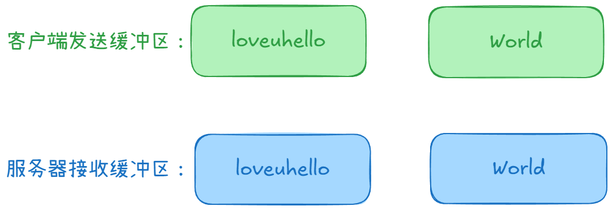
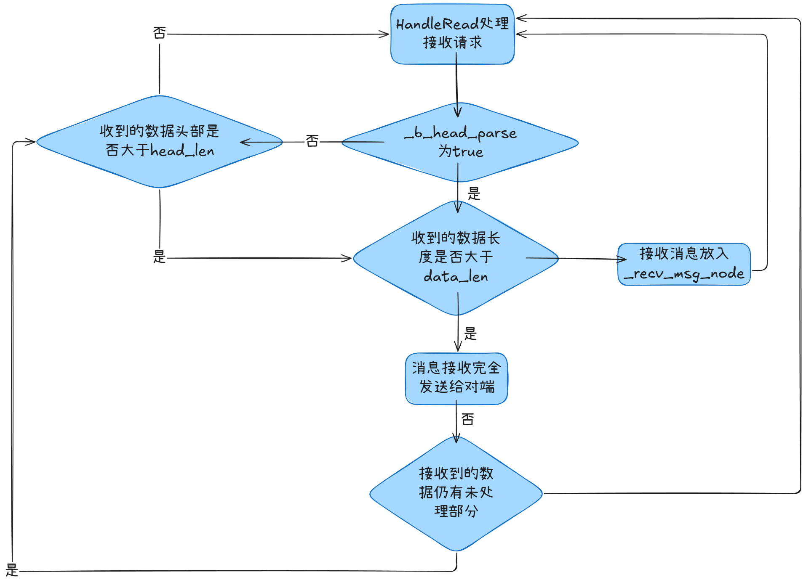
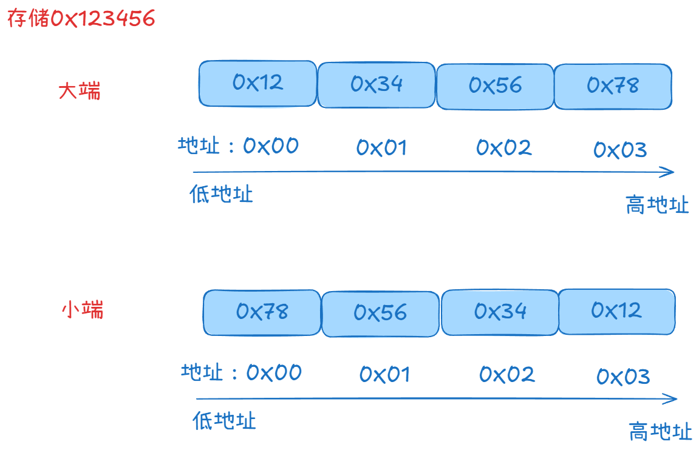

# asio 进阶

> 上篇笔记讲了一些简单的同步异步 `demo` ，现在针对那些 `demo` 可能出现的问题进行优化。

​	**需优化：**

1. 二次析构问题
2. 未实现全双工通信
3. 未处理粘包问题


## 伪闭包

```js
function outer() 
{
    let count = 0; // 外部函数的变量
    function inner() 
    {
        count++; // 内部函数访问外部变量
        console.log(count);
    }
    return inner; // 返回内部函数
}
```

1. 在上诉 `js` 代码中，子函数内部使用父函数的变量时，**变量的生命周期被延长成和子函数一样**长，即使父函数死亡。**这就是闭包。**

2. `js`、`go`、`python`等语言有原生闭包效果，C++需要使用 **`lambda`** 、**智能指针**等来实现伪闭包效果。


## 伪闭包实现安全连接

> 之前的异步服务器为echo模式，但其存在安全隐患，就是在极端情况下客户端关闭导致触发写和读回调函数，二者都进入错误处理逻辑，进而造成二次析构的问题。
> 下面我们介绍通过 **C++11智能指针** 构造成一个伪闭包的状态延长session的生命周期。

> [完整代码案例](./代码案例/1. 异步读写+伪闭包服务器)


### 智能指针管理Session

> 我们可以通过智能指针的方式管理Session类，将acceptor接收的链接保存在Session类型的智能指针里。由于智能指针会在引用计数为0时自动析构，所以为了防止其被自动回收，也方便Server管理Session，因为我们后期会做一些重连踢人等业务逻辑，我们在Server类中添加成员变量，该变量为一个map类型，key为Session的uid，value为该Session的智能指针。

```cpp
//服务器端点
class Server
{
public://监听所有指定端口的所有信息
	Server(boost::asio::io_context& ioc, short port) :_ioc(ioc), _acceptor(ioc, tcp::endpoint(tcp::v4(), port)) 
	{
		start_accept();
	};

	void ClearSession(std::string uuid);
private:
	void start_accept();//启动监听

	//对方有连接就触发回调函数循环,参数是回调类Session和错误提示
	void handle_accept(std::shared_ptr<Session> new_session,const boost::system::error_code& error);

	boost::asio::io_context& _ioc;//上下文操作不允许拷贝操作

	tcp::acceptor _acceptor;//监听同意的acceptor对象

	std::map<std::string, std::shared_ptr<Session>> _sessions;//智能指针管理Session，保证生命周期
};
```


> 通过Server中的_sessions这个map管理链接，可以增加Session智能指针的引用计数，只有当Session从这个map中移除后，Session才会被释放。
> 所以在接收连接的逻辑里将Session放入map

```cpp
void Server::start_accept()
{
	shared_ptr<Session> new_session = make_shared<Session>(_ioc, this);
	//Session* new_session = new Session(_ioc);

	//有连接时处理对端连接信息,第一个从参数是客户端连接的socket，第二个参数是回调函数，使用bind绑定到了handle_accept，这个函数专门对接Session回调类
	_acceptor.async_accept(new_session->Socket(),
		std::bind(&Server::handle_accept, this, new_session, placeholders::_1));
}

//回调函数的处理
void Server::handle_accept(shared_ptr<Session> new_session, const boost::system::error_code& error)
{
	if (!error)
	{
		new_session->Start();
		_sessions.insert(make_pair(new_session->Getuuid(), new_session));
	}
	else
	{

	}
	start_accept();//异步处理完一个连接后继续监听
}
```


> StartAccept函数中虽然new_session是一个局部变量，但是我们通过bind操作，将new_session作为数值传递给bind函数，而bind函数返回的函数对象内部引用了该new_session所以引用计数增加1，这样保证了new_session不会被释放。
> 在HandleAccept函数里调用session的start函数监听对端收发数据，并将session放入map中，保证session不被自动释放。
> 此外，需要封装一个释放函数，将session从map中移除，当其引用计数为0则自动释放

```cpp
void Server::ClearSession(std::string uuid)
{
	_sessions.erase(uuid);
}
```


### Session的uuid

> 关于session的uuid可以通过boost提供的生成唯一id的函数获得，当然你也可以自己实现雪花算法。

```cpp
//服务器端的接受请求和回声逻辑
class Session:public std::enable_shared_from_this<Session>
{
public:
	Session(boost::asio::io_context& ioc,Server* server) :_socket(ioc),_server(server) //接受上下文引用，用于创建socket
	{ 
		//生成唯一ID，两个括号是因为构造一个函数对象再加括号就是调用函数对象,random_generator相当于一个匿名对象
		boost::uuids::uuid a_uuid = boost::uuids::random_generator()(); 
		_uuid = boost::uuids::to_string(a_uuid);//转化类型写入
	};
	
	
	tcp::socket& Socket()//返回socket的引用，允许外部访问socket
	{
		return _socket;
	}

	void Start();//开始对话的窗口
	const std::string& Getuuid();//获取唯一ID

private:
	//异步读完成的回调函数，参数是错误操作码和实际读取的字节数
	void handle_read(const boost::system::error_code& error, size_t length,std::shared_ptr<Session> _self_shared);
	//异步写完成回调函数
	void handle_write(const boost::system::error_code& error, std::shared_ptr<Session> _self_shared);

	tcp::socket _socket;//socket对象
	enum {max_length=1024};//定义缓冲区的大小
	char _data[max_length];//数据缓冲区

	Server* _server;
	std::string _uuid;
};
```


### 构造伪闭包

> 正常情况下上述服务器运行不会出现问题，但是当我们像上次一样模拟，在服务器要发送数据前打个断点，此时关闭客户端，在服务器就会先触发写回调函数的错误处理，再触发读回调函数的错误处理，这样session就会两次从map中移除，因为map中key唯一，所以第二次map判断没有session的key就不做移除操作了。

> 但是这么做还是会有崩溃问题，因为第一次在session写回调函数中移除session，session的引用计数就为0了，调用了session的析构函数，这样在触发session读回调函数时此时session的内存已经被回收了自然会出现崩溃的问题。解决这个问题可以利用智能指针引用计数和bind的特性，实现一个伪闭包的机制延长session的生命周期。


#### 思路

1. 利用智能指针被复制或使用引用计数加一的原理保证内存不被回收
2. bind操作可以将值绑定在一个函数对象上生成新的函数对象，如果将智能指针作为参数绑定给函数对象，那么智能指针就以值的方式被新函数对象使用，那么智能指针的生命周期将和新生成的函数对象一致，从而达到延长生命的效果。


> 以 handle_read 举例,在bind时传递 `_self_shared` 指针增加其引用计数，这样`_self_shared`的生命周期就和`async_write`的第二个参数(也就是asio要求的回调函数对象)生命周期一致了

> handle_write 同理

```cpp
//回声服务器，上面的start函数服务器异步接受到客户端发的消息之后服务器再接受之后回声回复一下
void Session::handle_read(const boost::system::error_code& error, size_t length,std::shared_ptr<Session> _self_shared)
{
	if (!error)//没有错误就输出接受到的数据
	{  
		cout << "sever recive data is" << _data << endl;

		//异步回写数据给客户端
		boost::asio::async_write(_socket, boost::asio::buffer(_data, length),
			std::bind(&Session::handle_write, this, placeholders::_1,_self_shared));
	}
	else
	{
		cout << "read error" << endl;
		_server->ClearSession(_uuid);
	}
}

//上面的回声服务器响应之后继续调用这个函数继续下一次异步读取，循环下去
void Session::handle_write(const boost::system::error_code& error,std::shared_ptr<Session> _self_shared)
{
	if (!error)
	{
		memset(_data, 0, max_length);
		_socket.async_read_some(boost::asio::buffer(_data, max_length),
			std::bind(&Session::handle_read, this, placeholders::_1,placeholders::_2, _self_shared));
	}
	else
	{
		cout << "write error!" << error.value() << endl;
		_server->ClearSession(_uuid);
	}
}
```


#### 易错点

> 除此之外，我们也要在第一次绑定读写回调函数的时候传入智能指针的值,但是要注意传入的方式，不能用两个智能指针管理同一块内存，**如下用法是错误的**。

```cpp
void Session::Start()
{
	memset(_data, 0, max_length);//把数组置为零

	//异步操作的函数,参数1是数据缓冲区。参数2是回调函数，在操作完成时被调用，使用bind绑定之后就会调用handle_write
	_socket.async_read_some(boost::asio::buffer(_data,max_length),
		std::bind(&Session::handle_read, this, placeholders::_1, placeholders::_2,shared_ptr<Session>(this));
}
```


> shared_ptr(this)生成的新智能指针和this之前绑定的智能指针并不共享引用计数，所以要通过shared_from_this()函数返回智能指针，该智能指针和其他管理这块内存的智能指针共享引用计数。

```cpp
void Session::Start()
{
	memset(_data, 0, max_length);//把数组置为零

	//异步操作的函数,参数1是数据缓冲区。参数2是回调函数，在操作完成时被调用，使用bind绑定之后就会调用handle_write
	_socket.async_read_some(boost::asio::buffer(_data,max_length),
		std::bind(&Session::handle_read, this, placeholders::_1, placeholders::_2,shared_from_this()));
}
```

> shared_from_this()函数并不是session的成员函数，要使用这个函数需要继承std::enable_shared_from_this


## 实现全双工通信

> 前文介绍了通过智能指针实现伪闭包的方式延长了session的生命周期，而实际使用的服务器并不是简单的应答式。
>
> 实际使用是全双工通信方式，服务器一直监听写事件，接收对端数据，可随时发送数据给对端。

> 今天介绍如何封装异步的发送接口，因为多次发送时，异步的发送要保证回调触发后再次发送才能确保数据是有序的，这一点我们已经在前文异步发送函数介绍的时候提到了。

> [完整代码案例](./代码案例/2. +全双工)

### 数据节点设计

> 数据可能一次收发不完，设计一个数据节点保证数据完整有序

```cpp
class MsgNode
{
    friend class Session;
public:
    MsgNode(char * msg, int max_len) 
    {
        _data = new char[max_len];
        memcpy(_data, msg, max_len);
    }

    ~MsgNode() {
        delete[] _data;
    }

private:
    int _cur_len;//已经发送或接受的数据长度
    int _max_len;//数据总长
    char* _data;//已收已发数据都在这里
};
```

1. _cur_len表示数据当前已处理的长度(已经发送的数据或者已经接收的数据长度)，因为一个数据包存在未发送完或者未接收完的情况。
2. _max_len表示数据的总长度。 
3. _data表示数据域，已接收或者已发送的数据都放在此空间内。


### 封装发送接口

> 首先在Session类里新增一个队列存储要发送的数据，因为我们不能保证每次调用发送接口的时候上一次数据已经发送完，就要把要发送的数据放入队列中，通过回调函数不断地发送。而且我们不能保证发送的接口和回调函数的接口在一个线程，所以要增加一个锁保证发送队列安全性。


1. **发送接口的声明**

```cpp
void Send(char* msg,  int max_length);
std::queue<shared_ptr<MsgNode> > _send_que;
std::mutex _send_lock;
```


2. **发送接口的实现**

```cpp
void Session::Send(char* msg, int max_length)
{
	bool pending = false;//true是队列有数据，没发完。flase是已经发完，缓冲区为空
	std::lock_guard<std::mutex> lock(_send_lock);
	if (_send_que.size() > 0)
	{
		pending = true;
	}
	_send_que.push(make_shared<MsgNode>(msg, max_length));//要发送数据投递到队列
	if (pending)
		return;

	boost::asio::async_write(_socket, boost::asio::buffer(msg, max_length),
		std::bind(&Session::handle_write, this, std::placeholders::_1, shared_from_this()));
}
```

> 发送接口里判断发送队列是否为空，如果不为空说明有数据未发送完，需要将数据放入队列，然后返回。如果发送队列为空，则说明当前没有未发送完的数据，将要发送的数据放入队列并调用async_write函数发送数据。


### 修改写回调

> 现在不是单纯的应答器，而是全双工模式

```cpp
void CSession::hand_write(const boost::system::error_code& error, shared_ptr<CSession> _self_shared) 
{
    if (!error) 
    {
        std::lock_guard<std::mutex> lock(_send_lock);
        _send_que.pop();
        if (!_send_que.empty()) 
        {
            auto &msgnode = _send_que.front();
            boost::asio::async_write(_socket, boost::asio::buffer(msgnode->_data, msgnode->_max_len),
                std::bind(&CSession::HandleWrite, this, std::placeholders::_1, _self_shared));
        }
    }
    else 
    {
        std::cout << "handle write failed, error is " << error.what() << endl;
        _server->ClearSession(_uuid);
        //判断发送队列是否为空，为空则发送完，否则不断取出队列数据调用async_write发送，直到队列为空。
    }
}
```


### 修改读回调

> 因为我们要一直监听对端发送的数据，所以要在每次收到数据后继续绑定监听事件

```cpp
void CSession::hand_read(const boost::system::error_code& error, size_t  bytes_transferred, shared_ptr<CSession> _self_shared)
{
    if (!error)
    {
        cout << "read data is " << _data << endl;
        //发送数据
        Send(_data, bytes_transferred);
        memset(_data, 0, MAX_LENGTH);
        _socket.async_read_some(boost::asio::buffer(_data, MAX_LENGTH), std::bind(&CSession::HandleRead, this, 
            std::placeholders::_1, std::placeholders::_2, _self_shared));
    }
    else 
    {
        std::cout << "handle read failed, error is " << error.what() << endl;
        _server->ClearSession(_uuid);
    }
}
```


## 处理粘包问题

> 从原始的字节流变成可靠的消息边界识别，确保数据完整性。

### 粘包原因

> [完整代码案例](./代码案例/3. +处理粘包)

​	**形成原因：**

1. TCP面向字节流传输，**TCP只保证发送的顺序和完整，不会对数据进行切割、没有消息边界**

2. 客户端的发送频率远高于服务器的接收频率，就会导致数据在服务器的tcp接收缓冲区滞留形成粘连，比如客户端1s内连续发送了两个hello world！,服务器过了2s才接收数据，那一次性读出两个hello world！。
3.  tcp底层的安全和效率机制不允许字节数特别少的小包发送频率过高，tcp会在底层累计数据长度到一定大小才一起发送，比如连续发送1字节的数据要累计到多个字节才发送，可以了解下tcp底层的Nagle算法。
4. 再就是最简单的情况，发送端缓冲区有上次未发送完的数据或者接收端的缓冲区里有未取出的数据导致数据粘连，如下示例：



### 处理粘包

​	处理粘包的方式主要采用应用层定义收发包格式的方式，这个过程俗称切包处理，**即收发都使用相同的格式**

​	常用的协议被称为**tlv协议**(消息id+消息长度+消息内容)，如下图：


> 本节还没有实现格式化，**因此就简化一下先不实现消息ID，只有消息长度和消息内容。**


### 完善消息节点

> 之前设计过消息节点的数据结构MsgNode，在CSeesion.h里面，这里需要完善一下:

```cpp
#define MAX_LENGTH  1024*2
#define HEAD_LENGTH 2
---------------------------------
    
class MsgNode
{
    friend class CSession;
public:
    MsgNode(char* msg, short max_len) :_total_len(max_len + HEAD_LENGTH), _cur_len(0)   //两个字节存储消息长度
    {
        _data = new char[_total_len + 1]();//消息长度+消息本身就是_total_len,+1存储\0
        memcpy(_data, &max_len, HEAD_LENGTH);//存储消息长度
        memcpy(_data + HEAD_LENGTH, msg, max_len);//偏移两个长度存储消息本身
        _data[_total_len] = '\0';
    }

    MsgNode(short max_len) :_total_len(max_len), _cur_len(0)
    {
        _data = new char[_total_len + 1]();
    }

    ~MsgNode() {
        delete[] _data;
    }

    void Clear()
    {
        ::memset(_data, 0, _total_len);
        _cur_len = 0;
    }
private:
    short _cur_len;
    short _total_len;
    char* _data;
};
```

- 两个参数的构造函数做了完善，之前的构造函数通过消息首地址和长度构造节点数据，现在需要在构造节点的同时把长度信息也写入节点,该构造函数主要用来发送数据时构造发送信息的节点。
- 一个参数的构造函数为较上次新增的，主要根据消息的长度构造消息节点，该构造函数主要是接收对端数据时构造接收节点调用的。
- 新增一个Clear函数清除消息节点的数据，主要是避免多次构造节点造成开销。


### CSeesion类完善

> 为能够对收到的数据切包处理，需要定义一个消息接收节点，一个bool类型的变量表示头部是否解析完成，以及将处理好的头部先缓存起来的结构。

```cpp
    //收到的消息内容
    std::shared_ptr<MsgNode> _recv_msg_node;
    bool _b_head_parse;//消息是否解析
    //收到的消息长度
    std::shared_ptr<MsgNode> _recv_head_node;
```

- _recv_msg_node用来存储接受的消息体信息
- _recv_head_node用来存储接收的头部信息
- _b_head_parse表示是否处理完头部信息


### 完善接收逻辑

> 完善HandleRead函数

```cpp
void CSession::HandleRead(const boost::system::error_code& error, size_t  bytes_transferred, std::shared_ptr<CSession> shared_self){
    if (!error) {
        //已经移动的字符数
        int copy_len = 0;
        while (bytes_transferred>0) {
            if (!_b_head_parse) {
                //收到的数据不足头部大小
                if (bytes_transferred + _recv_head_node->_cur_len < HEAD_LENGTH) {
                    memcpy(_recv_head_node->_data + _recv_head_node->_cur_len, _data+ copy_len, bytes_transferred);
                    _recv_head_node->_cur_len += bytes_transferred;
                    ::memset(_data, 0, MAX_LENGTH);
                    _socket.async_read_some(boost::asio::buffer(_data, MAX_LENGTH), 
                        std::bind(&CSession::HandleRead, this, std::placeholders::_1, std::placeholders::_2, shared_self));
                    return;
                }
                //收到的数据比头部多
                //头部剩余未复制的长度
                int head_remain = HEAD_LENGTH - _recv_head_node->_cur_len;
                memcpy(_recv_head_node->_data + _recv_head_node->_cur_len, _data+copy_len, head_remain);
                //更新已处理的data长度和剩余未处理的长度
                copy_len += head_remain;
                bytes_transferred -= head_remain;
                //获取头部数据
                short data_len = 0;
                memcpy(&data_len, _recv_head_node->_data, HEAD_LENGTH);
                cout << "data_len is " << data_len << endl;
                //头部长度非法
                if (data_len > MAX_LENGTH) {
                    std::cout << "invalid data length is " << data_len << endl;
                    _server->ClearSession(_uuid);
                    return;
                }
                _recv_msg_node = make_shared<MsgNode>(data_len);

                //消息的长度小于头部规定的长度，说明数据未收全，则先将部分消息放到接收节点里
                if (bytes_transferred < data_len) {
                    memcpy(_recv_msg_node->_data + _recv_msg_node->_cur_len, _data + copy_len, bytes_transferred);
                    _recv_msg_node->_cur_len += bytes_transferred;
                    ::memset(_data, 0, MAX_LENGTH);
                    _socket.async_read_some(boost::asio::buffer(_data, MAX_LENGTH), 
                        std::bind(&CSession::HandleRead, this, std::placeholders::_1, std::placeholders::_2, shared_self));
                    //头部处理完成
                    _b_head_parse = true;
                    return;
                }

                memcpy(_recv_msg_node->_data + _recv_msg_node->_cur_len, _data + copy_len, data_len);
                _recv_msg_node->_cur_len += data_len;
                copy_len += data_len;
                bytes_transferred -= data_len;
                _recv_msg_node->_data[_recv_msg_node->_total_len] = '\0';
                cout << "receive data is " << _recv_msg_node->_data << endl;
                //此处可以调用Send发送测试
                Send(_recv_msg_node->_data, _recv_msg_node->_total_len);
                //继续轮询剩余未处理数据
                _b_head_parse = false;
                _recv_head_node->Clear();
                if (bytes_transferred <= 0) {
                    ::memset(_data, 0, MAX_LENGTH);
                    _socket.async_read_some(boost::asio::buffer(_data, MAX_LENGTH), 
                        std::bind(&CSession::HandleRead, this, std::placeholders::_1, std::placeholders::_2, shared_self));
                    return;
                }
                continue;
            }

            //已经处理完头部，处理上次未接受完的消息数据
            //接收的数据仍不足剩余未处理的
            int remain_msg = _recv_msg_node->_total_len - _recv_msg_node->_cur_len;
            if (bytes_transferred < remain_msg) {
                memcpy(_recv_msg_node->_data + _recv_msg_node->_cur_len, _data + copy_len, bytes_transferred);
                _recv_msg_node->_cur_len += bytes_transferred;
                ::memset(_data, 0, MAX_LENGTH);
                _socket.async_read_some(boost::asio::buffer(_data, MAX_LENGTH), 
                    std::bind(&CSession::HandleRead, this, std::placeholders::_1, std::placeholders::_2, shared_self));
                return;
            }
            memcpy(_recv_msg_node->_data + _recv_msg_node->_cur_len, _data + copy_len, remain_msg);
            _recv_msg_node->_cur_len += remain_msg;
            bytes_transferred -= remain_msg;
            copy_len += remain_msg;
            _recv_msg_node->_data[_recv_msg_node->_total_len] = '\0';
            cout << "receive data is " << _recv_msg_node->_data << endl;
            //此处可以调用Send发送测试
            Send(_recv_msg_node->_data, _recv_msg_node->_total_len);
            //继续轮询剩余未处理数据
            _b_head_parse = false;
            _recv_head_node->Clear();
            if (bytes_transferred <= 0) {
                ::memset(_data, 0, MAX_LENGTH);
                _socket.async_read_some(boost::asio::buffer(_data, MAX_LENGTH),
                    std::bind(&CSession::HandleRead, this, std::placeholders::_1, std::placeholders::_2, shared_self));
                return;
            }
            continue;
        }
    }
    else {
        std::cout << "handle read failed, error is " << error.what() << endl;
        Close();
        _server->ClearSession(_uuid);
    }
}
```

1. copy_len记录的是已经处理过数据的长度，因为存在一次接收多个包的情况，所以copy_len用来做已经处理的数据长度的。
2. 首先判断_b_head_parse是否为false，如果为false则说明头部未处理，先判断接收的数据是否小于头部, 如果小于头部大小则将接收到的数据放入_recv_head_node节点保存，然后继续调用读取函数监听对端发送数据。否则进入步骤3.
3. 如果收到的数据比头部多，可能是多个逻辑包，所以要做切包处理。根据之前保留在_recv_head_node的长度，计算出剩余未取出的头部长度，然后取出剩余的头部长度保存在_recv_head_node节点，然后通过memcpy方式从节点拷贝出数据写入short类型的data_len里，进而获取消息的长度。接下来继续处理包体，也就是消息体，判断接收到的数据未处理部分的长度和总共要接收的数据长度大小，如果小于总共要接受的长度，说明消息体没接收完，则将未处理部分先写入_recv_msg_node里，并且继续监听读事件。否则说明消息体接收完全，进入步骤4
4. _将消息体数据接收到_recv_msg_node中，接受完全后返回给对端。当然存在多个逻辑包粘连，此时要判断bytes_transferred是否小于等于0，如果是说明只有一个逻辑包，我们处理完了，继续监听读事件，就直接返回即可。否则说明有多个数据包粘连，就继续执行上述操作。
5. 因为存在_b_head_parse为true，也就是包头接收并处理完的情况，但是包体未接受完，再次触发HandleRead，此时要继续处理上次未接受完的消息体，大体逻辑和3，4一样。
6. 具体流程图如下：




### 客户端修改

> 客户端的发送也要遵循先发送数据2个字节的数据长度，再发送数据消息的结构。
> 接收时也是先接收两个字节数据获取数据长度，再根据长度接收消息。

```cpp
#include <iostream>
#include <boost/asio.hpp>
#include <thread>
using namespace std;
using namespace boost::asio::ip;
const int MAX_LENGTH = 1024 * 2;
const int HEAD_LENGTH = 2;

int main()
{
	try {
		//创建上下文服务
		boost::asio::io_context   ioc;
		//构造endpoint
		tcp::endpoint remote_ep(boost::asio::ip::make_address("127.0.0.1"), 10086);
		tcp::socket  sock(ioc);
		boost::system::error_code   error = boost::asio::error::host_not_found; ;
		sock.connect(remote_ep, error);
		if (error) {
			cout << "connect failed, code is " << error.value() << " error msg is " << error.message();
			return 0;
		}

		thread send_thread([&sock] {
			for (;;) {
				this_thread::sleep_for(std::chrono::milliseconds(2));
				const char* request = "hello world!";
				short request_length = strlen(request);
				char send_data[MAX_LENGTH] = { 0 };
				//转为网络字节序
				short request_host_length = boost::asio::detail::socket_ops::host_to_network_short(request_length);
				memcpy(send_data, &request_host_length, 2);
				memcpy(send_data + 2, request, request_length);
				boost::asio::write(sock, boost::asio::buffer(send_data, request_length + 2));
			}
			});

		thread recv_thread([&sock] {
			for (;;) {
				this_thread::sleep_for(std::chrono::milliseconds(2));
				cout << "begin to receive..." << endl;
				char reply_head[HEAD_LENGTH];
				size_t reply_length = boost::asio::read(sock, boost::asio::buffer(reply_head, HEAD_LENGTH));
				short msglen = 0;
				memcpy(&msglen, reply_head, HEAD_LENGTH);
				//转为本地字节序
				msglen = boost::asio::detail::socket_ops::network_to_host_short(msglen);
				char msg[MAX_LENGTH] = { 0 };
				size_t  msg_length = boost::asio::read(sock, boost::asio::buffer(msg, msglen));

				std::cout << "Reply is: ";
				std::cout.write(msg, msglen) << endl;
				std::cout << "Reply len is " << msglen;
				std::cout << "\n";
			}
			});

		send_thread.join();
		recv_thread.join();
	}
	catch (std::exception& e)
	{
		std::cerr << "Exception: " << e.what() << endl;
	}
	return 0;
}
```


### 粘包测试

> 为了测试粘包，需要制造粘包产生的现象，可以让客户端发送的频率高一些，服务器接收的频率低一些，这样造成前后端收发数据不一致导致多个数据包在服务器tcp缓冲区滞留产生粘包现象。


1. 在服务器的CSession类里添加打印二进制数据的函数，便于查看缓冲区的数据

```cpp
void CSession::PrintRecvData(char* data, int length)
{
    stringstream ss;
    string result = "0x";
    for (int i = 0; i < length; i++) {
        string hexstr;
        ss << hex << std::setw(2) << std::setfill('0') << int(data[i]) << endl;
        ss >> hexstr;
        result += hexstr;
    }
    std::cout << "receive raw data is : " << result << endl;;
}
```


2. 然后将这个函数放到HandleRead里，每次收到数据就调用这个函数打印接收到的最原始的数据，然后睡眠2秒再进行收发操作，用来延迟接收对端数据制造粘包，之后的逻辑不变

```cpp
void CSession::HandleRead(const boost::system::error_code& error, size_t  bytes_transferred, std::shared_ptr<CSession> shared_self){
    if (!error) {
        PrintRecvData(_data, bytes_transferred);
        std::chrono::milliseconds dura(2000);
        std::this_thread::sleep_for(dura);
    }
}
```


3. 修改客户端逻辑，实现收发分离。

```cpp
int main()
{
    try {
        //创建上下文服务
        boost::asio::io_context   ioc;
        //构造endpoint
        tcp::endpoint  remote_ep(address::from_string("127.0.0.1"), 10086);
        tcp::socket  sock(ioc);
        boost::system::error_code   error = boost::asio::error::host_not_found; ;
        sock.connect(remote_ep, error);
        if (error) {
            cout << "connect failed, code is " << error.value() << " error msg is " << error.message();
            return 0;
        }

        thread send_thread([&sock] {
            for (;;) {
                this_thread::sleep_for(std::chrono::milliseconds(2));
                const char* request = "hello world!";
                size_t request_length = strlen(request);
                char send_data[MAX_LENGTH] = { 0 };
                memcpy(send_data, &request_length, 2);
                memcpy(send_data + 2, request, request_length);
                boost::asio::write(sock, boost::asio::buffer(send_data, request_length + 2));
            }
            });

        thread recv_thread([&sock] {
            for (;;) {
                this_thread::sleep_for(std::chrono::milliseconds(2));
                cout << "begin to receive..." << endl;
                char reply_head[HEAD_LENGTH];
                size_t reply_length = boost::asio::read(sock, boost::asio::buffer(reply_head, HEAD_LENGTH));
                short msglen = 0;
                memcpy(&msglen, reply_head, HEAD_LENGTH);
                char msg[MAX_LENGTH] = { 0 };
                size_t  msg_length = boost::asio::read(sock, boost::asio::buffer(msg, msglen));

                std::cout << "Reply is: ";
                std::cout.write(msg, msglen) << endl;
                std::cout << "Reply len is " << msglen;
                std::cout << "\n";
            }
            });

        send_thread.join();
        recv_thread.join();
    }
    catch (std::exception& e) {
        std::cerr << "Exception: " << e.what() << endl;
    }
    return 0;
}
```


## 更简单的粘包处理

### 思路

**之前的处理粘包逻辑是：**

```cpp
_socket.async_read_some(boost::asio::buffer(_data, MAX_LENGTH), std::bind(&CSession::HandleRead, this, 
std::placeholders::_1, std::placeholders::_2, SharedSelf()));
```

> `async_read_some` 这个函数的特点是只要对端发数据，服务器接收到数据，即使没有收全对端发送的数据也会触发HandleRead函数，所以我们会在HandleRead回调函数里判断接收的字节数，接收的数据可能不满足头部长度，可能大于头部长度但小于消息体的长度，可能大于消息体的长度，还可能大于多个消息体的长度，所以要切包等，这些逻辑写起来很复杂。


**优化逻辑：**

​		所以我们可以通过读取指定字节数，直到读完这些字节才触发回调函数，那么可以采用`async_read`函数，这个函数指定读取指定字节数，只有完全读完才会触发回调函数。


## 字节序转换和消息队列控制

> 不同设备字节序可能不一样，因此在传输数据时需要对数据的字节序进行统一，以保证数据能够正常传输和解析。这就是网络字节序的作用。**网络通信通常使用的是大端序**

> [完整代码案例](./代码案例/4. +字节序转换+消息队列控制)

| 大端序                                           | 小端序                                           |
| ------------------------------------------------ | ------------------------------------------------ |
| 高位字节存储在低地址处，而低位字节存储在高地址处 | 高位字节存储在高地址处，而低位字节存储在低地址处 |



### 常用函数

1. **标准网络库**

| 函数名      | 功能                                             | 参数类型   | 返回值类型 | 常用场景             |
| :---------- | :----------------------------------------------- | :--------- | :--------- | :------------------- |
| **`htonl`** | 将32位长整型从**主机字节序**转换为**网络字节序** | `uint32_t` | `uint32_t` | IP地址、32位整数     |
| **`htons`** | 将16位短整型从**主机字节序**转换为**网络字节序** | `uint16_t` | `uint16_t` | 端口号、16位整数     |
| **`ntohl`** | 将32位长整型从**网络字节序**转换为**主机字节序** | `uint32_t` | `uint32_t` | 接收IP地址、32位整数 |
| **`ntohs`** | 将16位短整型从**网络字节序**转换为**主机字节序** | `uint16_t` | `uint16_t` | 接收端口号、16位整数 |


2. **asio网络库**

| **特性**       | **Boost.Asio 内部函数**                                    | **标准函数** | **说明**                   |
| :------------- | :--------------------------------------------------------- | :----------- | :------------------------- |
| **完整函数名** | `boost::asio::detail::socket_ops::host_to_network_long()`  | `htonl()`    | 32位主机序转网络序         |
|                | `boost::asio::detail::socket_ops::host_to_network_short()` | `htons()`    | 16位主机序转网络序         |
|                | `boost::asio::detail::socket_ops::network_to_host_long()`  | `ntohl()`    | 32位网络序转主机序         |
|                | `boost::asio::detail::socket_ops::network_to_host_short()` | `ntohs()`    | 16位网络序转主机序         |
| **命名空间**   | `boost::asio::detail::socket_ops`                          | 全局命名空间 | Boost 使用详细命名空间封装 |


​	**示例：**

```cpp
#include <boost/asio.hpp>
#include <iostream>
int main()
{
    uint32_t host_long_value = 0x12345678;
    uint16_t host_short_value = 0x5678;

    uint32_t network_long_value = boost::asio::detail::socket_ops::host_to_network_long(host_long_value);
    uint16_t network_short_value = boost::asio::detail::socket_ops::host_to_network_short(host_short_value);

    std::cout << "Host long value: 0x" << std::hex << host_long_value << std::endl;
    std::cout << "Network long value: 0x" << std::hex << network_long_value << std::endl;
    std::cout << "Host short value: 0x" << std::hex << host_short_value << std::endl;
    std::cout << "Network short value: 0x" << std::hex << network_short_value << std::endl;

    return 0;
}
```


### 判断本机字节序的简单方法

```cpp
#include <iostream>

using namespace std;

// 判断当前系统的字节序是大端序还是小端序
bool is_big_endian() 
{
    int num = 1;
    if (*(char*)&num == 1)// 当前系统为小端序
    {
        return false;
    } 
    else				// 当前系统为大端序
    {
        return true;
    }
}
```


### 代码demo添加字节序转换

1. **在服务器的HandleRead函数里，添加对data_len的转换，将网络字节转为本地字节序**

```cpp
short data_len = 0;
memcpy(&data_len, _recv_head_node->_data, HEAD_LENGTH);
//.........
//****** 此处添加以下代码 *******//
//网络字节序转化为本地字节序
data_len=boost::asio::detail::socket_ops::network_to_host_short(data_len);
cout << "data_len is " << data_len << endl;
```


2. **在服务器的发送数据时会构造消息节点，构造消息节点时，将发送长度由本地字节序转化为网络字节序**

```cpp
    MsgNode(char * msg, short max_len):_total_len(max_len + HEAD_LENGTH),_cur_len(0){
        _data = new char[_total_len+1]();
        //转为网络字节序
        int max_len_host = boost::asio::detail::socket_ops::host_to_network_short(max_len);
        memcpy(_data, &max_len_host, HEAD_LENGTH);
        memcpy(_data+ HEAD_LENGTH, msg, max_len);
        _data[_total_len] = '\0';
    }
```


### 代码demo添加消息队列控制

> 发送时我们会将发送的消息放入队列里以保证发送的时序性，每个session都有一个发送队列，因为有的时候发送的频率过高会导致队列增大，所以要对队列的大小做限制，当队列大于指定数量的长度时，就丢弃要发送的数据包，以保证消息的快速收发。

```cpp
void CSession::Send(char* msg, int max_length) {
    std::lock_guard<std::mutex> lock(_send_lock);
    int send_que_size = _send_que.size();
    if (send_que_size > MAX_SENDQUE) {
        cout << "session: " << _uuid << " send que fulled, size is " << MAX_SENDQUE << endl;
        return;
    }

    _send_que.push(make_shared<MsgNode>(msg, max_length));
    if (send_que_size>0) {
        return;
    }
    auto& msgnode = _send_que.front();
    boost::asio::async_write(_socket, boost::asio::buffer(msgnode->_data, msgnode->_total_len), 
        std::bind(&CSession::HandleWrite, this, std::placeholders::_1, SharedSelf()));
}
```


