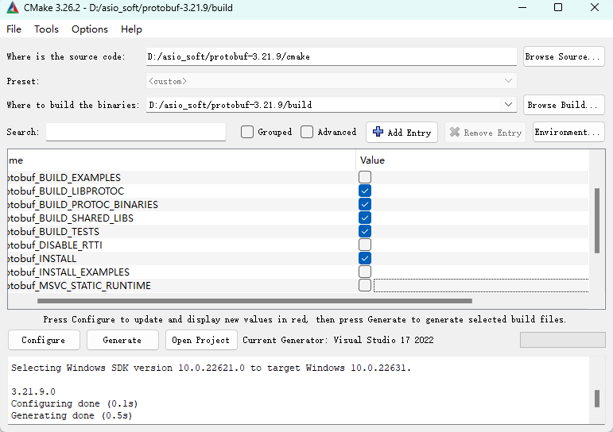
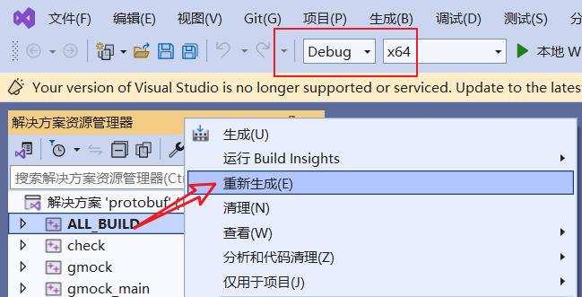
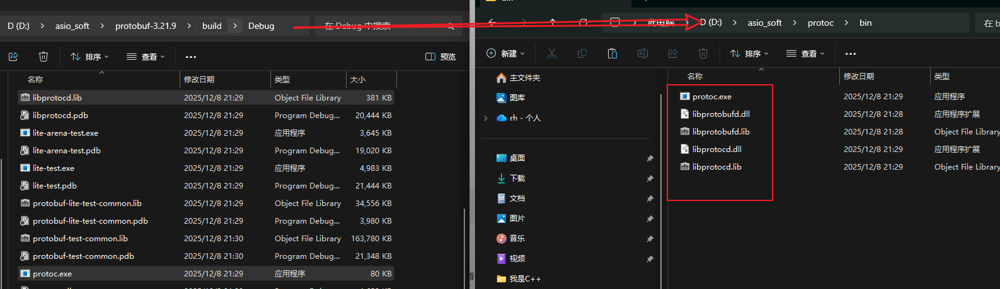
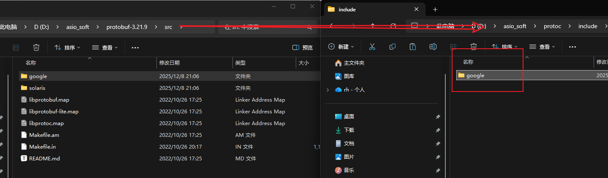
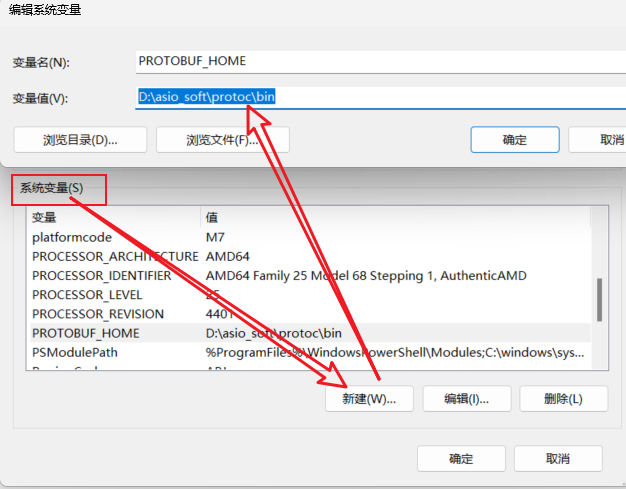
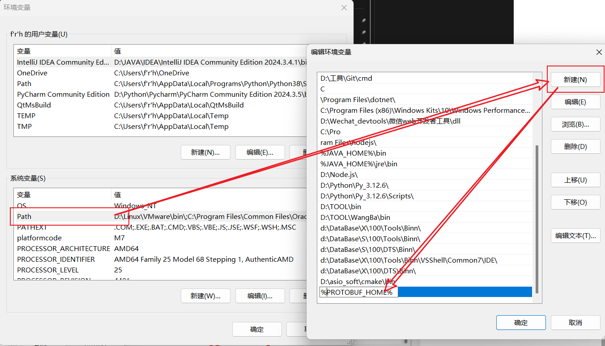
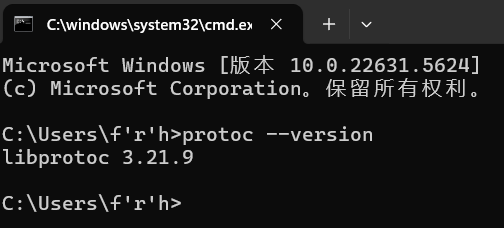
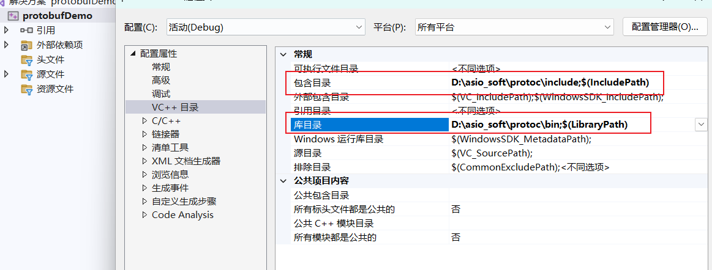
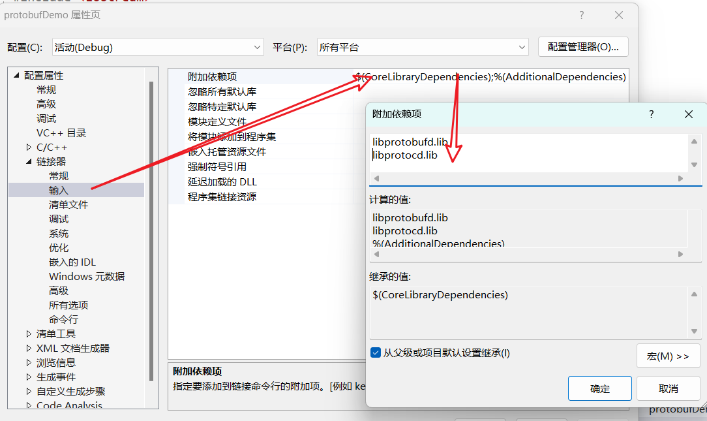
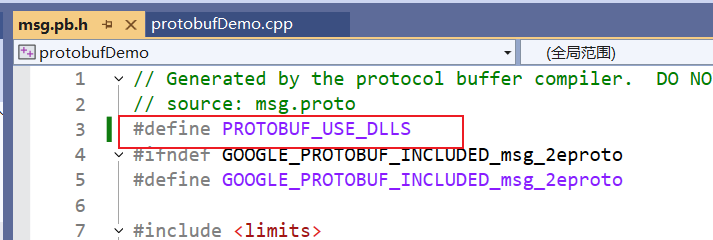

# 序列化

> 将**内存中的数据结构或对象状态**转换为可以**存储或传输的格式**的过程。不同语言间转换成二进制才可传递消息。

这里着重介绍两种方法：

| 维度            | Protobuf         | JsonCpp(JSON)        |
| --------------- | ---------------- | -------------------- |
| 表示形式        | 二进制           | 文本                 |
| 是否需要 schema | 是（proto 文件） | 否                   |
| 类型安全        | 强               | 弱                   |
| 性能            | 极高             | 一般                 |
| 数据体积        | 很小             | 较大                 |
| 可读性          | 差（工具可解码） | 非常好               |
| 多语言支持      | 极强             | 依赖 JSON 库         |
| 使用复杂度      | 较高             | 低                   |
| 典型用途        | RPC、系统间通信  | 配置、日志、REST API |


## protobuf

> Protocol Buffers（简称 Protobuf）是一种轻便高效的序列化数据结构的协议，由 Google 开发。
> 它可以用于将结构化数据序列化到二进制格式，并广泛用于数据存储、通信协议、配置文件等领域。
> 我们的逻辑由类等抽象数据构成的，而tcp是面向字节流的，我们需要将类结构序列化为字符串来传输。


### 安装protobuf和cmake

1. [protobuf下载地址](https://github.com/protocolbuffers/protobuf/releases)

2. [cmake下载地址](https://cmake.org/download/)


### 编译protobuf

**一定一定要注意版本。。。。高版本根本不行！！！** [合适版本号链接](https://pan.baidu.com/s/1Yg9Usdc3T-CYhyr9GiePCw?pwd=ng6x)

​	**步骤：**

1. 在 **protobuf** 目录中创建一个文件夹，名字叫做 **build**，你可以叫其他的名字；
2. 然后我们打开刚才下载的 `cmake-gui.exe` 桌面程序
   - `source code` 目录选择protobuf源码路径下的cmake目录
     `build the binaries` 目录选择我们刚刚创建的build目录

3. 点击config，**选择对应信息如下**，

    

   再点击 **generate** 就可以生成了，生成后我们可以看到 protobuf 的 build 文件夹内生成了.sln文件。


4. 建议 **ALL Build**，全部生成一遍，也建议 debug 和 release 都编译一遍，这样有两个库比较好



​	以Debug为例：生成完毕后，生成的库就在 **build** 目录下的 **Debug** 里面


5. 在 **protobuf** 同级目录下创建一个 `protoc/bin、include` 文件夹

- 拷贝 **build/Debug** 下的几个库到 **bin** 文件夹内（偷懒可以全部拷贝）
- 拷贝 **protobuf/src/google** 的整个google文件夹到 **include** 文件夹内






6. **添加环境变量**

​		因为我们要用到protoc命令，所以要将该命令配置到环境变量，在系统环境变量里添加一个环境变量**PROTOBUF_HOME**,
设置它的值为**D:\asio_soft\protoc\bin**




​		然后将该值添加到系统的path路径即可,格式为 **%PROTOBUF_HOME%**



​		命令行查看，成功




### visual studio 配置 protobuf

1. 新建一个项目，右击 - > 属性，添加 **include** 和 **bin** 目录目录，和 **boost.asio** 一样




2. 链接器添加如下连接

```bash
libprotobufd.lib
libprotocd.lib
```




### 生成pb文件

> 要想使用protobuf的序列化功能，需要生成pb文件，pb文件包含了我们要序列化的类信息。

1. 在项目文件下添加一个文件 **msg.proto** ，添加如下代码：

```bash
syntax = "proto3";
message Book
{
   string name = 1;
   int32 pages = 2;
   float price = 3;
}
```


2. **然后在这个目录进入命令行输入：**

```bash
protoc --cpp_out=. ./msg.proto
```

- --cpp_out= 表示指定要生成的pb文件所在的位置

- ./msg.proto 表示msg.proto所在的位置，因为我们是在msg.proto所在文件夹中执行的protoc命令,所以是当前路径即可。
  	

  ​		执行后，会看到当前目录生成了msg.pb.h和msg.pb.cc两个文件，这两个文件就是我们要用到的头文件和cpp文件。

  

3. **右击项目添加现有文件，我们将这两个文件添加到项目里**，然后在主函数中包含msg.pb.h，做如下测试：

​	**注意：**

```cpp
#define PROTOBUF_USE_DLLS
```

> 要先在 **`msg.pb.h`** 添加以上宏




```cpp
#include <iostream>
#include "msg.pb.h"
int main()
{
    Book book;
    book.set_name("CPP programing");
    book.set_pages(100);
    book.set_price(200);
    std::string bookstr;
    book.SerializeToString(&bookstr);
    std::cout << "serialize str is " << bookstr << std::endl;
    Book book2;
    book2.ParseFromString(bookstr);
    std::cout << "book2 name is " << book2.name() << " price is " 
        << book2.price() << " pages is " << book2.pages() << std::endl;
    getchar();
}
```

> 再编译就成功了。。。。太难了


### 在网络编程中使用

1. 先为服务器定义一个用来通信的proto

```cpp
syntax = "proto3";
message MsgData
{
   int32  id = 1;
   string data = 2;
}
```

- id代表消息id，data代表消息内容
- 我们用protoc生成对应的pb.h和pb.cc文件
- 将proto,pb.cc,pb.h三个文件复制到我们之前的服务器项目里并且配置。


2. 我们修改服务器接收数据和发送数据的逻辑
   当服务器收到数据后，完成切包处理后，将信息反序列化为具体要使用的结构,打印相关的信息，然后再发送给客户端

```cpp
    MsgData msgdata;
    std::string receive_data;
    msgdata.ParseFromString(std::string(_recv_msg_node->_data, _recv_msg_node->_total_len));
    std::cout << "recevie msg id  is " << msgdata.id() << " msg data is " << msgdata.data() << endl;
    std::string return_str = "server has received msg, msg data is " + msgdata.data();
    MsgData msgreturn;
    msgreturn.set_id(msgdata.id());
    msgreturn.set_data(return_str);
    msgreturn.SerializeToString(&return_str);
    Send(return_str);
```


3. 同样的道理，客户端在发送的时候也利用protobuf进行消息的序列化，然后发给服务器

```cpp
    MsgData msgdata;
    msgdata.set_id(1001);
    msgdata.set_data("hello world");
    std::string request;
    msgdata.SerializeToString(&request);
```


## jsoncpp

> 它提供了将 JSON 数据解析为 C++ 对象、将 C++ 对象序列化为 JSON 数据的功能。它支持所有主流操作系统（包括 Windows、Linux、Mac OS X 等），并且可以与常见编译器（包括 Visual Studio、GCC 等）兼容。

> 相较于 `protobuf` 配置简单一点


### 下载安装

[官方地址](https://github.com/open-source-parsers/jsoncpp)

[网盘](https://pan.baidu.com/s/1Yg9Usdc3T-CYhyr9GiePCw?pwd=ng6x)


