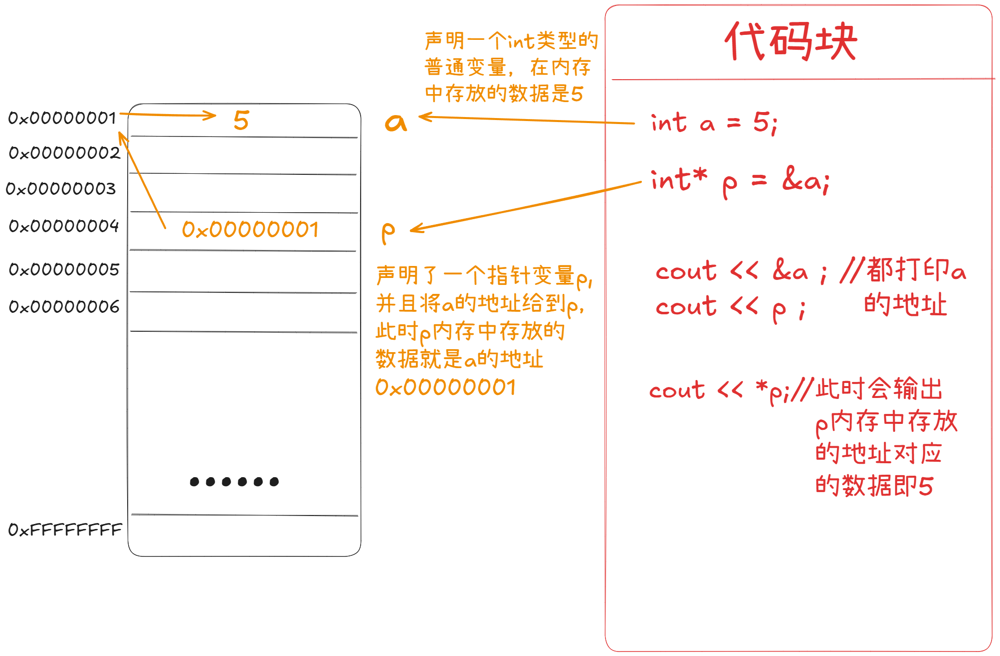

# C++核心语法

> 此部分包括C++较为复杂的基础语法；C++特性：写出高效、类型安全、模块化的代码
>


## 引用

### 基本知识

> 引用变量是C++新增加的**复合类型**。

​	**语法：**

​	**`数据类型 &引用名 = 原变量名`**


​	**作用：**

- 引用是为已定义的变量**起的别名**

- 可以在**不复制数据的情况下访问和修改变量的值**

  > 即：引用是**某个已有变量的别名**，它**不是一个新变量**，而是对原变量的另一种访问方式。


​	**特性注意：** 

| 特性                   | 说明                                     |
| ---------------------- | ---------------------------------------- |
| **必须初始化**         | 定义引用时**必须立即绑定变量**           |
| **一旦绑定，不能更改** | 引用一经绑定，不能再指向别的变量         |
| 处境相同               | **修改其中任意一个，另一个也一样被修改** |
| 不是指针               | 没有地址操作，也不能为 `nullptr`         |
| 作用类似指针           | 但更安全、更直观，不需要 `*` 解引用      |


​	**示例：**

```cpp
int main()
{
	int a = 3;
	int b = 4;

	int& c = a;	//必须在声明的时候初始化
	//int& c = b;	//错误，绑定后不能再修改指向

	cout << "a=" << a << endl;
	cout << "c=" << c << endl;

	c = b;//赋值操作，不是改变指向，没有错误
	cout << "a=" << a << endl;//修改c,a也一样发生改变
	cout << "c=" << c << endl;
}
```

​	**输出：**

```cpp
a=3
c=3
a=4
c=4
```


### 引用的本质

> 引用的本质是 **指针常量** 
>
> 引用的底层机制就是指针，只是为了语法方便由编译器帮我们完成了指针部分的操作，因此引用操作并没有节省空间。

> 指针常量的指向不可以修改，也说明了为什么常量不能修改指向

​	**示例：**

```cpp
void func(int& tmp)
{
	tmp = 100; // tmp是引用，转换为*tmp = 100
}
int main()
{
	int a = 10;

	//编译器发现是引用，转换为 int* const tmp = &a;
	int& tmp = a;
	tmp = 20; //内部发现tmp是引用，自动帮我们转换为 *tmp = 20;

	cout << "a:" << a << endl;
	cout << "tmp:" << tmp << endl;

	func(a);
	cout << "a:" << a << endl;
	cout << "tmp:" << tmp << endl;
	return 0;
}
```


​	**输出：**

```cpp
a:20
tmp:20
a:100
tmp:100
```


### 引用作为函数参数

​	**作用：** 和指针作为函数参数逻辑相同，**使用引用在形参时也会修改实参，且相对于指针更加简单便利，代码也更容易理解**

​	**示例：** 

```cpp
//地址传递
void Swap1(int* a, int* b)
{
	int temp = *a;
	*a = *b;
	*b = temp;
}

//引用传递
void Swap2(int& a, int& b)
{
	int temp = a;
	a = b;
	b = temp;
}

int main() 
{
	int a = 10;
	int b = 20;

	Swap1(&a, &b);
	cout << "a:" << a << " b:" << b << endl;

	Swap2(a, b);
	cout << "a:" << a << " b:" << b << endl;
    
	return 0;
}
```


### 引用作为函数返回值

​	**好处：** 

1. 传统返回需要拷贝一份返回值预备调用，**而引用返回避免了不必要的拷贝。** 适合返回大型对象时使用

2. 可以在返回调用时**作为左值直接修改原对象**  (避免出现"表达式必须是可修改的左值“的错误提示)

​	**注意：** 

- **不能返回临时变量、局部变量（因为其在返回后就被销毁，出现野指针情况）**

  > 局部变量可以尝试转换成静态变量如 `static int x` 再返回即可

​	**示例:** 

```cpp
int& getMax(int &a, int &b) 
{
    if(a > b)
        return a;
    else
        return b;
}

int main() 
{
    int x = 10;
    int y = 20;
    int &max = getMax(x, y);
    std::cout << "Max: " << max << std::endl;
    max = 30; // 修改引用
    std::cout << "After modification, y: " << y << std::endl;
    return 0;
}
```

> **解释**：`getMax`函数返回较大的变量的引用，修改`max`实际上修改了`y`。


### 左值引用和右值引用

> 在C++中，**左值（`lvalue`）和右值（`rvalue`）**是表达式的两种基本分类，它们决定了表达式的结果在内存中的位置和状态。左值通常指的是具有持久状态的对象，它们有明确的内存地址，可以被多次赋值。而右值通常是临时的、没有持久状态的值，它们通常没有内存地址，或者其内存地址在表达式结束后就变得无效。

> C++11引入了**右值引用（`rvalue reference`）**，用`T&&`表示，作为对**左值引用（`lvalue reference`，用`T&`表示）**的补充。这一特性极大地增强了C++的表达能力，特别是在资源管理和性能方面。


#### 左值引用

> 左值引用是C++98就有的特性，它允许我们为已存在的对象创建一个别名。左值引用必须被初始化为一个左值，即一个具有持久状态的对象。

```cpp
int a = 10;
int& b = a; // b是a的左值引用
```


#### 右值引用

> 右值引用是C++11新增的特性，它允许我们为右值（即临时对象或即将被销毁的对象）创建一个引用。这样，我们就可以对右值进行更复杂的操作，比如**移动语义（move semantics）。**

```cpp
std::string foo() 
{
    return std::string("Hello, World!"); // 返回的临时字符串是一个右值
}
std::string&& d = foo(); // d是foo()返回的临时字符串的右值引用
```


#### 移动语义和完美转发

1. 右值引用的引入主要是**为了支持移动语义（move semantics）**，它允许我们在对象被销毁前“窃取”其资源（如动态分配的内存、文件句柄等），而不是进行深拷贝。这可以显著提高性能，特别是在处理大型对象或容器时。

2. **完美转发（perfect forwarding）**是另一个与右值引用相关的概念，它允许我们**将参数原封不动地传递给另一个函数**，无论是左值还是右值。这通过模板和`std::forward`函数实现。


## 指针

> 指针变量简称指针。**指针变量是 `p` 而不是 `*p`** 。**`*p` 是解引用 ** 

**指针是变量：** **其存储**的是另一个变量的**地址**。( 通过取地址符 `&` 来**获取变量在地址中的起始地址。** )



### 指针基础

#### 指针和引用区别

| 特性                       | 说明                                                         |
| -------------------------- | ------------------------------------------------------------ |
| **指针本身是一个对象**     | 指针有自己的地址，允许对指针**赋值和拷贝**，而且在指针的生命周期内它可以**先后指向几个不同的对象**。 |
| **指针无须在定义时赋初值** | 和其他内置类型一样，在块作用域内定义的指针如果没有被初始化，也将拥有一个不确定的值。 |

```cpp
//声明一个指向整数的指针，可以不赋初值
int *ptr;
//ip1和ip2都是指向int类型对象的指针
int *ip1, *ip2;
//dp2是指向double类型对象的指针,dp是double型对象
double dp, *dp2;
```


#### 指针的值

**指针的值（即地址）应属下列4种状态之一：**

| 情况                                                    | 说明                                                         |
| ------------------------------------------------------- | ------------------------------------------------------------ |
| 指向一个对象                                            |                                                              |
| 指向紧邻对象所占空间的下一个位置（end() ）              |                                                              |
| 空指针，意味着指针没有指向任何对象                      | `int* p = nullptr` 。不能对空指针进行解引用，即不能访问其指向的内存 |
| **无效指针（野指针）**，指针不能指向一个合法/有效的地址 | 1. 一定要初始化，没有值就初始化成 `nullptr` <br />2. 动态分配的内存被释放之后就将其重置成 `nullptr`  <br />3. 函数不要返回局部变量的地址 |

**注意：**

把int变量直接赋给指针是错误的操作，即使int变量的值恰好等于0也不行

```cpp
int zero = 0;
pi = zero;	//错误
```


#### 指向指针的指针

```cpp
//定义ptr2并且赋值，指向var地址
int var = 10;
int* ptr2 = &var;

//ptr_address 存储ptr2的地址
int** ptr_address = &ptr2;
std::cout << "var 的地址为: " << &var << std::endl;
std::cout << "ptr2 存储的值为: " << ptr2 << std::endl;
std::cout << "ptr2 地址为: " << &ptr2 << std::endl;
std::cout << "ptr_address 的值为: " << ptr_address << std::endl;
```

---

输出：

```cpp
var 的地址为: 0xad6a5ffc24
ptr2 存储的值为: 0xad6a5ffc24
ptr2 地址为: 0xad6a5ffc18
ptr_address 的值为: 0xad6a5ffc18
```

> `ptr2` 的类型是指向 `int` 型的指针即 `int*` ，所以 `ptr_address` 的类型就是指向 `int*` 类型的指针即 `int**` 
>
> 所以写法是 `int** ptr_address = &ptr2;`


#### 指向指针的引用

引用本身不是一个对象，因此不能定义指向引用的指针。但指针是对象，所以存在对指针的引用：

```cpp
  int init = 10;
  int *ptr1 = nullptr;
  int *&ptr2 = ptr1; // ptr2是ptr1的引用，都是指针类型，都存储一样的地址
  ptr2 = &init;      // ptr2指向init，ptr1也指向init
  std::cout << "*ptr1=" << *ptr1 << std::endl;
  std::cout << "*ptr2=" << *ptr2 << std::endl;

  *ptr1 = 20; // 通过ptr1修改init的值，ptr2也能看到修改后的值
  std::cout << "*ptr1=" << *ptr1 << std::endl;
  std::cout << "*ptr2=" << *ptr2 << std::endl;
```

**输出：**

```cpp
*ptr1=10
*ptr2=10
*ptr1=20
*ptr2=20
```


### 指针和函数

#### 指针做参数

> 将函数的形参声明为指针，调用时将实参的地址传入，形参中存放实参的地址，在函数中通过解引用的方式直接操作形参中地址对应的数据。

和引用的作用一样：

```cpp
//使用普通变量作为参数
void swap1(int x, int y)
{
	int tmp = x;
	x = y;
	y = tmp;
}

//使用指针变量作为参数
void swap2(int* x, int* y)
{
	int tmp = *x;
	*x = *y;
	*y = tmp;
}

int main()
{
	int a = 10, b = 20;//定义实参a和b
	swap1(a,b);
	cout << "使用普通变量作为参数交换后a=" << a << "  b=" << b<<endl;

	swap2(&a, &b);
	cout << "使用指针变量作为参数交换后a=" << a << "  b=" << b << endl;
	return 0;
}
```

**输出：**

```cpp
使用普通变量作为参数交换后a=10  b=20
使用指针变量作为参数交换后a=20  b=10
```


#### 函数指针

> 函数以二进制代码存放在代码段中。函数的地址就是其在内存当中的首地址。

> 函数指针是**指向函数的指针变量**，它可以保存一个函数的地址，从而可以通过该指针调用相应的函数。这是 C 和 C++ 中非常强大且常用的一种机制，常用于回调函数、事件驱动编程和实现函数表等。


**1. 函数指针的声明**

​	函数指针的声明需要**指明返回类型和参数类型**，假设有以下函数：

```cpp
int add(int a, int b) {
    return a + b;
}
```

​	此时声明一个指向该函数的指针，格式如下：

```cpp
int (*func_ptr)(int, int);
```

> 其中： **`func_ptr`** 是指针，**必须加上括号** ，否则就是返回值为指针的函数。返回类型为 `int` ,两个参数类型为 `int` 。


**2. 函数指针的赋值**

类似于数组名就是数组的地址，**函数名就是函数的地址。**

```cpp
func_ptr = add;  // 或者 func_ptr = &add;
```


**3. 函数指针的调用**

在赋值之后，就可以通过该指针调用原函数：

```cpp
int result = func_ptr(3, 4);  // 相当于调用 add(3, 4)
std::cout << result << std::endl;  // 输出 7
```


### 指针和数组

> 数组在内存中是连续的，C++将数组名解释为数组第0个元素的地址（**即 `arr` 大多数情况下等价于 `&arr[0]`**）

#### 一维数组遍历

指针可以进行算术运算，如递增（++）和递减（--），这些操作会改变指针所指向的内存地址。这种操作**仅限于指向数组元素的指针**。

```cpp
// 这些操作会改变指针所指向的内存地址。但是，这种操作仅限于指向数组元素的指针。
int arr[5] = {1, 2, 3, 4, 5};
int *ptr_arr = arr;
std::cout << "ptr_arr is : " << ptr_arr << std::endl;
int firstElement = *ptr_arr;
std::cout << "firstElement is " << firstElement << std::endl;
// 递增指针
++ptr_arr; // ptr 现在指向 arr[1]
std::cout << "ptr_arr is : " << ptr_arr << std::endl;
// 访问新位置的值
int secondElement = *ptr_arr; // secondElement 等于 2
std::cout << "secondElement is " << secondElement;
```

**输出：**

```cpp
ptr_arr is : 0xc7801ff6e0
firstElement is 1
ptr_arr is : 0xc7801ff6e4
secondElement is 2
```


#### new动态创建

> 普通数组在栈上分配内存，栈很小，因此可以在堆上分配更多内存。

**语法：**

```cpp
int* p = new int[5];//分配5个大小为 sizeof(int) 的内存块

delete[] p;//注意是delete[]
```

---

**注意：** 

- 动态创建的数组没有数组名
- `delete[]` 只能释放一块内存一次，释放多次相当于野指针
- 释放内存时 `delete[]` 不用指明大小，因为系统会自动跟踪分配

---

**示例：** 

```cpp
int* arr = new int[5];
for (int i = 0; i < 5; i++)
{
	arr[i] = i + 1;
	cout << "arr[" << i << "]=" << *(arr + i)<<endl;
}
delete[] arr;
```

> `*(arr+i)` 等价于 `arr[i]`

​	**输出：**

```cpp
arr[0]=1
arr[1]=2
arr[2]=3
arr[3]=4
arr[4]=5
```


## const限定符

> `const` 是 C++ 关键字，用于指示变量的值不可修改。可以提高代码的安全性与可读性，防止无意中修改变量的值。

### 基本使用

```cpp
const int a = 10;
int const a = 10; // 同上，比较少用

int i1 = 10;
const int i2 = i1; // 可以用一个变量初始化常量

int i3 = i2; // 也可以将一个常量赋值给一个变量
```

> **`const` 必须初始化**


### 编译器如何处理const

> 普通变量是外部链接， **`const` 是内部链接的**。特别在声明定义处逻辑不同，逻辑相反。

1. `const` 在编译时被视为**只读** 

   ```
   const int bufSize = 512;
   ```

   > 编译器会把所有 `bufSize` 换成512


---

2. `const` 在默认情况下**仅在文件内有效** 。其可以在头文件声明定义，且不会发生重定义问题

   在 `a.h` 内添加定义：

   ```cpp
   const int bufSize = 100;
   ```

​		在 `b.cpp `和 `c.cpp`  内包含 `a.h` , 可以编译通过不报错，因为两个 `cpp` 文件内**是不同的 `bufSize`** 

---

3. 有时**想定义相同的 `const` 变量**，可以使用 `extern` 声明。声明后 `const` 和普通变量的使用逻辑相同

   在 `a.h` 内添加声明（此处可以不初始化）：

   ```cpp
   extern const int bufSize;
   ```

   > 此时**只能在一处定义 `bufSize`** ，其他地方引用这个文件使用 `bufSize` ，这样**所有文件用的是同一个 `bufSize`** 

---

4. **C++ 17 最好的写法**

   ```cpp
   inline const int bufSize = 1024;
   ```

   > 可以写在头文件，多个 cpp include，程序仍然只有一个定义


### const的引用

> 可以把引用绑定到`const`对象上，就像绑定到其他对象上一样，我们称之为对常量的引用（`reference to const`）。与普通引用不同的是，**对常量的引用不能被用作修改它所绑定的对象：**

```cpp
const int a1 = 1024;
const int &a2 = a1;

vector<int> vec;
```

---

| 类型                  | 说明                                      |
| --------------------- | ----------------------------------------- |
| `a2 = 2048`           | ❌ 不能修改常量引用的值                    |
| `int& b = a1`         | ❌ 类型不匹配                              |
| `const int &a4 = vec` | ✅ 允许将const int& 绑定到一个普通的对象上 |

> - 只是不能通过 `x` 去修改值，但是可以随便改 `vec` ,修改同步
> - 但是不能改数组结构，如 `push_back` 等，可能引发未知问题


**思考对比：**

| 类型                                               | 说明                                      |
| -------------------------------------------------- | ----------------------------------------- |
| `double dval = 3.14; `<br />` int& ri = dval;`     | ❌ 类型不匹配，`int&` 不能绑定临时对象     |
| `double dval = 3.14;`<br/>`const int & ri = dval;` | ✅ 编译通过，`const int&` 可以绑定临时对象 |

---

**为什么编译能通过？** 上面的代码在编译器内部相当于：

```cpp
//上面代码会做隐式转换,相当于下面代码
const int temp = static_cast<int>(dval); // 3
const int &ri = temp;
```

因为类型转换时编译器会产生临时变量，**而临时变量和引用对象类型一致**，就和要转换的类型匹配上了。


### const和指针

| 类型       | 指针（p）能否改变 | 指向（*p）能否改变 | 语法示例                         |
| ---------- | ----------------- | ------------------ | -------------------------------- |
| 常量指针   | 能                | 不能               | `const int* p` 或 `int const* p` |
| 指针常量   | 不能              | 能                 | `int* const p`                   |
| 常指针常量 | 不能              | 不能               | `const int* const p`             |

---

1. **常量指针**

```cpp
	const int* p1 = &a; 
	p1 = &b; //指向可以修改,即可以修改指针内存放的地址
	//*p1 = 100; //指向的值不能修改
```

---

2. **指针常量**

```cpp
	int* const p2 = &a;
	//p2 = &b; //指向不能修改
	*p2 = 100; //指向的值可以修改
```

> **必须初始化**，因为以后不能再改。

> **在C++中指针常量就是 引用** 


### 顶层/底层const

1. 顶层 `const` 表示任意的对象：如指针( `p` )、基本数据、类等
2. 底层 `const` 表示 “完整类型的部分”：如**指针( `*p` ) ,引用类型**等

```cpp
int i = 0;

int * const p1 = &i;//不能改变p1的值，这是一个顶层const

const int ci  = 42;//不能改变ci的值，这是一个顶层const

const int *  p2 = &ci;//允许改变p2的值，这是一个底层const

const int * const p3 = p2;///靠右边的const是顶层const，靠左边的const是底层const

const int &r = ci;//用于声明引用的const都是底层const
```

---

3. 底层`const`的限制却不能忽视。当执行对象的拷贝操作时，拷入和拷出的对象必须具有相同的底层const资格，或者两个对象的数据类型必须能够转换

```cpp
//p2拥有底层const,p4无底层const，所以无法赋值。即*p2不能改，但是*p4可以改，赋值会出问题
//int * p4 = p2;
```


### constexpr

> 常量表达式 `(const expression)` 用于**声明在编译期即可求值的常量或函数**。
>
> 它的核心目标是：**让表达式在编译阶段计算，而不是运行阶段计算**，从而提高效率并增强类型安全。


#### 常量表达式

> 用常量表达式初始化的 `const` 对象是常量表达式

**例如：** 

```cpp
int GetSize(){
    return 20;
}
```

---

```cpp
{
    const int max_files = 20;//max_files是一个常量表达式
    const int limit = max_files + 10;//limit是一个常量表达式
    int staff_size = 20;//staff_size不是常量表达式,无const声明,只是int
    const int sz = GetSize();//sz不是常量表达式,运行时计算才得知
}
```

> **普通函数调用被认为是运行期行为**，因此加了 `const` 也不是常量表达式


#### constexpr变量

> 在一个复杂系统中，很难（几乎肯定不能）分辨一个初始值到底是不是常量表达式。
>
> 因此：C++11新标准规定，允许将变量声明为 `constexpr` 类型以便由编译器来验证变量的值是否是一个常量表达式。声明为`constexpr`的变量一定是一个常量，而且必须用常量表达式初始化


1. **`constexpr` 必须初始化**

2. 初始化表达式**必须是编译期常量表达式**

```cpp
constexpr int a = 5;
constexpr int b = a + 10;// ✅

int x = 5;
constexpr int y = x;   // ❌ 因为 x 不是编译期常量。

constexpr int sz = GetSize(); //❌ 因为 函数 不是编译期常量。
```


#### constexpr与函数

1. 但是可以把足够简单的函数定义成 `constexpr` 函数。这样就能用`constexpr`函数去初始化`constexpr`变量了。

```cpp
constexpr int GetSizeConst() {
    return 20;
}
```

---

```cpp
constexpr int sz = GetSizeConst();
```

> 这样这个函数也是编译期计算结果了


2. `constexpr` 函数是 **可编译期执行的函数，而不是必须编译期执行。**

---

```cpp
constexpr int square(int x)
{
    return x * x;
}
constexpr int a = square(5);//编译器会在编译期算出：a = 25


int x;
cin >> x;
int y = square(x); //此时函数会 退化为普通函数，在运行期执行。
```


#### constexpr与指针

1. **`constexpr` 修饰的是变量本身**，即限定符constexpr**仅对指针有效**，与指针所指的对象无关：

```cpp
constexpr int *p = nullptr;
//等价于
//int* const p = nullptr;
```


2. 一个 `constexpr` 指针的初始值**必须是`nullptr`或者0**，或者是**存储于某个固定地址中的对象**。

> 函数体内定义的变量一般来说并非存放在固定地址中，因此`constexpr`指针不能指向这样的变量。
>
> 定义于所有函数体之外的对象其地址固定不变，能用来初始化`constexpr`指针

```cpp
{
    int x = 10;
    constexpr int *p = &x;//❌ 局部作用域内都不是固定地址
}

//可以定义为nullptr
constexpr int *p = nullptr;

//可以绑定全局变量，全局变量地址固定
constexpr  int *cp = &global_i;
```


## 类型别名和推导

### 类型别名

1. `typedef` 关键字

```cpp
//wages 是double的同义词
typedef double wages;
//base是double的同义词,p是double*的同义词
typedef wages base, *p;
```

---

```cpp
//使用
wages a1 = 1.1；
base a2 = a1;
p a3 = &a1;//p就是double*
```


2. `using` 关键字，别名声明

```cpp
using int64_t = long long;//64位整型
```


3. **注意点！** 别名可能带来的意想不到的后果：

```cpp
typedef char * pstring;
const pstring cstr = 0;	//第一处
const pstring * ps;		//第二处
```

---

**第一处：** 

- const 修饰的是 pstring，而 pstring 本身是一个指针类型。**因此 `const` 修饰的是指针**，等价于：

  ```cpp
  char * const cstr = 0;
  ```

- **`cstr` 的类型不是常量指针**，而是指针常量，即 `cstr` 不可修改，`*cstr` 可以修改

---

**第二处：**

- 最后转换为：

  ```cpp
  char * const * ps
  ```


### decltype类型指示符

> `decltype` 可以用表达式的类型推断出要定义的变量的类型，但并不计算这个表达式。

> 和 `auto` 类似，但是更加精准严格。

```cpp
decltype(f()) sum = x; //sum的类型就是函数f的返回值的类型
```

| 特性           | `auto`        | `decltype` |
| -------------- | ------------- | ---------- |
| 推导变量类型   | ✅             | ✅          |
| **保留引用**   | ❌             | ✅          |
| **保留 const** | 去掉顶层const | 完整保留   |
| 用表达式推导   | 不方便        | 非常方便   |


#### 四条核心规则

1. **变量名** 

   ```cpp
   int a = 10;
   
   decltype(a) x;
   ```

   则 x 是 `int` 类型

---

2. **保留const和引用** 

```cpp
const int ci = 0, &cj = ci;

decltype(ci) x = 0;	//x 是 const int类型
decltype(cj) y = x;	//y是一个const int&类型，y绑定到x
//decltype(cj) z;	//错误，z是一个引用,引用必须初始化
```

> 需要指出的是，引用大多数情况都会直接退化成所引用对象的类型，只有用在`decltype`处是一个例外，会保留引用。

---

3. **表达式 （左值表达式永远是引用）**

```cpp
int a = 10;
decltype((a)) x = a;
```

- (a) 是左值表达式，因此 `decltype((a)) → int&` ，**即 x 是 `int&` 类型**

---

4. **表达式和引用的具体使用注意** 

```cpp
int i = 42, *p = &i, &r = i;

decltype(r + 0) b;	//正确，r+0结果是int，因此b是一个未初始化的int
//decltype(*p) c;	//错误，c是int&，必须初始化
```

- `decltype（r）` 是 `int&` 类型，但是把r做为表达式的一部分，这个表达式就是一个具体值了，即 `decltype(r + 0)` 就是 `int` 类型
- `*p` 是左值表达式，因此 `decltype(*p)` 是 `int&` 类型


## 函数

### 函数默认参数

> 在函数声明时为某些参数**指定默认值**，在函数调用时就可以省略这些参数。当然也可以在调用时重新赋值。


1. **默认参数自右向左默认**，设定了一个默认参数，则其右边都需要设置。

   ```cpp
   void func(int a = 10, int b = 20, int c = 30);  // ✅ 正确
   void func(int a, int b = 20 int c = 30);       // ✅ 正确
   
   // void func(int a = 10, int b, int c = 30);    // ❌ 错误：a 默认了但 b 没有
   ```

---

2. **默认参数只书写一次**，即一般在声明处书写后，定义处就不再书写。

   ```cpp
   // 头文件或函数声明
   void showMessage(string msg = "Hello");
   
   // 函数定义（不能重复写默认值！）
   void showMessage(string msg) 
   {
      cout << msg << "\n";
   }
   ```


---

3. 默认参数**可以是常量、宏、表达式**（但不能是运行时变量）

   ```cpp
   const int defaultAge = 20;
   void info(int age = defaultAge);  // ✅ OK
   
   int x = 30;
   // void info(int age = x);        // ❌ 错：x 不是编译时常量
   ```

---

4. 在调用过程中，如果重新指定了某个参数的值，那么该参数左边的所有参数都必须重新指定。

   > 这个很好理解，指定过程肯定是从左到右。


### 函数占位参数

> C++ 中的**函数占位参数（placeholder parameter）**，是指：**在函数参数列表中存在但未命名的参数**，也可以是**保留位置但不打算使用的参数**。

​	**作用：** **占位置**，为了满足函数签名要求，或兼容某些函数原型（如重载、继承、回调等），但不实际使用这些参数。

​	**示例：** 

```cpp
//函数占位参数 ，占位参数也可以有默认参数
void func(int a, int) {
	cout << "aaa" << endl;
}

int main() 
{
	func(10,10); //调用时占位参数必须填补
	return 0;
}
```


### 函数重载

> **在同一作用域内，函数名相同，但参数列表不同**，编译器会根据调用时传入的参数来**自动选择匹配的函数版本**。

| 允许的差异                 | 示例                                 |
| -------------------------- | ------------------------------------ |
| 参数个数不同               | `f(int)` vs `f(int, int)`            |
| 参数类型不同               | `f(int)` vs `f(double)`              |
| 参数顺序不同（类型也不同） | `f(int, double)` vs `f(double, int)` |
| 引用/指针/const 版本       | `f(int&)` vs `f(const int&)`         |

​	**注意：** 

1. **仅返回值有差异不能区分重载（即必须参数列表存在差异）**

   ```cpp
   int func(int a);
   double func(int a);  // ❌ 错误！只返回类型不同，不能重载
   ```


---

2. **结合默认参数时会有二义性问题**

   ```cpp
   void show(int a, int b = 10);  // 有默认参数
   void show(int a);              // ⚠️二义性：调用 show(5) 时不明确
   ```

   > 避免产生歧义，要么用重载，要么用默认参数，不要混用。

---

3. **单引用有二义性问题**

   ```cpp
   void func(int a);
   void func(int& a);
   ```

   `const` 与引用搭配，根据实参区分

   ```cpp
   void print(int& a)
   {
       std::cout << "非 const 引用\n";
   }
   
   void print(const int& a)
   {
       std::cout << "const 引用\n";
   }
   
   int x = 10;
   const int y = 20;
   print(x);  // 调用 非 const 引用
   print(y);  // 调用 const 引用
   ```

   > 指针类似，也加 `const` 


### 内联函数

> 在函数前加`inline`关键字，**建议编译器**将函数代码**嵌入到调用处**，是一种通过**消除函数调用开销**来提高程序性能的机制。
>
> **内联函数 = 高效、安全的函数调用优化手段**，适用于**小而频繁调用**的函数。
> 但它只是一个建议，最终是否内联由**编译器决定**。

```cpp
inline int square(int x) //函数声明前加上inline
{
    return x * x;
}

int a = square(5);  // 编译器尝试展开为：int a = 5 * 5;
```

> 内联函数直接在函数调用点尝试将其替换成函数体代码，省去函数调用开销。


​	**补充：**

1. **递归函数不能内联**。
2. 类内定义的成员函数是**默认内联**的。
3. 只是一个建议，最终是否内联由编译器决定，可能提高程序性能，过多使用内联请求也可能使代码膨胀。


### lambda表达式       

详见：[lambda表达式](../03_C++高级特性/可调用对象.md#lambda表达式) 
