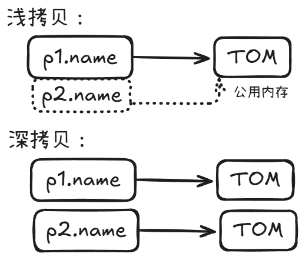
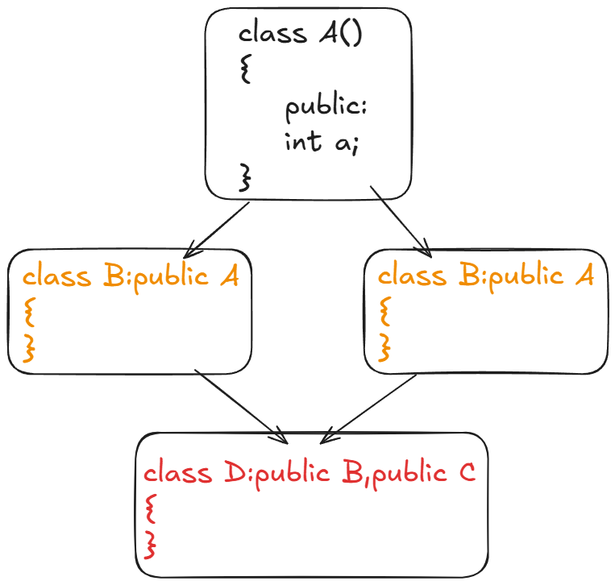
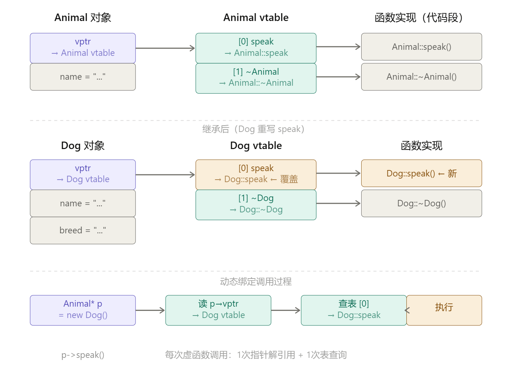

# 类和对象

> C++面向对象三大特性：封装、继承和多态。

## 类和对象基础

### 类的定义

```cpp
class 类名 {
访问权限说明符:
    // 成员变量（属性）
    // 成员函数（方法、行为）
};
```

> - 类的成员可以是变量，也可以是函数
> - 成员变量也可以叫属性、成员函数也可以叫方法或行为
> - 用类定义一个类的变量**叫实例化一个对象** 
> - 对象的所有成员变量、成员函数的作用域和生命周期与对象的作用域和生命周期相同


### 类的实例化

> 就是创建对象的过程

使用 **`对象名.成员名`** 的方式来访问成员变量或成员函数。

```cpp
class Car
{
public:
    string brand;
    void drive()
    {
        cout << brand << " is driving." << endl;
    }
};

int main() 
{
    Car myCar;               // 实例化对象
    myCar.brand = "Toyota";  // 设置属性
    myCar.drive();           // 调用方法
}
```


### 访问权限

| **访问者/访问位置**          | **访问目标成员权限** | **访问权限** | **说明**                      |
| ---------------------------- | -------------------- | ------------ | ----------------------------- |
| **类内成员函数中**           | `private`            | ✅ 允许       | 自己当然能访问自己的私有成员  |
|                              | `protected`          | ✅ 允许       | 可访问受保护成员              |
|                              | `public`             | ✅ 允许       | 可访问公共成员                |
| **类外（main 函数/其他类）** | `private`            | ❌ 禁止       | 除非通过友元或公有接口        |
|                              | `protected`          | ❌ 禁止       | 不能访问，除非在子类中        |
|                              | `public`             | ✅ 允许       | 可自由访问                    |
| **子类中（public继承）**     | `private`            | ❌ 禁止       | 子类无法访问父类 private 成员 |
|                              | `protected`          | ✅ 允许       | 子类可访问受保护成员          |
|                              | `public`             | ✅ 允许       | 子类可访问公共成员            |
| **子类中（protected继承）**  | `private`            | ❌ 禁止       | 同上                          |
|                              | `protected`          | ✅ 允许       | 在子类中仍是 protected        |
|                              | `public`             | ✅ 允许       | 变为 protected                |
| **子类中（private继承）**    | `private`            | ❌ 禁止       | 同上                          |
|                              | `protected`          | ✅ 允许       | 在子类中变为 private          |
|                              | `public`             | ✅ 允许       | 在子类中变为 private          |
| **外部通过对象访问成员**     | `private`            | ❌ 禁止       | 对象不能访问 private 成员     |
|                              | `protected`          | ❌ 禁止       | 同上                          |
|                              | `public`             | ✅ 允许       | 可访问 public 成员            |
| **友元函数/类访问**          | `private`            | ✅ 允许       | 可访问一切成员                |
|                              | `protected`          | ✅ 允许       | 可访问一切成员                |
|                              | `public`             | ✅ 允许       | 可访问一切成员                |

> 以更严格的方式进行继承，继承后的访问权限也会严格一个等级。


## 构造函数和析构函数

> 由编译器自动调用，完成对象的初始化和清理工作

### 基本知识

1. **对比** 

| 项目             | 构造函数                             | 析构函数                             |
| ---------------- | ------------------------------------ | ------------------------------------ |
| 访问权限         | 必须 `public`                        | 必须 `public`                        |
| 名称格式         | **`类名() {...}`**                   | **`~类名() {...}`**                  |
| 是否返回值       | 没有返回值                           | 没有返回值                           |
| 参数             | 可以有参数，支持重载                 | 不允许有参数，不支持重载             |
| 调用时机         | **对象创建时自动调用**               | **对象销毁时自动调用**               |
| 调用次数         | 每个对象创建时调用一次，不可手工调用 | 每个对象销毁时调用一次，可以手工调用 |
| 是否必须显式写出 | 非必须（编译器可生成默认构造）       | 非必须（编译器可生成默认析构）       |
| 是否可以继承     | 不可以被继承                         | 不可以被继承                         |
| 常见用途         | 初始化成员、分配资源                 | 清理资源、释放内存                   |
| 使用初始化列表   | 推荐用构造函数初始化列表             | 析构函数中不使用初始化列表           |

---

2. **调用顺序** 

| 情况           | 构造顺序       | 析构顺序       |
| -------------- | -------------- | -------------- |
| 成员变量       | 成员 → 本类    | 本类 → 成员    |
| 继承结构       | 父类 → 子类    | 子类 → 父类    |
| 多成员、多继承 | 按声明顺序构造 | 反声明顺序析构 |


### 构造函数分类及定义

| 类型                     | 定义                                       | 特点                                                       | 示例                                                   |
| ------------------------ | ------------------------------------------ | ---------------------------------------------------------- | ------------------------------------------------------ |
| 默认构造函数（无参构造） | 不带参数或所有参数有默认值                 | 编译器可自动生成，如果你写了有参构造，默认构造不会自动生成 | `MyClass() { x = 0; }`                                 |
| 有参构造函数             | 带参数，用于初始化对象                     | 可以自定义初始化逻辑                                       | `MyClass(int a) { x = a; }`                            |
| 拷贝构造函数             | 用同类对象初始化新对象                     | 形式：`MyClass(const MyClass &obj)`，默认是浅拷贝          | `MyClass(const MyClass &other) { x = other.x; }`       |
| 移动构造函数（C++11）    | 用右值对象初始化新对象，避免拷贝，提高效率 | 形式：`MyClass(MyClass &&obj)`                             | `MyClass(MyClass &&other) { x = other.x; other.x=0; }` |
| 委托构造函数（C++11）    | 一个构造函数调用同类的另一个构造函数       | 减少重复代码                                               | `MyClass(): MyClass(0) {}`                             |

>  **被移动后的对象（moved-from object）仍然要被析构，只是它的“内部状态已经被转移了”。**

---

```cpp
#include <iostream>

class Example
{
public:
    // 默认构造函数
    Example() : data_(0) 
    {
        std::cout << "Default constructor called.\n";
    }

    // 参数化构造函数
    Example(int data) : data_(data)
    {
        std::cout << "Parameterized constructor called with data = " << data_ << ".\n";
    }

    // 拷贝构造函数
    Example(const Example& other) : data_(other.data_) 
    {
        std::cout << "Copy constructor called.\n";
    }

    // 移动构造函数
    Example(Example&& other) noexcept : data_(other.data_) 
    {
        other.data_ = 0;
        std::cout << "Move constructor called.\n";
    }

    // 析构函数
    ~Example() 
    {
        std::cout << "Destructor called for data = " << data_ << ".\n";
    }

private:
    int data_;
};
```

---

```cpp
int main() 
{
    Example ex1;               // 调用默认构造函数
    Example ex2(42);           // 调用参数化构造函数
    Example ex3 = ex2;         // 调用拷贝构造函数
    Example ex4 = std::move(ex2); // 调用移动构造函数
    return 0;
}
```


### 初始化列表

> 构造函数除了参数列表和函数体之外，还可以有初始化列表。 **初始化列表** 是一种在构造函数中**初始化成员变量**的语法。

```cpp
class Person 
{
    int age;
    string name;

public:
    // 构造函数使用初始化列表
    Person(int a, string n) : age(a), name(n) 
    {
        // 构造函数体（可以留空）
    }
};
```

1. 成员变量**可以不全出现**在初始化列表中；若已出现，就不能再次赋值。
2. 初始化列表和赋值完全不同。

---

​	**为什么使用初始化列表：**

| 目的                       | 原因                                                         |
| -------------------------- | ------------------------------------------------------------ |
| **初始化 const 成员变量**  | **const 只能初始化，不能赋值**                               |
| **初始化引用成员变量**     | **引用必须在初始化时绑定**                                   |
| 没有默认构造函数的成员对象 | 必须使用初始化列表                                           |
| 避免重复初始化             | 成员在进入构造函数体前已经初始化，初始化列表更高效           |
| 提高性能                   | 对于类成员（如 string/vector），直接构造比先默认构造再赋值**更高效** |

---

```cpp
class Demo 
{
    const int id;
    int& ref;
public:
    Demo(int i, int& r) : id(i), ref(r) {}  // ✅ 唯一合法方式
};
```

> 推荐全部使用初始化成员列表。


### 拷贝构造函数

> 拷贝构造函数是 **C++ 中用于“用一个已有对象初始化另一个对象”** 的特殊构造函数。

#### 基本定义

```CPP
class ClassName {
public:
    ClassName(const ClassName& other);  // 拷贝构造函数
};
```

- 参数必须是 **同类型对象的 const 引用**

- 不能写成值传递（否则会无限递归调用）

---

#### 调用时机

1. 用已有对象初始化新对象

   ```cpp
   Person p1(1, "Tom");
   Person p2 = p1;   // 拷贝构造
   ```

---

2. 以值传递方式传参

   ```cpp
   void func(Person p) {}  // 触发拷贝
   func(p1);
   ```

---

3. 函数返回对象（可能触发，但通常被优化）

   ```cpp
   Person create() {
       Person p;
       return p;   // 可能触发（NRVO优化）
   }
   ```


## Rule of 3 and 5

> 关于**资源所有权（Resource Ownership）问题的必然结果**。

```bash
是否使用 new / malloc / 文件句柄？
        ↓
      是
        ↓
必须实现 Rule of 3
        ↓
是否追求性能？
        ↓
实现 Rule of 5
        ↓
是否可以用 STL 替代？
        ↓
尽量用 Rule of 0
```


### 浅拷贝和深拷贝

| 类型   | 说明                                   | 内存情况                 | 是否需要自定义拷贝构造 |
| ------ | -------------------------------------- | ------------------------ | ---------------------- |
| 浅拷贝 | 拷贝指针地址，两个对象共用同一块内存   | 指针成员**指向同一地址** | ❌（编译器默认实现）    |
| 深拷贝 | 拷贝指针所指内容，两个对象各有一块内存 | 指针成员**指向不同地址** | ✅（必须自己写）        |



#### 浅拷贝

> 逐成员拷贝（**编译器默认行为**）。但可能有多重释放问题
>

```cpp
#include <iostream>

class Buffer
{
private:
    int* data;

public:
    Buffer(int value)
    {
        data = new int(value);
        std::cout << "构造: " << *data << std::endl;
    }

    ~Buffer()
    {
        std::cout << "析构: " << *data << std::endl;
        delete data;
    }
};

int main()
{
    Buffer a(10);

    // 默认拷贝构造：浅拷贝
    Buffer b = a;

    return 0;
}
```

> 很容易出现的问题，浅拷贝指针指向同一地址，会delete同一地址两遍，程序崩溃。


#### 深拷贝

>  **拷贝资源本身（重新分配内存）**。需要**自定义**，生命周期独立。

深拷贝和浅拷贝没有好坏之分，取决于自己的设计。


### Rule of 3

#### 规则

当你的类**管理资源**时（典型：`new` / 文件句柄 / socket / mutex），**如果你需要自定义以下任意一个函数，就必须同时定义另外两个：**

| 函数         | 触发时机   |
| ------------ | ---------- |
| **析构函数** | 对象销毁   |
| **拷贝构造** | `A b = a;` |
| **拷贝赋值** | `b = a;`   |

```cpp
class A 
{
public:
    ~A();	// 1️⃣ 析构函数

    A(const A& other);	// 2️⃣ 拷贝构造函数

    A& operator=(const A& other);	// 3️⃣ 拷贝赋值运算符
};
```

---

> 它们共同维护：**资源生命周期一致性** ，避免默认函数**浅拷贝**带来的**双重释放**问题。
>
> 如果只写一个：
>
> - ❌ 只写析构 → double free
> - ❌ 只写拷贝构造 → 赋值仍然浅拷贝
> - ❌ 只写赋值 → 初始化仍然浅拷贝


#### 实现示例

```cpp
class A 
{
public:
    int* data;

    A(int val) 
    {
        data = new int(val);
    }

    // 1️⃣ 拷贝构造（深拷贝）
    A(const A& other)
    {
        data = new int(*other.data);
    }

    // 2️⃣ 拷贝赋值（注意自赋值 + 释放旧资源）
    A& operator=(const A& other)
    {
        if (this == &other) return *this;
        delete data;  // 释放旧资源
        data = new int(*other.data);
        return *this;
    }

    // 3️⃣ 析构函数
    ~A() 
    {
        delete data;
    }
};
```


### Rule of 5

#### 规则

> C++11引入 **移动语义** ，一旦你**自定义了 Rule of 3** 中的任意函数，编译器通常就**不会再为你生成 “有用的移动操作” 了**

> 因此为了提高性能，可以再自定义生成移动语义操作：

| 函数         | 触发时机              |
| ------------ | --------------------- |
| **移动构造** | `A a = A(10); `       |
| **移动赋值** | `A b;  b = A(20);   ` |

```cpp
class A 
{
public:
    // Rule of 3
    ~A();
    A(const A&);
    A& operator=(const A&);

    // Rule of 5
    A(A&& other);            //  移动构造
    A& operator=(A&& other); //  移动赋值
};
```


#### 实现示例

```cpp
A(A&& other) noexcept 
{
    data = other.data;   // 接管资源
    other.data = nullptr; // 防止 double free
}

A& operator=(A&& other) noexcept 
{
    if (this == &other) return *this;

    delete data;          // 释放旧资源

    data = other.data;    // 接管资源
    other.data = nullptr; // 防止 double free

    return *this;
}
```


### Rule of 0

> 现代C++推荐不要再自己管理资源，多使用容器和智能指针

```cpp
class A 
{
public:
    std::unique_ptr<int> data;
};
```

> 自动拥有：
>
> - 正确拷贝/移动语义
> - 无需手写 Rule of 5


## 类的成员

> 介绍重要的成员变量和成员函数

### 对象成员

> **当一个类将另一个类的对象作为成员变量** ，那么这个成员变量就是 **“对象成员”** 

```cpp
class Engine 
{
public:
    Engine() { std::cout << "Engine 构造" << std::endl; }
};

class Car
{
    Engine e;  // ✅ Engine 是 Car 的成员
public:
    Car() { std::cout << "Car 构造" << std::endl; }
};
```

> e就是对象成员


### static静态成员

> C++ 中的 **静态成员（static members）** 是类作用域内的特殊成员，**属于整个类**而不是某个对象。它分为 **静态成员变量** 和 **静态成员函数**，具有独特的存储、访问和生命周期特性。

#### 静态成员变量

```cpp
class MyClass 
{
public:
    static int count; // 静态成员变量声明
};
int MyClass::count = 0; // 必须在类外定义和初始化（除非是 constexpr）
```

| 特性                     | 描述                                                         |
| ------------------------ | ------------------------------------------------------------ |
| 属于类（**不属于对象**） | 所有对象**共享一份存储空间**，整个程序共享                   |
| 不依赖对象               | 可以**通过 `类名::成员变量名` 直接访问** (也可以通过对象正常访问) |
| 类内声明，类外初始化     | 必须在**程序全局区单独初始化**                               |
| 生命周期                 | 从程序开始到结束（全局存储区）                               |

---

```cpp
class A
{
    //类中声明
    static int sum;
}

//全局区初始化
int A :: sum = 0;

int main()
{
    cout << A::sum << endl;
    
    A a;
    cout << a.sum <<endl;//也可以通过类名访问
}
```


#### 静态成员函数

```cpp
class MyClass 
{
public:
    static void printCount();
};
```

| 特性                     | 描述                                                      |
| ------------------------ | --------------------------------------------------------- |
| 属于类（**不属于对象**） | 所有对象**共享一份存储空间**，整个程序共享                |
| 只能访问静态成员         | 因为没有 this 指针，**不能访问对象的非静态变量或函数**    |
| 不依赖对象               | **通过 `类名::函数名()` 直接调用** （也可以通过类名调用） |
| 不含 this 指针           | 不能通过 this 操作成员，**适用于与对象无关的类操作**      |

---

```cpp
class A 
{
public:
    static int count;
    static void show() 
    {
        cout << "Total count = " << count << endl;
        // cout << value << endl; ❌ 错误，不能访问非静态成员
    }
    
private:
    int value; // 非静态成员变量
};

int Counter::count = 5;

int main() 
{
    Counter::show(); // 输出 Total count = 5
    
    A a;
    a.show();//也可以通过类名访问
}
```


### const修饰成员

> 在 C++ 中，`const` 可以修饰类中的**成员变量**和**成员函数参数/返回值**，其主要作用是**限制修改权限**，提升代码安全性和可读性。

#### const成员变量

```cpp
class MyClass 
{
public:
    const int count;
    
    MyClass(int c):count(c) {}
};
```

| 特性                 | 说明                                               |
| -------------------- | -------------------------------------------------- |
| 必须初始化列表       | const 成员变量**必须在构造函数初始化列表中初始化** |
| 依赖对象             | 不是 static，不是共享的                            |
| 一旦初始化后不可修改 | 是只读的，构造后就不能再改变了                     |


#### const静态成员变量

> static静态成员变量通常搭配const一起使用

```cpp
class A {
public:
    static const int value = 42; // ✅ 可以类内直接初始化
};
```

> 只有**整型常量**（如 int、char）才允许类内初始化，其他类型仍需类外初始化。


#### const修饰成员函数

```cpp
class MyClass 
{
public:
	int getValue() const; // const 成员函数声明
};
```

> 注意： `const` 放在函数参数列表 **后面**，表示这是一个 **常量成员函数：**

---

1. **修饰后不能改变成员变量** 

```cpp
class Person 
{
private:
    string name;
public:
    Person(string n) : name(n) {}
    string getName() const 
    {
        // name = "Bob"; ❌ 错误：不能修改成员变量
        return name;
    }
};
```

> 因为如果一个成员函数被标记为 `const`，那么 `this` 指针将变为指向常量对象的指针，即 **`const MyClass*`**，表示函数内部不能修改对象的成员变量（除非它是 `mutable`）。

---

2. **const对象只能调用const函数** （常对象只能调用常函数）

```cpp
void print(const Person& p) 
{
    cout << p.getName(); // 如果 getName 不是 const，会报错
}
```

> 当我们以 `const Person&` 调用函数时，只能调用 `const` 成员函数。

> 没有加 `const` 会造成 **const 对象无法调用该成员函数**。


#### 搭配 mutable成员函数

> 如果确实需要在 `const` 成员函数中**可以修改某个成员变量**，可以将它声明为 `mutable`：

```cpp
class Timer 
{
    mutable int accessCount = 0;
public:
    int getTime() const 
    {
        accessCount++; // ✅ 允许修改
        return 123;
    }
};
```


## 简单对象模型

### 数据与函数关系

> 在C++中，类的成员变量和成员函数是分开存储的。

**C++中有两种数据成员，三种函数成员：**

| 数据成员 | 函数成员 |
| -------- | -------- |
| Nostatic | Nostatic |
| static   | static   |
|          | virtual  |

---

**对象空间存储**

| 类别                      | 是否占对象内存                                |
| ------------------------- | --------------------------------------------- |
| 所有非静态数据成员大小    | ✅                                             |
| 为内存对齐补充大小        | ✅                                             |
| 为支持virtual成员额外开销 | ✅                                             |
| 静态成员变量              | ❌（属于类，不属于对象）                       |
| 成员函数                  | ❌（分开存储，无论对象是否存在都占用存储空间） |

> 对象的地址是第一个非静态成员变量的地址，类中没有非静态成员变量的话，编译器会隐含的增加一个字节的占位空间。


### this 指针

> **this指针指向调用非静态成员函数的 当前对象**

```cpp
class MyClass 
{
public:
    void print() 
    {
        cout << "This pointer is: " << this << endl;  // 输出当前对象的地址
    }
};
```

> `this` 指针的类型是 `MyClass*` ，即指向当前对象的指针

---

1. **访问当前对象的成员**

```cpp
class MyClass
{
private:
    int value;
public:
    MyClass(int value) 
    {
        this->value = value;  // 用 this 区分成员变量和形参
    }
};
```

> **`this->value`** 用于访问当前对象的成员变量 `value`。

> 如果没有 `this`，会默认认为 `value` 是构造函数的参数。

---

2. **返回当前对象的引用**

```cpp
class MyClass 
{
private:
    int value;
public:
    MyClass& setValue(int value) 
    {
        this->value = value;
        return *this;  // 返回对象本身
    }
};
```

> `*this` 表示当前对象。


### 空指针访问成员函数

> 空指针可以调用到没有用到 `this` 指针的**非静态成员函数。** 

**只要成员函数内部没有访问成员变量，就可以用空指针访问成员函数。** 

```cpp
class Test 
{
public:
    void sayHello() 
    {
        std::cout << "Hello" << std::endl;
    }

    void showValue() 
    {
        std::cout << value << std::endl;
    }

private:
    int value = 42;
};

int main() {
    Test* p = nullptr;
    p->sayHello();     // ✅ 可能运行正常
    p->showValue();    // ❌ 可能崩溃（访问了成员变量）
    return 0;
}
```

> 仅展示，不建议使用。


## 友元

> **友元（friend）**允许一个非成员函数或者其他类的成员**访问某个类的私有成员和保护成员。**友元函数可以是普通函数，也可以是其他类的成员函数，甚至是整个类。

| 友元全局函数 | 友元类 | 友元成员函数 |
| ------------ | ------ | ------------ |


### 友元全局函数

> 一个普通函数声明为一个类的友元函数后，**这个函数就可以访问该类的所有成员。**

```cpp
class MyClass 
{
private:
    int value;

public:
    MyClass(int val) : value(val) {}

    // 声明友元函数
    friend void display(MyClass& obj);
};

// 友元函数
void display(MyClass& obj) 
{
    cout << "Value: " << obj.value << endl;  // 可以访问私有成员
}

int main() 
{
    MyClass obj(10);
    display(obj);  // 友元函数调用
    return 0;
}
```

---

​	**注意：** 

1. **友元函数必须在类内声明**。可以在类内定义，推荐在类外定义。
2. 友元全局函数和成员函数很像，但是他只是外部函数，不是类的成员，也没有 `this` 指针。


### 友元类

> 一个类声明为另一个类的友元类之后，**这个类就可以访问另一个类的所有成员。**

```cpp
//先声明类
class AnotherClass;

class MyClass 
{
private:
    int value;

public:
    MyClass(int val) : value(val) {}

    // 声明为友元类
    friend class AnotherClass;
};

//定义类
class AnotherClass 
{
public:
    void showValue(MyClass& obj) 
    {
        cout << "Value: " << obj.value << endl;  // 可以访问私有成员
    }
};

int main() 
{
    MyClass obj(20);
    AnotherClass another;
    another.showValue(obj);  // 友元类访问 MyClass 的私有成员
    return 0;
}
```

> 相同的，必须在类内声明。


### 友元成员函数

> 某个类的成员函数声明为友元之后，**这个成员函数可以访问其他类的所有成员。** 

```cpp
class AnotherClass; 

class MyClass 
{
private:
    int value;

public:
    MyClass(int val) : value(val) {}

    // 声明友元成员函数
    friend void AnotherClass::modifyValue(MyClass& obj);
};

class AnotherClass 
{
public:
    // 定义友元成员函数
    void modifyValue(MyClass& obj) 
    {
        obj.value = 100;  // 友元成员函数可以修改 MyClass 的私有成员
    }
};

int main() 
{
    MyClass obj(50);
    AnotherClass another;
    another.modifyValue(obj);  // 修改 MyClass 的私有成员
    std::cout << "Modified value: " << obj.value << std::endl;
    return 0;
}
```

> 声明定义方式有点复杂，需要记忆。


## 运算符重载

> 对已有的运算符进行重定义，赋予其另一种功能，以适应不同的数据类型。

### 分类

#### 按定义方式分类

| 类型             | 语法                                      |
| ---------------- | ----------------------------------------- |
| **成员函数重载** | `返回类型 operator符号(参数列表);`        |
| **全局函数重载** | `返回类型 operator符号(参数列表);`        |
| **友元函数重载** | `friend 返回类型 operator符号(参数列表);` |

---

1. 成员函数重载

```cpp
class ClassName 
{
public:
    Point operator + (const Point& other)
    {
        return ...
    }
};
```

> 运算符作为类的成员函数进行重载时，左操作数是当前对象（`this`）。因此，对于需要修改左操作数的运算符，成员函数方式通常更直观。

---

2. 全局函数重载

```cpp
void operator + (const Point& other)
```

---

3. 友元函数重载

```cpp
class ClassName 
{
    friend ClassName operator+(const ClassName& lhs, const ClassName& rhs);
};
```

> 当需要对两个不同类型的对象进行运算，或者左操作数不是当前类的对象时，通常使用非成员函数方式。为了访问类的私有成员，非成员函数通常被声明为类的友元函数。


#### 按功能分类

| 功能类型 | 运算符例子                     | 要求           |
| -------- | ------------------------------ | -------------- |
| 算术运算 | `+ - * / %`                    | 成员或全局     |
| 关系运算 | `== != < <= > >=`              | 成员或全局     |
| 赋值运算 | `=`、`+=`、`-=` 等             | **仅成员函数** |
| 逻辑运算 | `&&`                           |                |
| 自增自减 | `++`、`--`（有前置和后置区别） | 成员或全局     |
| 下标运算 | `[]`                           | **仅成员函数** |
| 函数调用 | `()`                           | **仅成员函数** |
| 指针运算 | `->`、`*`、`->*                | **仅成员函数** |
| 输入输出 | `<<`、`>>`                     | 全局           |


#### 重载限制

1. **不能改变运算符的优先级和结合性**：运算符的优先级和结合性在编译阶段就确定，不能通过重载来改变。

2. **不能创建新的运算符**：仅能重载C++中已有的运算符，不能定义新的运算符。

3. **至少有一个操作数必须是用户定义的类型**：不能对两个内置类型进行运算符重载。

4. **某些运算符不能重载**：包括 `.`（成员选择运算符）、`.*`、`::`、`?:`（条件运算符）等。

5. **重载运算符的优先级和结合性不可改变**。

| 运算符   | 含义         |
| -------- | ------------ |
| `::`     | 作用域运算符 |
| `.`      | 成员访问     |
| `.*`     | 指向成员指针 |
| `sizeof` | 求大小       |
| `typeid` | 类型识别     |
| `? :`    | 条件运算符   |


### 算数运算符重载(+)

> **`+ - * / %`** ，常用于输出 **类对象**之和、之差等

```cpp
class Vector2D 
{
public:
    double x, y;
    Vector2D(double x = 0, double y = 0) : x(x), y(y) {}

    // 成员函数重载 +
    Vector2D operator+(const Vector2D& other) const
    {
        return Vector2D(x + other.x, y + other.y);
    }

    // 全局友元函数重载 -
    friend Vector2D operator-(int a, const Vector2D& b) 
    {
        return Vector2D(a - b.x, a - b.y);
    }
}
```

---

1. 输出对象之和等如 `obj_a + obj_b` ,推荐成员函数

2. **友元函数重载运算符的意义：**在“需要访问私有成员 + 运算是对称关系 + **左操作数不是本类**”时，提供一种既安全又灵活的实现方式


### 关系运算符重载(!=)

> `== != < > <= >=` ，比较两个自定义数据类型间的关系。

​	**示例：**

```cpp
class Rectangle
{
    int width, height;
public:
    Rectangle(int w, int h) : width(w), height(h) {}

    friend bool operator==(const Rectangle& a, const Rectangle& b) 
    {
        return a.width == b.width && a.height == b.height;
    }

    friend bool operator<(const Rectangle& a, const Rectangle& b) 
    {
        return a.width * a.height < b.width * b.height;
    }
};
```


### 赋值运算符重载(=)

> `=`、`+=`、`-=` 等 ， `=` 较为特殊，分开介绍。

#### 复合赋值

```cpp
class Vector2D 
{
public:
    double x, y;
    Vector2D& operator+=(const Vector2D& other) 
    {
        x += other.x; y += other.y;
        return *this;
    }
};
```

> 返回 `*this` 支持链式调用。


#### 单 = 赋值

若一个类**中包含指针或资源管理（如动态分配内存）** ，默认浅拷贝行为会导致程序错误（详见[5.4](###浅拷贝和深拷贝)）

此时就必须重载 `operator =` 以实现深拷贝。

```cpp
class MyString 
{
private:
    char* str;

public:
    MyString(const char* s = "") 
    {
        str = new char[strlen(s) + 1];
        strcpy(str, s);
    }

    // 拷贝构造函数（配合赋值）
    MyString(const MyString& other) 
    {
        str = new char[strlen(other.str) + 1];
        strcpy(str, other.str);
    }

    // 析构函数
    ~MyString() 
    {
        delete[] str;
    }

    // 赋值运算符重载
    MyString& operator=(const MyString& other) 
    {
        if (this == &other) return *this;  // 自赋值检查

        delete[] str;  // 清理旧资源

        str = new char[strlen(other.str) + 1];  // 分配新资源
        strcpy(str, other.str);

        return *this;  // 支持 a = b = c;
    }

    void print() const 
    {
        std::cout << str << '\n';
    }
};

int main()
{
    MyString a("Hello");
    MyString b("World");

    a = b;
    a.print();  // 输出：World

    a = a;      // 自赋值，不出错
}
```

> 必须进行自赋值检查。


### 自增自减重载(++)

| 类型   | 写法  | 调用函数                | 特点               |
| ------ | ----- | ----------------------- | ------------------ |
| 前置增 | `++x` | `operator ++ ()`        | 效率高（返回引用） |
| 后置增 | `x++` | **`operator ++ (int)`** | 参数是 dummy `int` |
| 前置减 | `--x` | `operator -- ()`        | 同上               |
| 后置减 | `x--` | **`operator -- (int)`** | 同上               |

> **即前置返回引用，后置返回值。**

> 仅在需要返回旧值时才实现后置，非必要不重载后置。

---

```cpp
class Counter 
{
private:
    int value;

public:
    Counter(int val = 0) : value(val) {}

    // 前置 ++x
    Counter& operator++() 
    {
        ++value;
        return *this;
    }

    // 后置 x++
    Counter operator++(int) 
    {
        Counter temp = *this;  // 保存旧值
        ++value;
        return temp;           // 返回旧值
    }

    // 前置 --x
    Counter& operator--() 
    {
        --value;
        return *this;
    }

    // 后置 x--
    Counter operator--(int) 
    {
        Counter temp = *this;
        --value;
        return temp;
    }

    void show() const 
    {
        std::cout << "Value: " << value << '\n';
    }
};

int main() 
{
    Counter c(10);

    ++c;        // 前置
    c.show();   // 11

    c++;        // 后置
    c.show();   // 12

    --c;        // 前置
    c.show();   // 11

    c--;        // 后置
    c.show();   // 10
}
```


### 下标运算符重载([])

> 重载 `[]` 之后，允许对象像数组一样访问下标。

---

1. 应该返回 **引用** 以支持赋值操作。（类似数组的操作需要对实参也进行修改）
2. 分为两个版本：
   - `const` 成员函数：只读
   - 非 `const` 成员函数：支持读写

---

​	**示例：**

```cpp
class IntArray 
{
private:
    int* data;
    size_t size;

public:
    IntArray(size_t n) : size(n) 
    {
        data = new int[size]{};
    }

    ~IntArray() 
    {
        delete[] data;
    }

    // 非 const 版本：支持写入
    int& operator[](size_t index) 
    {
        return data[index];
    }

    // const 版本：只读
    const int& operator[](size_t index) const 
    {
        return data[index];
    }

    size_t length() const
    {
        return size;
    }
};

IntArray arr(5);
arr[0] = 42;       // 写操作
cout << arr[0];    // 读操作

const IntArray& carr = arr;
cout << carr[1];   // 使用 const 版本
```


### 函数调用重载(())

> `operator()` 重载之后，就可以将对象当作函数来使用。
>
> ```cpp
> MyFunctor f;
> f(1, 2);  // 看起来像函数，其实是对象调用重载的 operator()
> 
> ```

这种对象通常称为 **函数对象（function object）** 或 **仿函数（functor）**。

---

​	**示例：**

```cpp
class Multiplier 
{
private:
    int factor;
public:
    Multiplier(int f) : factor(f) {}

    int operator()(int x) const 
    {
        return x * factor;
    }
};

Multiplier times2(2), times5(5);

cout << times2(10);  // 20
cout << times5(10);  // 50
```


### 指针运算重载

典型用例：重载 `*` 和 `->` 以模拟智能指针：

```cpp
template <typename T>
class SmartPtr 
{
private:
    T* ptr;

public:
    SmartPtr(T* p = nullptr) : ptr(p) {}
    ~SmartPtr() { delete ptr; }

    // 解引用 *
    T& operator*() const 
    {
        return *ptr;
    }

    // 成员访问 ->
    T* operator->() const 
    {
        return ptr;
    }

    // 禁止复制，模拟 unique_ptr 行为
    SmartPtr(const SmartPtr&) = delete;
    SmartPtr& operator=(const SmartPtr&) = delete;
};

struct Person 
{
    void say() const 
    {
        std::cout << "Hi!\n";
    }
};

int main() 
{
    SmartPtr<Person> p(new Person);
    (*p).say();    // 解引用调用
    p->say();      // 通过 -> 访问成员
}
```


### 输入输出运算符重载

> 通过 `cin` 和 `cout` 输出自定义类型。

```cpp
class Person 
{
private:
    string name;
    int age;

public:
    Person() : name(""), age(0) {}

    // 声明友元函数重载运算符
    friend ostream& operator<<(ostream& out, const Person& p);
    friend istream& operator>>(istream& in, Person& p);
};

ostream& operator << (ostream& out, const Person& p) 
{
    out << "Name: " << p.name << ", Age: " << p.age;
    return out;
}

istream& operator >> (istream& in, Person& p) 
{
    cout << "Enter name: ";
    in >> p.name;
    cout << "Enter age: ";
    in >> p.age;
    return in;
}

int main()
{
    Person p;
    cin >> p;
    cout << p << endl;
    return 0;
}
```

---

1. 返回类型是引用
2. 输出 `<<` 对象建议加 `const` ,输入 `>>` 对象不加 `const` 。
3. **返回值类型固定是 `i/ostream` ,第一个参数固定是 `i/ostream` ,本身通常声明成友元类型**


## 继承

> 用于实现代码复用、类之间的层次结构与扩展性。

```cpp
class Animal 
{
public:
    void speak()
    {
        cout << "Animal sound" << endl;
    }
};

class Dog : public Animal 
{
public:
    void bark() 
    {
        cout << "Woof!" << endl;
    }
};
```


### 继承方式

> 继承方式决定了**派生类对象对基类成员的访问权限**，以及**在多态和类型转换时的行为**。C++提供了三种继承方式。

#### 三种继承方式

| 继承方式     | 语法                    | 对基类成员的访问控制影响（默认）                             |
| ------------ | ----------------------- | ------------------------------------------------------------ |
| **公有继承** | `class A : public B`    | 基类访问权限不变； `private` 无法访问                        |
| **保护继承** | `class A : protected B` | 降低基类访问权限：`(public`、`protected)` ➡ `protected` ；`private` 无法访问 |
| **私有继承** | `class A : private B`   | 全部变为 `private`：`(public`、`protected)` ➡ `private` ； `private` 无法访问 |

> 理解为在更严格继承之后，访问等级也变得更严格。

---

```cpp
class Base
{
public:
    int pub;
protected:
    int pro;
private:
    int pri;
};

// 1. 公有继承
class Derived1 : public Base 
{
    void func() 
    {
        pub = 1;   // ✅ 可访问   还是public
        pro = 2;   // ✅ 可访问   还是protected
        // pri = 3; // ❌ 无法访问
    }
};

// 2. 保护继承
class Derived2 : protected Base 
{
    void func() 
    {
        pub = 1;   // ✅ 可访问   但变为protected
        pro = 2;   // ✅ 可访问   还是protected
        // pri = 3; // ❌ 无法访问
    }
};

// 3. 私有继承
class Derived3 : private Base
{
    void func()
    {
        pub = 1;   // ✅ 可访问   但变为private
        pro = 2;   // ✅ 可访问   但变为private
        // pri = 3; // ❌ 无法访问
    }
};
```


#### using改变访问权限

> 使用 `using` 关键字可以改变派生类中对父类成员的访问权限。

​	**注意：**

1. **`using` 在派生类的代码段属于什么访问权限，就将继承的成员改变成什么权限**
2. **任何有关 `private` 权限都不能使用 `using`**

| 基类原权限  | 继承方式     | `using` 所在访问区 | 最终权限（派生类） | 合法性 |
| ----------- | ------------ | ------------------ | ------------------ | ------ |
| `public`    | public       | `public:`          | public             | ✅      |
| `public`    | public       | `protected:`       | protected          | ✅      |
| `protected` | public       | `private:`         | private            | ✅      |
| `protected` | public       | `public:`          | public             | ✅      |
| `private`   | 任何继承方式 | 任意访问区         | ❌ 无法访问         | ❌      |

> 只和 `using` 所在代码段的访问权限有关

---

```cpp
class A 
{
public:
    int pub = 10;
protected:
    int pro = 20;
};

class B : public A
{
public:
    using A::pub;   // public → public
protected:
    using A::pro;   // protected → protected（保持）
};

class C : public A
{
protected:
    using A::pub;   // public → protected（降权）
};

class D : public A 
{
private:
    using A::pub;   // public → private（降权）
};
```


### 继承中特殊关系

#### 构造和析构顺序

| 函数     | 顺序          |
| -------- | ------------- |
| 构造函数 | 父类 - > 子类 |
| 析构函数 | 子类 - > 父类 |

> 即使手动调用派生类的析构函数，也会先调用父类的析构函数。


#### 派生类对象

1. 可以直接**将派生类对象赋值给基类对象**，同时舍弃非基类成员。
2. **基类指针**可以不显式的指向派生类对象，**基类引用**可以不显式的引用派生类对象。**（但是不能调用方法）**
3. **如果函数形参是基类，其实参可以使用派生类。**
4. 创建派生类对象时，先调用基类构造函数初始化基类对象，再初始化派生类对象（没有声明就调用默认构造函数）


### 名字遮蔽

> 在C++中，**名字遮蔽**（Name Hiding）是指在派生类中定义了与基类同名的成员（变量、函数等），导致**基类的成员**在派生类中被“遮蔽”或“隐藏”。

---

1. 派生类和基类成员重名，会遮蔽基类成员，**优先调用派生类成员。**

2. 不会构成重载情况
3. 可以通过**作用域解析符间接**调用基类对象成员。
4. 尽管静态成员变量与普通成员变量不同，它们是与类而不是对象关联的，但遮蔽的规则相同。
5. **调用方式有两种：**
   - **通过对象**
   - **通过类名**

---

```cpp
class Base
{
public:
	static void func()
	{
		cout << "Base - static void func()" << endl;
	}
	static void func(int a)
	{
		cout << "Base - static void func(int a)" << endl;
	}

	static int m_A;
};

int Base::m_A = 100;

class Son : public Base 
{
public:
	static void func()
	{
		cout << "Son - static void func()" << endl;
	}
	static int m_A;
};

int Son::m_A = 200;

//同名成员属性
void test01()
{
	//通过对象访问
	cout << "通过对象访问： " << endl;
	Son s;
	cout << "Son  下 m_A = " << s.m_A << endl;
	cout << "Base 下 m_A = " << s.Base::m_A << endl;

	//通过类名访问
	cout << "通过类名访问： " << endl;
	cout << "Son  下 m_A = " << Son::m_A << endl;
	cout << "Base 下 m_A = " << Son::Base::m_A << endl;
}

//同名成员函数
void test02()
{
	//通过对象访问
	cout << "通过对象访问： " << endl;
	Son s;
	s.func();
	s.Base::func();

	cout << "通过类名访问： " << endl;
	Son::func();
	Son::Base::func();
	//出现同名，子类会隐藏掉父类中所有同名成员函数，需要加作作用域访问
	Son::Base::func(100);
}
```


### 多继承

> 多继承是指一个类可以继承多个父类的特性。在 C++ 中，子类可以同时从多个基类继承成员，从而使得子类能够同时拥有多个父类的功能。

---

1. 有了多继承就会发生菱形继承问题，因此引出虚拟继承来解决菱形继承问题
2. **多继承能不用就不用**

---

```cpp
class ClassA 
{
public:
    void funcA() 
    {
        cout << "Function A" << endl;
    }
};

class ClassB
{
public:
    void funcB()
    {
        cout << "Function B" << endl;
    }
};

class ClassC : public ClassA, public ClassB 
{
    // ClassC继承了ClassA和ClassB
};
```


#### 菱形继承

> 当两个父类共同的祖先时，子类就有可能继承到相同的成员。如下例，D会重复继承a :




#### 虚拟继承

> 为了解决菱形继承问题，**搬出了虚拟继承以防止继承相同成员：**

```cpp
class A
{
public:
    void func() { std::cout << "A's func" << std::endl; }
};

class B : virtual public A 
{
public:
    void funcB() { std::cout << "B's func" << std::endl; }
};

class C : virtual public A 
{
public:
    void funcC() { std::cout << "C's func" << std::endl; }
};

class D : public B, public C 
{
    // 通过虚拟继承，D不会重复继承A的成员
};
```


## 多态

> **多态**指的是同一操作作用于不同的对象时，能够表现出不同的行为。

### 分类

| 类别                       | 举例                                                   |
| -------------------------- | ------------------------------------------------------ |
| 编译时多态**（静态多态）** | 函数重载、运算符重载、模板（重载多态、参数化多态）     |
| 运行时多态**（动态多态）** | 继承 + 虚函数 + **基类指针/引用 指向子类对象**（重写） |

> 运行时多态是在程序运行时根据对象的实际类型决定调用哪一个函数。

---

**重载和重写的区分：**

| 重载                     | 重写                                            |
| ------------------------ | ----------------------------------------------- |
| 见上文详解，仅同名函数。 | 函数返回值类型 函数名 参数列表 完全一致称为重写 |


### 虚函数表

> 编译器为每个**含虚函数的类**生成一张虚函数表，表中存储该类所有虚函数的**函数指针**。每个对象内部有一个隐藏的 **vptr** 指向所属类的 vtable。

#### 基本概念



> vptr 在构造函数执行体之前设置，在析构函数执行体之后重置 —— 这就是为什么构造/析构中的虚函数调用不具备多态性。


#### 内存布局细节

```cpp
class Animal
{
public:
    virtual void speak() { }
    virtual ~Animal() { }
    string name;
};

class Dog : public Animal
{
public:
    void speak() override { }
    string breed;
};
```

---

```bash
Animal 对象（内存）         Dog 对象（内存）
┌─────────────┐            ┌─────────────┐
│ vptr (8字节) │            │ vptr (8字节) │  ← 指向 Dog vtable
│ name (32字节)│            │ name (32字节)│  ← 继承自 Animal
└─────────────┘            │ breed(32字节)│  ← Dog 新增
                           └─────────────┘
sizeof(Animal) = 40         sizeof(Dog) = 48
```


#### 多级继承的vtable

```cpp
class A { virtual void f(); virtual void g(); };
class B : public A { void f() override; };      // 覆盖 f
class C : public B { void g() override; };      // 覆盖 g
```

---

```bash
A vtable      B vtable      C vtable
┌─────────┐   ┌─────────┐   ┌─────────┐
│ A::f    │   │ B::f ←覆│   │ B::f    │
│ A::g    │   │ A::g    │   │ C::g ←覆│
└─────────┘   └─────────┘   └─────────┘
```


#### 多重继承的vtable

> 多重继承时，对象内部会有**多个 vptr**：

```cpp
class A { virtual void fa(); };
class B { virtual void fb(); };
class C : public A, public B 
{ 
    void fa() override;
    void fb() override;
};
```

---

```bash
C 对象内存：
┌─────────────────────────┐
│ vptr_A → C的A部分vtable  │  ← 用于 A* 指针
│ A 的数据成员              │
├─────────────────────────┤
│ vptr_B → C的B部分vtable  │  ← 用于 B* 指针
│ B 的数据成员              │
├─────────────────────────┤
│ C 自身的数据成员           │
└─────────────────────────┘
```


### 虚函数

> 父类指针只能调用父类的成员函数，不能调用派生类的成员函数。可若将基类的成员函数声明成虚函数，父类指针就可以调用派生类中的同名成员函数。 此方法即为运行时**多态**。**虚函数是实现运行时多态的核心机制**

---

1. 使用 **`virtual`** 关键字在基类中声明虚函数，在派生类中使用 **`override`** 关键字**重写**：

```cpp
class Base 
{
public:
    virtual void func() { std::cout << "Base\n"; }
};

class Derived : public Base 
{
public:
    void func() override { std::cout << "Derived\n"; }
};

Base* p = new Derived();
p->func();   // ✅ 输出 Derived
```

> 1. 重写虚函数要注意函数特征完全相同，注意 **`virtual`** 和 **`override`** 关键字。
> 2. 派生类没有重写虚函数就会调用基类的虚函数；派生类重写了虚函数则可以使用 **类名 + 域解析符** 来访问基类虚函数。

---

2. **关键字扩展** 

   - ```cpp
     void func() override;
     ```

     - 编译器检查你是否真的在“重写虚函数”，防止写错函数签名

   - ```cpp
     virtual void func() final;
     ```

     - 禁止子类再重写

---

3. 代码示例

```cpp
class Shape {
public:
    virtual void draw() const { // 虚函数
        std::cout << "Drawing a shape." << std::endl;
    }

    virtual ~Shape() {} // 虚析构函数
};

class Circle : public Shape {
public:
    void draw() const override { // 重写虚函数
        std::cout << "Drawing a circle." << std::endl;
    }
};

class Square : public Shape {
public:
    void draw() const override { // 重写虚函数
        std::cout << "Drawing a square." << std::endl;
    }
};

void render(const Shape& shape) {
    shape.draw(); // 动态绑定，根据实际对象类型调用对应的draw()
}

int main() {
    Circle c;
    Square s;
    Shape genericShape;

    render(c);           // 输出: Drawing a circle.
    render(s);           // 输出: Drawing a square.
    render(genericShape); // 输出: Drawing a shape.

    return 0;
}
```


### 纯虚函数和抽象类

1. **纯虚函数通常没有函数体**（也可以有，基本不用），只能由派生类去具体实现。

2. **有纯虚函数的类就是抽象类**，**抽象类不能实例化对象** ，但是可以派生。

3. **派生类若不实现所有纯虚函数**，就还是一个抽象类

   ```cpp
   virtual void show() = 0;
   ```

---

```cpp
// 抽象类
class Shape 
{
public:
    // 纯虚函数，派生类必须重写
    virtual void draw() = 0;
    virtual double area() = 0;

    // 虚析构函数，确保派生类的析构函数被正确调用
    virtual ~Shape() = default;
};

// 派生类
class Circle : public Shape 
{
public:
    Circle(double r) : radius(r) {}

    void draw() override 
    {  // 重写纯虚函数
        cout << "Drawing a circle with radius " << radius << endl;
    }

    double area() override
    {  // 重写纯虚函数
        return 3.14 * radius * radius;
    }

private:
    double radius;
};

// 派生类
class Rectangle : public Shape 
{
public:
    Rectangle(double w, double h) : width(w), height(h) {}

    void draw() override
    {  // 重写纯虚函数
        cout << "Drawing a rectangle with width " << width << " and height " << height << endl;
    }

    double area() override 
    {  // 重写纯虚函数
        return width * height;
    }

private:
    double width, height;
};

int main() 
{
    // Shape s;  // 错误，不能实例化抽象类
    
    Shape* shape1 = new Circle(5);
    shape1->draw();  // Drawing a circle with radius 5
    cout << "Area: " << shape1->area() << endl;  // Area: 78.5

    Shape* shape2 = new Rectangle(4, 6);
    shape2->draw();  // Drawing a rectangle with width 4 and height 6
    cout << "Area: " << shape2->area() << endl;  // Area: 24

    delete shape1;
    delete shape2;

    return 0;
}


// 输出：
Drawing a circle with radius 5
Area: 78.5
Drawing a rectangle with width 4 and height 6
Area: 24
```


### 虚析构和纯虚析构

#### 虚析构

1. 当通过**基类指针**删除派生类对象时，如果析构函数不是虚函数，**只会调用基类析构函数，导致派生类资源泄漏。** 

2. **只要类会被继承，并且可能用基类指针删除对象，就必须写虚析构。反正写就对了** 

---

**错误示例：** 

```cpp
class Base 
{
public:
    ~Base() { cout << "Base 析构" << endl; }  // 非虚
};

class Derived : public Base 
{
    int* data;
public:
    Derived() { data = new int[100]; }
    ~Derived() { delete[] data; }  // 永远不会被调用！
};

Base* p = new Derived();
delete p;  // ❌ 只调用 ~Base()，内存泄漏
```

**修正：** 

```cpp
class Base
{
public:
    virtual ~Base() { cout << "Base 析构" << endl; }
};

class Derived : public Base 
{
    int* data;
public:
    Derived() { data = new int[100]; }
    virtual ~Derived() 
    { 
        delete[] data;
        cout << "Derived 析构" << endl;
    }
};

Base* p = new Derived();
delete p;
// ✅ 先调用 ~Derived()，再调用 ~Base()
```


#### 纯虚析构

与普通纯虚函数不同，**纯虚析构函数必须有函数体**，因为派生类析构时会沿继承链向上调用。

纯虚析构可以保证基类是抽象的，用到的比较少

---

```cpp
class Base
{
public:
    virtual ~Base() = 0;  // 纯虚析构函数
};

Base::~Base() 
{  // 必须提供定义
    cout << "Base pure virtual destructor" << endl;
}

class Derived : public Base
{
public:
    ~Derived() override //子类进行重写
    {
        cout << "Derived destructor" << endl;
    }
};

int main()
{
    Base* basePtr = new Derived();
    delete basePtr;  // 会调用Derived的析构函数，然后调用Base的纯虚析构函数
    return 0;
}
```


### 向上向下转型

#### 向上转型

派生类 → 基类，**隐式、安全、无需转型符号**。

- **隐式转化即可、且安全** ，因为子类大于等于父类，转换成父类没有任何缺失。

- **访问受限** ，向上转换后就只能访问父类部分**(多态仍属于父类部分)**，不能访问子类**独有**部分。

---

```cpp
class Animal
{
public:
    virtual void speak() { cout << "Animal" << endl; }
};

class Dog : public Animal
{
public:
    void speak() override { cout << "Woof!" << endl; }
    void fetch() { cout << "Fetching!" << endl; }
};

Dog dog;
Animal* a = &dog;      // ✅ 隐式向上转型
Animal& ar = dog;      // ✅ 引用也可以

a->speak();   // 输出 "Woof!"  —— 多态仍然生效
a->fetch();   // ❌ 编译错误，Animal 没有 fetch()
```

> 向上转型后只能访问基类接口，但虚函数仍按实际类型调用。


#### 向下转型

基类 → 派生类，**需要显式转型**，存在风险。

- **需要显式转换，且不安全** ，因为派生类更多，可能越界访问

---

1. **`static_cast`（不安全）** 

   ```cpp
   Animal* a = new Dog();
   Dog* d = static_cast<Dog*>(a);   // 编译通过，运行时不检查
   d->fetch();                       // ✅ 碰巧正确
   
   Animal* a2 = new Animal();
   Dog* d2 = static_cast<Dog*>(a2); // ❌ 编译也通过！
   d2->fetch();                      // 💥 未定义行为
   ```

   > `static_cast` 完全信任程序员，编译期不验证实际类型。

---

2. **`dynamic_cast`（安全）**

> `dynamic_cast` 是一种运行时类型识别（RTTI）机制，它会在**运行时检查**转型是否合法。

- **基类必须有虚函数**，`dynamic_cast` 是专门用于解决虚函数问题的

- 若转换失败：
  - 对指针，返回 `nullptr` 
  - 对引用，抛出 `std::bad_cast` 异常

```cpp
Animal* a1 = new Dog();
Animal* a2 = new Animal();

// 指针版本：失败返回 nullptr
Dog* d1 = dynamic_cast<Dog*>(a1);
if (d1) {
    d1->fetch();   // ✅ 安全执行
}

Dog* d2 = dynamic_cast<Dog*>(a2);
if (!d2) {
    cout << "转型失败" << endl;  // ✅ 安全处理
}

// 引用版本：失败抛出 std::bad_cast
try 
{
    Dog& dr = dynamic_cast<Dog&>(*a2);
} 
catch (bad_cast& e) 
{
    cout << "bad_cast: " << e.what() << endl;
}
```

> **频繁需要向下转型，往往是多态设计不足的信号**——优先考虑在基类增加虚函数，而不是到处 `dynamic_cast`。


#### 四种转型符号

| 转型符             | 用途            | 安全性     | 运行时检查     |
| ------------------ | --------------- | ---------- | -------------- |
| 隐式转型           | 向上转型        | ✅ 完全安全 | 无需           |
| `static_cast`      | 向下转型        | ⚠️ 不检查   | ❌ 无           |
| `dynamic_cast`     | 向下转型        | ✅ 安全     | ✅ 有（需RTTI） |
| `reinterpret_cast` | 任意指针重解释  | ❌ 危险     | ❌ 无           |
| `const_cast`       | 去除/添加 const | ⚠️ 慎用     | ❌ 无           |


### 容器与继承

#### 对象切片

将派生类对象**按值**赋给基类对象时，派生类独有的部分被"切掉"。

```cpp
class Animal 
{
public:
    string name;
    virtual void speak() { cout << "Animal" << endl; }
};

class Dog : public Animal 
{
public:
    string breed;                  // 派生类独有
    void speak() override { cout << "Woof!" << endl; }
};

Dog dog;
dog.name  = "Rex";
dog.breed = "Husky";

Animal a = dog;        // ⚠️ 发生切片！
a.speak();             // 输出 "Animal"，多态丢失
// a.breed            // ❌ 不存在，breed 被切掉了

cout << sizeof(Dog);    // > sizeof(Animal)
cout << sizeof(a);      // 只有 Animal 的大小
```


#### 容器中的切片问题

```cpp
vector<Animal> zoo;          // ❌ 存值，必然切片

Dog d1; Cat c1;
zoo.push_back(d1);           // 切片：存入的是 Animal 副本
zoo.push_back(c1);           // 切片：存入的是 Animal 副本

for (auto& a : zoo) 
{
    a.speak();               // 全部输出 "Animal"，多态完全失效
}
```


#### 指针避免切片

容器里面存指针、或智能指针。**尽量不按值存原始对象！**

```cpp
// 方案一：unique_ptr（独占所有权）
vector<unique_ptr<Animal>> zoo;
zoo.push_back(make_unique<Dog>());
// zoo[0] 不能拷贝，只能 move

// 方案二：shared_ptr（共享所有权）
vector<shared_ptr<Animal>> zoo;
auto dog = make_shared<Dog>();
zoo.push_back(dog);          // dog 和 zoo[0] 共享同一对象

// 方案三：裸指针 + 外部管理（不推荐）
vector<Animal*> zoo;
Dog d;
zoo.push_back(&d);           // 注意生命周期！d 析构后指针悬空
```

| 方案                 | 多态 | 内存安全 | 可拷贝 | 适用场景             |
| -------------------- | ---- | -------- | ------ | -------------------- |
| `vector<Animal>`     | ❌    | ✅        | ✅      | 无继承关系           |
| `vector<Animal*>`    | ✅    | ⚠️ 手动   | ✅      | 对象生命周期外部管理 |
| `vector<unique_ptr>` | ✅    | ✅        | ❌      | 容器独占所有权       |
| `vector<shared_ptr>` | ✅    | ✅        | ✅      | 共享所有权           |


#### 函数参数中的切片问题

```cpp
// ❌ 按值传递，发生切片
void makeSpeak(Animal a) 
{
    a.speak();               // 永远是 "Animal"
}

// ✅ 按引用传递
void makeSpeak(Animal& a)
{
    a.speak();               // 多态正常
}

// ✅ 按指针传递
void makeSpeak(Animal* a)
{
    a->speak();              // 多态正常
}

// ✅ 按常量引用（只读场景）
void makeSpeak(const Animal& a)
{
    a.speak();
}

Dog d;
makeSpeak(d);   // 根据上面哪个版本决定结果
```


#### 禁止切片的方法

1. **删除基类拷贝操作** 

   ```cpp
   class Animal
   {
   public:
       Animal(const Animal&) = delete;             // 禁止拷贝构造
       Animal& operator=(const Animal&) = delete;  // 禁止拷贝赋值
       virtual ~Animal() {}
       virtual void speak() = 0;
   };
   
   Dog d;
   Animal a = d;   // ❌ 编译错误，切片在编译期被阻止
   ```

2. **纯虚函数强制抽象类** 

   ```cpp
   class Animal 
   {
   public:
       virtual void speak() = 0;   // 纯虚 → 抽象类
       virtual ~Animal() = 0;
   };
   Animal::~Animal() {}
   
   Animal a;       // ❌ 编译错误，抽象类不可实例化
   // 自然避免了切片赋值目标
   ```

3. **虚克隆模式（Clone Pattern）** 

   ```cpp
   class Animal {
   public:
       virtual unique_ptr<Animal> clone() const = 0;
       virtual ~Animal() {}
   };
   
   class Dog : public Animal {
   public:
       unique_ptr<Animal> clone() const override {
           return make_unique<Dog>(*this);  // 深拷贝自身
       }
   };
   
   // 安全"复制"多态对象
   unique_ptr<Animal> a = make_unique<Dog>();
   unique_ptr<Animal> b = a->clone();   // ✅ 得到真正的 Dog 副本
   b->speak();                          // ✅ "Woof!"
   ```