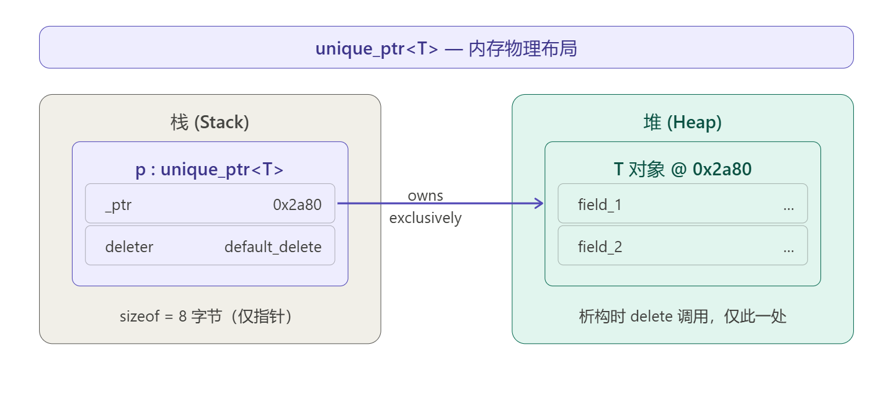
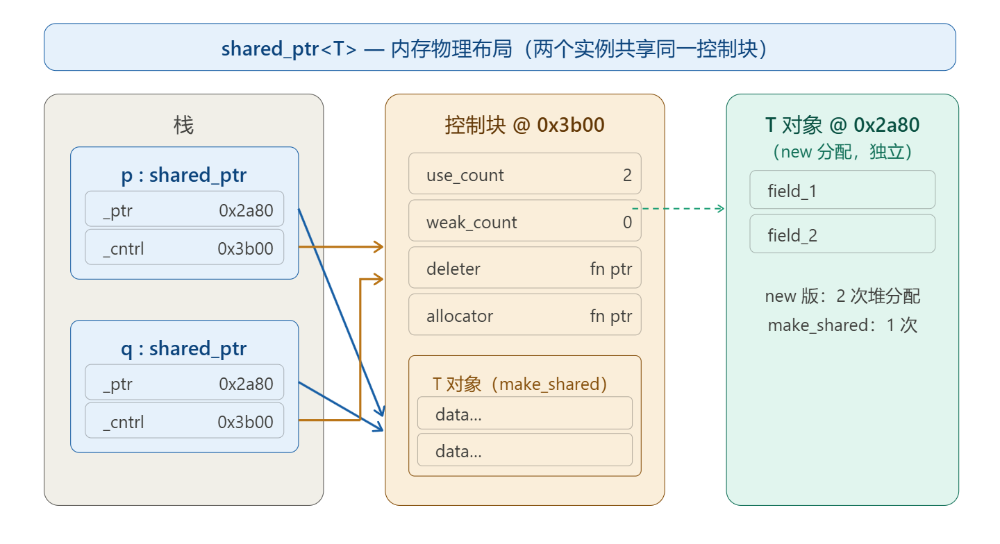
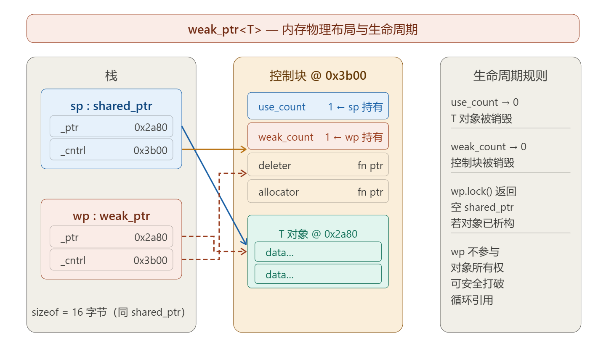

# 智能指针

> 智能指针属于 **C++ 内存管理（RAII）机制**，是现代 C++ 里推荐的 **自动化资源管理工具**，核心目标是 **防止内存泄漏和悬空指针**。

> 包含头文件 `<memory>` 


## unique_ptr

### 特性



> `unique_ptr` 在栈上只占 **8 字节**（等于一个裸指针），堆上只有对象本身，没有任何额外开销。`default_delete` 是零大小的空基类，编译器通过 EBO（空基类优化）将其压缩到 0 字节。

---

**主要特性：** 

1. **独占所有权：**任何时刻**只能有一个** `unique_ptr` 实例拥有对某单个对象的所有权。
2. **不能拷贝：**`unique_ptr` **不能被拷贝和隐式转换，只能被移动。** 
3. **轻量级：** 没有引用次数，开销小。


### 构造和赋值

| 方法             | 底层接口                                | 说明                                                         | 示例                                                         |
| ---------------- | --------------------------------------- | ------------------------------------------------------------ | ------------------------------------------------------------ |
| **默认构造**     | `constexpr unique_ptr() noexcept;`      | 创建空的 `unique_ptr`，不管理任何对象。                      | `unique_ptr<int> up;`                                        |
| **从裸指针构造** | `explicit unique_ptr(T* p) noexcept;`   | 接管裸指针的所有权。⚠️ **只能有一个** `unique_ptr` 管理同一指针。 | `int* p = new int(42);`<br />`unique_ptr<int> up1(p);`<br />`❌ unique_ptr<int> up2(p);`<br />`   //错误:两个 unique_ptr 管同一个指针` |
| **移动构造**     | `unique_ptr(unique_ptr&& u) noexcept;`  | 转移所有权；`u` 置空。被 `move` 的指针在当时只是置空，在程序结束后依然会析构回收。 | `unique_ptr<int> up1 = make_unique<int>(20);`<br />`unique_ptr<int> up2(move(up1));` |
| **带删除器构造** | `unique_ptr(T* p, Deleter d) noexcept;` | 自定义删除器（释放数组、文件句柄等）。                       | `unique_ptr<int, void(*)(int*)> up(new int[5], [](int* p){ delete[] p; });` |

> **(C++14)** 推荐使用 `make_unique` 方式进行构造。

***

| 方法         | 底层接口                                          | 说明                                          | 示例                                                         |
| ------------ | ------------------------------------------------- | --------------------------------------------- | ------------------------------------------------------------ |
| **移动赋值** | `unique_ptr& operator=(unique_ptr&& u) noexcept;` | 释放原有对象 → 接管 `u` 的所有权 → `u` 置空。 | `unique_ptr<int> up1(new int(20));`<br />`unique_ptr<int> up2;up2 = move(up1);` |

> **不支持任何形式的拷贝操作！！！** 

---

```cpp
  unique_ptr<int> up1; // 默认构造

  unique_ptr<int> up2(new int(42)); // 从裸指针接管

  unique_ptr<int> up3(up2);       // 错误，不能任何形式的拷贝
  unique_ptr<int> up3(move(up2)); // 移动构造
  unique_ptr<int> up4 = make_unique<int>(40); // 右值移动构造，右值会在语句结束后立即释放，因此是移动构造
```

> 注意**右值是移动构造**。


### 其他操作

> **以下操作为三个智能指针共有操作。**

| 成员函数           | 功能                         | 示例                                                         |
| ------------------ | ---------------------------- | ------------------------------------------------------------ |
| `get()`            | 获取原始指针（不转移所有权） | `unique_ptr<int> up(new int(42));`<br />`int* p = up.get(); // p 指向同一块内存，但 up 仍然负责释放` |
| `reset(p)`         | 替换管理对象,释放原有对象    | `unique_ptr<int> up(new int(42));`<br />`up.reset(new int(99));  // 原来的 42 被释放，现在托管 99`<br />`up.reset();  // 相当于释放内存并置空` |
| `swap(u)`          | 与另一 `unique_ptr` 交换     | `up1.swap(up2);`                                             |
| `operator*` / `->` | 解引用、成员访问             | `*up = 10; up->func();`                                      |
| `operator bool()`  | 判断是否为空                 | `if(!up) {...}  //等价于if(up == nullptr)`                   |
| `get_deleter()`    | 获取删除器(若自定义了删除器) | `auto& d = up.get_deleter();`                                |

***

`unique_ptr` 独有。

| `release()` | 释放所有权，返回指针 | `unique_ptr<int> up(new int(42));`<br/>`int* p = up.release(); // up 变为空，p 需要手动 delete`<br/>`delete p;` |
| ----------- | -------------------- | ------------------------------------------------------------ |


## shared_ptr

### 特性



> 每个 `shared_ptr` 实例在栈上占 **16 字节**（两个指针：一个指向对象，一个指向控制块）。控制块位于堆上，包含 `use_count`、`weak_count`、`deleter` 和 `allocator` 等函数指针。**用 `make_shared` 时，控制块和 T 对象合并为一次堆分配，缓存局部性更好。**
>
> 
>
> `std::shared_ptr` 通过 **引用计数（reference counting）** 来管理对象的生命周期：
>
> 每个被 `shared_ptr` 管理的对象，都有一个 **控制块（control block）**，指向同一个对象时，多个 `shared_ptr` 共享一个控制块。
>
> 控制块里保存了：
>
> 1. **强引用计数（use_count）**：有多少个 `shared_ptr` 指向这个对象。
> 2. **弱引用计数（weak_count）**：有多少个 `weak_ptr` 指向这个对象，**不增加强引用计数**。
> 3. 空间适配器（allocator）
> 4. **删除器（deleter）**：释放对象的方式。
> 5. **多态实现两种控制块结构：** 
>    - **使用 `make_shared` 方式会把对象直接放进控制块内** 
>    - 使用 `new` 就独立分配，控制块内加一个指向 `new` 对象的指针
>

---

**主要特性：**

1. **共享所有权：** 多个 `shared_ptr` 可以指向同一个对象。

2. **引用计数：** 新的 `shared_ptr` 指向对象时：`count + 1`；离开时 `count - 1` 。`count = 0` 时，释放对象。

   

### 构造和赋值

| 方法                                                   | 说明                                                         | 示例                                                         |
| :----------------------------------------------------- | ------------------------------------------------------------ | :----------------------------------------------------------- |
| `shared_ptr() noexcept;`                               | **默认构造** 创建一个空的 `shared_ptr`，不管理任何对象。     | `shared_ptr<int> sp; //sp.use_count() == 0`                  |
| `shared_ptr(const shared_ptr& r) noexcept;`            | **拷贝构造** 引用计数 `+1`，共享控制块。                     | `shared_ptr<int> sp1 = make_shared<int>(10)`<br />`shared_ptr<int> sp2(sp1); // 引用计数 +1` |
| `shared_ptr(shared_ptr&& r) noexcept;`                 | **移动构造**  转移所有权；`r` 变为空。                       | `shared_ptr<int> sp1 = make_shared<int>(20)`<br />`shared_ptr<int> sp2(move(sp1));` |
| `explicit shared_ptr(T* p);`                           | **从裸指针构造** 接管 `p` 的所有权；调用 `delete p` 释放； **不要**传给多个 `shared_ptr`，否则 double free。 | `shared_ptr<int> sp(new int(42));`                           |
| `explicit shared_ptr(const weak_ptr<T>& r);`           | **从 `weak_ptr` 构造** 如果对象未过期，生成一个 `shared_ptr`；否则为空。 | `weak_ptr<int> wp;`<br />`{ auto sp = make_shared<int>(30); wp=sp; }`<br />`shared_ptr<int> sp2(wp); // sp2 为空` |
| `template<class Deleter> shared_ptr(T* p, Deleter d);` | **带删除器构造**  自定义删除方式（比如释放数组、文件句柄）。 | `shared_ptr<int> sp(new int[5], [](int* p){ delete[] p; });` |

> **推荐使用 `make_shared`** ，它同时分配 **对象 + 控制器** ，效率更高。


***

| 方法                                                   | 说明                                                         | 示例                                                         |
| ------------------------------------------------------ | ------------------------------------------------------------ | ------------------------------------------------------------ |
| `shared_ptr& operator=(const shared_ptr& r) noexcept;` | **拷贝赋值** 先释放原来的对象（引用计数 -1），再共享新对象（引用计数 +1）。 | `shared_ptr<int> sp1 = make_shared<int>(40)`<br />`shared_ptr<int> sp2;sp2 = sp1; //sp2也指40` |
| `shared_ptr& operator=(shared_ptr&& r) noexcept;`      | **移动赋值** 转移所有权；原 `shared_ptr` 清空                | `shared_ptr<int> sp1 = make_shared<int>(50)`<br />`shared_ptr<int> sp2;sp2 = move(sp1);` |


​	**示例：**

```cpp
class Student
{
......
};

int main()
{
  shared_ptr<Student> stu0; // 默认构造

  shared_ptr<Student> stu1(new Student()); // 裸指针构造

  shared_ptr<Student> stu2 = make_shared<Student>("zzz",10);
  shared_ptr<Student> stu3(stu2); // 拷贝构造

  shared_ptr<Student> stu4 = make_shared<Student>("www",20);
  shared_ptr<Student> stu5(move(stu4)); // 移动构造
}
```


### 其他操作

> 主要介绍其独特的成员函数，主要与计数器相关。 （共享操作见： [三个智能指针共有操作](#其他操作) ）

| 成员函数                                   | 作用                                                         | 示例                                                         |
| ------------------------------------------ | ------------------------------------------------------------ | ------------------------------------------------------------ |
| `use_count()`                              | 返回引用次数。                                               | `shared_ptr<int> sp1(new int(42));`<br />`shared_ptr<int> sp2 = sp1;`<br />`cout << sp1.use_count(); // 2` |
| `unique()`                                 | 判断是否是“唯一”拥有者（即引用计数是否为 1）。               | `if (sp1.unique()) { /* 独占资源 */ }`                       |
| `owner_before(const shared_ptr<U>& other)` | 比较两个 `shared_ptr`/`weak_ptr` 是否指向同一控制块，通常用于关联容器排序。 | `shared_ptr<int> sp1(new int(1));`<br />`shared_ptr<int> sp2(new int(2));`<br />`bool cmp = sp1.owner_before(sp2);` |
| `get_deleter<D>()`                         | 获取当初传入的自定义删除器（如果有）。                       | `shared_ptr<int> sp(new int(42), [](int* p){ delete p; });`<br />`auto d = sp.get_deleter<void(*)(int*)>();`<br />`if (d) { std::cout << \"has deleter\"; }` |


## weak_ptr

### 特性



---

**主要特性：** 

1. **不拥有所有权：** **不增加**引用次数，用于观察但不影响对象的生命周期。
2. **可从 `shared_ptr` 生成：** 通过 `weak_ptr` 可以监控 `shared_ptr` 管理的对象。
3. **避免循环引用：** 常用于解决 `shared_ptr` 的循环引用问题。


###  经典案例

> `weak_ptr` 的一个重要作用就是解决 `shared_ptr` 的互引用死循环问题。

​	**错误案例：**

```cpp
class B;
class A
{
public:
  std::shared_ptr<B> bPtr; // A持有B的shared_ptr
  A() { std::cout << "A构造函数" << std::endl; }
  ~A() { std::cout << "A析构函数" << std::endl; }
};

class B
{
public:
  std::shared_ptr<A> aPtr; // B持有A的shared_ptr
  B() { std::cout << "B构造函数" << std::endl; }
  ~B() { std::cout << "B析构函数" << std::endl; }
};

int main()
{
  {
    std::shared_ptr<A> a = std::make_shared<A>();
    std::shared_ptr<B> b = std::make_shared<B>();

    a->bPtr = b; // A持有B的shared_ptr
    b->aPtr = a; // B持有A的shared_ptr

    // 当main函数结束时，a和b会被销毁，但由于它们互相持有对方的shared_ptr，导致引用计数永远不为0，资源无法释放
  }

  std::cout << "程序结束" << std::endl;
  return 0;
}
```

```text
A构造函数
B构造函数
程序结束
```

---

​	**问题详解：**

​			虽然 `a` 和 `b` 离开作用域，但 `A Destructor` 和 `B Destructor` 并未被调用，因为 `a` 和 `b` 相互引用，引用计数无法降到0，导致	内存泄漏。

---

​	**解决方案：**

​		**`weak_ptr`** 只观察不增加引用，因此改 A或B 为 `weak_ptr` 即可。


### 其他操作

> 主要介绍其特有的成员函数， **观察者，不控制对象生命周期**。（共享操作见： [三个智能指针共有操作](#其他操作) ）

| 函数                                  | 作用                                        | 示例                        |
| ------------------------------------- | ------------------------------------------- | --------------------------- |
| `expired()`                           | 判断资源是否已释放（引用计数是否为 0）      | `if (wp.expired()) { ... }` |
| `lock()`                              | 获取一个可用的 `shared_ptr`，如果对象还活着 | `if (auto sp = wp.lock())`  |
| `owner_before(const weak_ptr& other)` | 同 `shared_ptr`，比较控制块，用于容器排序   | `wp1.owner_before(wp2);`    |
| `ues_count`                           | 同 `shared_ptr`                             |                             |

---

**`weak_ptr` 不能直接访问对象**，需要通过 `lock()` 方法转换为 `shared_ptr`，并检查对象是否仍然存在。

```cpp
int main()
{
    std::shared_ptr<int> sp = std::make_shared<int>(42);
    std::weak_ptr<int> wp = sp;

    if (auto locked = wp.lock())
    { // 尝试获取 shared_ptr
        std::cout << "Value: " << *locked << std::endl;
    } 
    else 
    {
        std::cout << "Object no longer exists." << std::endl;
    }

    sp.reset(); // 释放资源

    if (auto locked = wp.lock()) { // 再次尝试获取 shared_ptr
        std::cout << "Value: " << *locked << std::endl;
    } 
    else 
    {
        std::cout << "Object no longer exists." << std::endl;
    }
    return 0;
}
```

---

```cpp
Value: 42
Object no longer exists.
```


## 自定义删除器

> 智能指针默认 `delete` 自动释放资源。有时候不全适用或者不够安全，因此**可以自定义删除器。** 
>
> “自定义删除器”（Custom Deleter）是为了让智能指针在释放资源时，不只是简单地执行 `delete`，而是执行你指定的动作（比如关闭文件句柄、释放数据库连接或释放动态数组）。

| 类型            | 适用场景         | 示例                                                         |
| --------------- | ---------------- | ------------------------------------------------------------ |
| 默认 `delete`   | 普通动态对象     | `unique_ptr<int> p(new int(42));`                            |
| 默认 `delete[]` | 动态数组         | `unique_ptr<int[]> arr(new int[10]);`                        |
| 函数指针        | 简单替换         | `shared_ptr<int>(new int, myDeleter);`                       |
| Lambda          | 资源管理，简洁   | `shared_ptr<FILE>(fopen(...), [](FILE*f){fclose(f);});`      |
| 仿函数对象      | 复杂逻辑，带状态 | `shared_ptr<FILE>(..., FileCloser());`                       |
| 系统资源删除器  | 句柄、fd、socket | `unique_ptr<HANDLE, decltype(&CloseHandle)> h(..., CloseHandle);` |
| 内存池删除器    | 自定义内存管理   | `shared_ptr<MyObject>(pool.acquire(), PoolDeleter());`       |


### 两种智能指针差别

| **特性**       | **std::unique_ptr**            | **std::shared_ptr**                            |
| -------------- | ------------------------------ | ---------------------------------------------- |
| **删除器类型** | 是 **类模板参数** 的一部分     | **不是** 类模板参数的一部分                    |
| **存储位置**   | 直接存储在智能指针对象中       | 存储在堆上的 **控制块（Control Block）** 中    |
| **性能开销**   | 几乎零开销（取决于删除器大小） | 有细微的运行时开销（虚函数或函数指针调用）     |
| **灵活性**     | 较低（类型固定）               | 极高（类型擦除，不同删除器可赋值给同类型指针） |


### 自定义仿函数删除器

> [仿函数介绍](./可调用对象.md#仿函数(Functors))

**管理FILE*资源** ，`shared_ptr` 用类型擦除实现删除器多态

```cpp
#include <iostream>
#include <memory>
#include <cstdio>
struct FileDeleter 
{
    void operator()(FILE* fp) const
    {
        if (fp) 
        {
            std::cout << "Closing file." << std::endl;
            fclose(fp);
        }
    }
};

int main()
{
    {
        std::shared_ptr<FILE> filePtr(fopen("example.txt", "w"), FileDeleter());
        if (filePtr) 
        {
            std::cout << "File opened successfully." << std::endl;
            // 使用 filePtr 进行文件操作
            fprintf(filePtr.get(), "Hello, World!\n");
        }
    } // 自动关闭文件
    std::cout << "Exiting main..." << std::endl;
    return 0;
}
```

```cpp
File opened successfully.
Closing file.
Exiting main...
```

---

**流程详解** 

当你创建 `std::shared_ptr<FILE>` 时，它的内部构造函数实际上做了两件事：

1. **保存指针**：把 `fopen` 返回的 `FILE*` 存起来。

2. **保存删除器**：把 `FileDeleter` 的临时实例存入**控制块（Control Block）**。

3. 当 `filePtr` 离开作用域时，它的析构函数会被触发。**会自动把指针传入删除器，触发自定义的删除器** 

   ```cpp
   FileDeleter deleter;
   deleter(fopen_p)
   ```

   > **智能指针的约束**：`std::shared_ptr<T>` 要求自定义删除器必须是“可调用的（Callable）”，且能够接受一个 `T*` 类型的参数。
   >
   > **编译器检查**：如果你给 `shared_ptr<int>` 传了一个只能接受 `FILE*` 的删除器，编译器在这一行就会直接报错，提示参数类型不匹配。


### 自定义lambda表达式删除器

`unique_ptr` 是“静态绑定删除器”。 编译器必须知道：删除器类型是什么，**所以删除器必须写在类型参数里面** 

`unique_ptr` 用模板参数实现零开销删除器绑定

```cpp
#include <iostream>
#include <memory>
#include <cstdio>

int main()
{
    {
        auto fileDeleter = [](FILE* fp){
            if (fp) 
            {
                std::cout << "Closing file via lambda." << std::endl;
                fclose(fp);
            }
        };

        std::unique_ptr<FILE, decltype(fileDeleter)> filePtr(fopen("example.txt", "w"), fileDeleter);
        if (filePtr) 
        {
            std::cout << "File opened successfully." << std::endl;
            fprintf(filePtr.get(), "Hello, Lambda!\n");
        }
    } // 自动关闭文件

    std::cout << "Exiting main..." << std::endl;
    return 0;
}
```

> 输出同上，更加简洁。


## 手写智能指针


### 简单的shared_ptr

- **共享所有权**：多个 `SimpleSharedPtr` 实例可以指向同一个对象，共享对该对象的所有权。

- **自动管理生命周期**：当最后一个 `SimpleSharedPtr` 被销毁或指向其他对象时，管理的对象被自动释放。

- **引用计数**：内部维护一个引用计数，记录有多少个 `SimpleSharedPtr` 实例指向同一个对象。

---

**在多线程环境下：** 

- **引用计数管理**：多个线程可能会同时拷贝、移动或销毁智能指针实例，导致引用计数的修改。若引用计数不是原子操作，则会引发数据竞争和未定义行为。

- **指针和控制块的访问**：多个线程可能会同时访问或修改同一个智能指针实例的 `ptr` 和 `control` 成员，这需要同步机制来保护。


#### 引用计数的实现

为了实现引用计数机制，`SimpleSharedPtr` 需要一个控制块（Control Block），它包含：

- **引用计数（**`ref_count`**）**：记录有多少个 `SimpleSharedPtr` 指向同一个对象。

- **指向对象的指针（**`ptr`**）**：指向实际管理的对象

> 标准库内**被管理对象是由控制块掌控的：**
>
> - 控制块与被管理对象一起被分配（make_shared方式）
>
> - 或者控制块内加一个指针指向被管理对象（new方式）

但为了简化实现，本示例将它们独立管理，由 `shared_ptr` 直接管理对象，但不放进控制块

```cpp
struct ControlBlock
{
  size_t refCount; // 引用计数
  ControlBlock() : refCount(1) {}
};
```

---

```cpp
template <typename T>
class SimpleSharedPtr
{
private:
  T *ptr;                     // 指向实际对象的指针
  ControlBlock *controlBlock; // 控制块，包含引用计数等信息
    
public:
    // 构造函数、析构函数、拷贝与移动操作、操作符重载等
};
```


#### 构造和析构

- **默认构造函数**：初始化指针和控制块为空。

- **参数化构造函数**：接受一个裸指针，初始化控制块，并初始化引用计数为1。

- **析构函数**：减少引用计数，若引用计数为0，则释放对象和控制块。

```cpp
 // 默认构造函数
  SimpleSharedPtr() : ptr(nullptr), controlBlock(nullptr) {}

  // 有参构造函数 防止隐式转换 如SImpleSharedPtr<int> ptr = new int(5); 这种写法会导致隐式转换
  explicit SimpleSharedPtr(T *ptr) : ptr(ptr), controlBlock(nullptr)
  {
    if (ptr)
    {
      controlBlock = new ControlBlock();
    }
  }

  ~SimpleSharedPtr()
  {
    release();
  }

void release()
  {
    if (controlBlock)
    {
      controlBlock->refCount--;
      if (controlBlock->refCount == 0)
      {
        delete ptr;          // 删除实际对象
        delete controlBlock; // 删除控制块
      }
    }
  }
```


#### 拷贝构造和拷贝赋值

```cpp
  // 拷贝构造函数
  SimpleSharedPtr(const SimpleSharedPtr &other) : ptr(other.ptr), controlBlock(other.controlBlock)
  {
    if (controlBlock)
    {
      controlBlock->refCount++;
    }
  }

 // 拷贝赋值运算符
  SimpleSharedPtr &operator=(const SimpleSharedPtr &other)
  {
    if (this != &other) // 自我赋值检查
    {
      release(); // 释放当前资源

      ptr = other.ptr;
      controlBlock = other.controlBlock;
      if (controlBlock) // 如果控制块不为空，增加引用计数,共同管理同一个对象
      {
        controlBlock->refCount++;
      }
    }
    return *this;
  }
```

> 必须 `return *this;` 即当前对象的引用(`SimpleSharedPtr &operator=(const SimpleSharedPtr &other)`)保证链式调用


#### 移动构造和移动赋值

```cpp
  // 移动构造函数
  SimpleSharedPtr(SimpleSharedPtr &&other) noexcept : ptr(other.ptr), controlBlock(other.controlBlock)
  {
    other.ptr = nullptr;
    other.controlBlock = nullptr;
  }

  // 移动赋值运算符，noexcept表示这个函数不会抛出异常，让编译器敢用这个函数进行优化
  SimpleSharedPtr &operator=(SimpleSharedPtr &&other) noexcept
  {
    if (this != &other)
    {
      release(); // 释放当前资源

      ptr = other.ptr;
      controlBlock = other.controlBlock;

      other.ptr = nullptr;
      other.controlBlock = nullptr;
    }
    return *this;
  }
```

> noexcept表示这个函数不会抛出异常，让编译器敢用这个函数进行移动操作，进行优化


#### 运算符重载

重载 `*` 和 `->` 操作符，以便像使用原生指针一样使用 `SimpleSharedPtr`。

```cpp
 // 使用s->name相当于使用s.ptr->name，重载了箭头运算符，可以使用内部对象的成员函数和成员变量
  T *operator->() const
  {
    return ptr;
  } // 重载箭头运算符，允许通过智能指针访问对象成员

  // 解引用运算符，(*s).name相当于(*s.ptr).name
  T &operator*() const
  {
    return *ptr;
  } // 重载解引用运算符，允许通过智能指针访问对象
```


#### 线程安全优化

##### 优化点

1. 使用 **`std::atomic` 管理引用计数：** 将 `ControlBlock::ref_count` 从普通的 `int` 替换为 `std::atomic<int>`，以确保引用计数的线程安全递增和递减。
   - 优点：简单高效，避免使用互斥锁带来的性能开销。类似于标准库中 `std::shared_ptr` 实现的引用计数管理。
   - 缺点：只能保证引用计数本身的线程安全，无法保护 `ptr` 和 `control` 的同步访问。

2. 引入互斥锁保护指针操作：在 `SimpleSharedPtr` 中引入 `std::mutex`，**在所有可能修改 `ptr` 和 `control` 的操作中加锁**。
   - 优点：确保 ptr 和 control 在多线程访问时的一致性。提供更全面的线程安全保障。
   - 缺点：引入锁机制，可能带来性能开销，特别是在高并发场景下。

---

3. 结合使用 `std::atomic<int>` 进行引用计数的管理，并使用 `std::mutex` 保护指针和控制块的访问。
   - 优点：引用计数管理高效且线程安全。指针和控制块的访问得到完全的同步保护。
   - 缺点：复杂性较高，需要同时管理原子操作和互斥锁。


##### 线程安全优化细则

1. 拷贝构造和移动构造

   ```cpp
   std::lock_guard<std::mutex> lock(other.mtx);
   ```

   用于拷贝构造和移动构造时锁住 `other.mtx`。意义是防止别的线程同时修改 `other.ptr` 或 `other.controlBlock`，避免你刚读到一半对象就被 reset、析构或者移动走。

---

2. 拷贝赋值和移动赋值

   ```cpp
    std::scoped_lock lock(mtx, other.mtx);
   ```

   用于拷贝赋值和移动赋值时同时锁住 `this->mtx` 和 `other.mtx` 。意义是一次性拿到两个对象的锁，避免两边互相等待造成死锁。

---

3. 其他重载的线程安全保护

   ```cpp
   std::lock_guard<std::mutex> lock(mtx);
   ```

   用于 `operator->`、`operator*`、`use_count`、`get`、`reset`。意义是把这些读写操作包进一个短临界区，保证在读取 `ptr`、`controlBlock`  或执行 reset 时，这些成员不会被别的线程同时改掉。


##### 锁的作用

为什么要用这种锁，而不是只用原子：

- 原子只能保证单个变量的读写是原子的，不能保证多变量之间的一致性。
- 这个类里一次状态变化往往不止一个变量，比如 `reset` 要先释放旧资源，再替换 `ptr` ，再重建 `controlBlock`；拷贝赋值要先释放当前对象，再接管对方资源，再增加引用计数。这里必须用互斥锁把整个过程串成一个不可打断的步骤。
- 互斥锁还能防止“读到一半就被改掉”的问题。比如 `get()` 和 `operator->()` 返回的是裸指针，锁只保护“取出指针的那一瞬间”，至少能保证取值时对象状态一致。

---

这两个锁都是 C++ 为了实现 **RAII（资源获取即初始化）** 机制而设计的锁管理器，它们都能在构造时加锁、析构时自动解锁，防止因异常或逻辑疏忽导致的死锁。

简单来说，**`std::scoped_lock`** 是 `std::lock_guard` 的**“高级增强版”**。

C++ 17以上推荐只写 `std::scoped_lock` ，其管理一个或多个锁都很方便，内部自定义避免了死锁

```cpp
std::scoped_lock lock(mtx);//管理一个
    
std::scoped_lock lock(mtx, other.mtx);//管理多个
```


#### 完整代码

```cpp
#include <iostream>
#include <thread>
#include <atomic>
#include <mutex>
#include <vector>

// 简化设计，控制块只包含引用计数，实际的资源管理和线程安全由ThreadSafeSharedPtr类负责
struct ControlBlock
{
  std::atomic<size_t> refCount; // 引用计数
  ControlBlock() : refCount(1) {}
};

template <typename T>
class ThreadSafeSharedPtr
{
public:
  // 默认构造函数
  ThreadSafeSharedPtr() : ptr(nullptr), controlBlock(nullptr)
  {
    std::cout << "无法创建无参构造函数的智能指针" << std::endl;
  }

  // 有参构造函数 防止隐式转换 如SImpleSharedPtr<int> ptr = new int(5); 这种写法会导致隐式转换
  explicit ThreadSafeSharedPtr(T *ptr) : ptr(ptr), controlBlock(nullptr)
  {
    if (ptr)
    {
      controlBlock = new ControlBlock();
      std::cout << "创建了一个新的智能指针，引用计数为" << controlBlock->refCount.load() << std::endl;
    }
  }

  ~ThreadSafeSharedPtr()
  {
    release();
  }

  // 拷贝构造函数
  ThreadSafeSharedPtr(const ThreadSafeSharedPtr &other)
  {
    std::lock_guard<std::mutex> lock(other.mtx); // 锁住other的互斥锁，确保线程安全
    ptr = other.ptr;
    controlBlock = other.controlBlock;

    if (controlBlock)
    {
      controlBlock->refCount++;
      std::cout << "拷贝构造函数被调用，引用计数增加到" << controlBlock->refCount.load() << std::endl;
    }
  }

  // 移动构造函数
  ThreadSafeSharedPtr(ThreadSafeSharedPtr &&other) noexcept
  {
    std::lock_guard<std::mutex> lock(other.mtx); // 锁住other的互斥锁，确保线程安全
    ptr = other.ptr;
    controlBlock = other.controlBlock;
    other.ptr = nullptr;
    other.controlBlock = nullptr;
    std::cout << "移动构造函数被调用，资源已转移" << std::endl;
  }

  // 拷贝赋值运算符
  ThreadSafeSharedPtr &operator=(const ThreadSafeSharedPtr &other)
  {
    if (this != &other) // 自我赋值检查
    {
      std::scoped_lock lock(mtx, other.mtx); // 同时锁住当前对象和other对象的互斥锁，防止死锁
      release();                             // 释放当前资源

      ptr = other.ptr;
      controlBlock = other.controlBlock;
      if (controlBlock) // 如果控制块不为空，增加引用计数,共同管理同一个对象
      {
        controlBlock->refCount++;
        std::cout << "拷贝赋值运算符被调用，引用计数增加到" << controlBlock->refCount.load() << std::endl;
      }
    }
    return *this;
  }

  // 移动赋值运算符，noexcept表示这个函数不会抛出异常，让编译器敢用这个函数进行优化
  ThreadSafeSharedPtr &operator=(ThreadSafeSharedPtr &&other) noexcept
  {
    if (this != &other)
    {
      std::scoped_lock lock(mtx, other.mtx);
      release(); // 释放当前资源

      ptr = other.ptr;
      controlBlock = other.controlBlock;

      other.ptr = nullptr;
      other.controlBlock = nullptr;
      std::cout << "移动赋值运算符被调用，资源已转移" << std::endl;
    }
    return *this;
  }

  // 使用s->name相当于使用s.ptr->name，重载了箭头运算符，可以使用内部对象的成员函数和成员变量
  T *operator->() const
  {
    std::lock_guard<std::mutex> lock(mtx);
    return ptr;
  } // 重载箭头运算符，允许通过智能指针访问对象成员

  // 解引用运算符，(*s).name相当于(*s.ptr).name
  T &operator*() const
  {
    std::lock_guard<std::mutex> lock(mtx);
    return *ptr;
  } // 重载解引用运算符，允许通过智能指针访问对象

  // 获取当前引用计数
  size_t use_count() const
  {
    std::lock_guard<std::mutex> lock(mtx);
    return controlBlock ? controlBlock->refCount.load() : 0;
  }

  // 获取裸指针
  T *get() const
  {
    std::lock_guard<std::mutex> lock(mtx);
    return ptr;
  }

  // reset函数，重置智能指针，或释放当前对象并管理新的对象
  // reset()和reset(new T)的区别在于前者会将智能指针重置为nullptr，释放当前管理的对象，而后者会将智能指针重置为new T分配的新对象，并管理该对象。
  void reset(T *newPtr = nullptr)
  {
    std::lock_guard<std::mutex> lock(mtx);
    release(); // 释放当前资源

    ptr = newPtr;
    if (ptr)
    {
      controlBlock = new ControlBlock();
      std::cout << "重置了智能指针，引用计数为" << controlBlock->refCount.load() << std::endl;
    }
    else
    {
      controlBlock = nullptr;
    }
  }

private:
  T *ptr;                     // 指向实际对象的指针
  ControlBlock *controlBlock; // 控制块，包含引用计数等信息

  mutable std::mutex mtx; // 互斥锁，保护引用计数的修改

  void release()
  {
    if (controlBlock)
    {
      if (--(controlBlock->refCount) == 0)
      {
        delete ptr;          // 删除实际对象
        delete controlBlock; // 删除控制块
        std::cout << "引用次数为零，对象和控制块已删除" << std::endl;
      }
      else
      {
        std::cout << "引用次数不为零，对象未删除，当前引用计数: " << controlBlock->refCount.load() << std::endl;
      }
    }
    ptr = nullptr;
    controlBlock = nullptr;
  }
};

// 测试类
class Test
{
public:
  Test(int val) : value(val)
  {
    std::cout << "Test Constructor: " << value << std::endl;
  }
  ~Test()
  {
    std::cout << "Test Destructor: " << value << std::endl;
  }
  void show() const
  {
    std::cout << "Value: " << value << std::endl;
  }

private:
  int value;
};

void thread_func_copy(ThreadSafeSharedPtr<Test> sptr, int thread_id)
{
  std::cout << "Thread " << thread_id << " is copying shared_ptr." << std::endl;
  ThreadSafeSharedPtr<Test> local_sptr = sptr;
  std::cout << "Thread " << thread_id << " copied shared_ptr, use_count = " << local_sptr.use_count() << std::endl;
  local_sptr->show();
}

void thread_func_reset(ThreadSafeSharedPtr<Test> &sptr, int new_val, int thread_id)
{
  std::cout << "Thread " << thread_id << " is resetting shared_ptr." << std::endl;
  sptr.reset(new Test(new_val));
  std::cout << "Thread " << thread_id << " reset shared_ptr, use_count = " << sptr.use_count() << std::endl;
  sptr->show();
}

int main()
{
  std::cout << "Creating ThreadSafeSharedPtr with Test(100)." << std::endl;
  ThreadSafeSharedPtr<Test> sptr(new Test(100));
  std::cout << "Initial use_count: " << sptr.use_count() << std::endl;

  // 创建多个线程进行拷贝操作
  const int num_threads = 5;
  std::vector<std::thread> threads_copy;

  for (int i = 0; i < num_threads; ++i)
  {
    threads_copy.emplace_back(thread_func_copy, sptr, i);
  }

  for (auto &t : threads_copy)
  {
    t.join();
  }

  std::cout << "After copy threads, use_count: " << sptr.use_count() << std::endl;

  // 创建多个线程进行 reset 操作
  std::vector<std::thread> threads_reset;

  for (int i = 0; i < num_threads; ++i)
  {
    threads_reset.emplace_back(thread_func_reset, std::ref(sptr), 200 + i, i);
  }

  for (auto &t : threads_reset)
  {
    t.join();
  }

  std::cout << "After reset threads, final use_count: " << sptr.use_count() << std::endl;

  std::cout << "Exiting main." << std::endl;
  return 0;
}
```

---

```text
空指针测试：
ptr1 use_count: 0
裸指针测试：
ptr2 use_count: 1
拷贝构造测试：
ptr2 use_count: 2
ptr3 use_count: 2
ptr1 use_count: 3
ptr2 use_count: 3
ptr3 use_count: 3
reset测试：
ptr1 use_count: 2
ptr2 use_count: 1
ptr3 use_count: 2
移动构造测试：
ptr2 use_count: 0
ptr4 use_count: 1
移动赋值测试：
ptr4 use_count: 0
ptr5 use_count: 1
多线程测试：
ptr5在线程中: 李四
student对象被销毁: 李四
student对象被销毁: 张三
```


### 简单的unique_ptr

> 任意时刻一个 `unique_ptr` 只管理一个对象。只能移动不能拷贝

和 `shared_ptr` 实现差不多，更简单一点，不用重载拷贝相关

```cpp
#include <iostream>

template <typename T>
class SimpleUniquePtr
{
public:
  SimpleUniquePtr() : ptr(nullptr) {}
  explicit SimpleUniquePtr(T *ptr) : ptr(ptr) {}
  ~SimpleUniquePtr()
  {
    delete ptr; // 析构函数，释放资源
  }

  SimpleUniquePtr(const SimpleUniquePtr &other) = delete;            // 禁止拷贝构造
  SimpleUniquePtr &operator=(const SimpleUniquePtr &other) = delete; // 禁止拷贝赋值

  SimpleUniquePtr(SimpleUniquePtr &&other) noexcept : ptr(other.ptr) // 移动构造函数
  {
    other.ptr = nullptr; // 将源对象的指针置空，转移所有权
  }

  SimpleUniquePtr &operator=(SimpleUniquePtr &&other) noexcept // 移动赋值运算符
  {
    if (this != &other) // 自我赋值检查
    {
      delete ptr;          // 释放当前资源
      ptr = other.ptr;     // 转移所有权
      other.ptr = nullptr; // 将源对象的指针置空
    }
    return *this;
  }

  T &operator*() const
  {
    return *ptr;
  } // 重载解引用运算符，允许通过智能指针访问对象

  T *operator->() const
  {
    return ptr;
  } // 重载箭头运算符，允许通过智能指针访问对象成员

  T *get() const
  {
    return ptr;
  } // 获取原始指针

  void reset(T *newPtr = nullptr)
  {
    delete ptr; // 释放当前资源
    ptr = newPtr;
  } // reset函数，重置智能指针，或释放当前对象并管理新的对象

  T *release()
  {
    T *temp = ptr; // 保存当前指针
    ptr = nullptr; // 将智能指针置空，释放所有权
    return temp;   // 返回原始指针
  } // release函数，释放智能指针的所有权，并返回原始指针

private:
  // 不需要控制块，因为SimpleUniquePtr不支持共享所有权，每个对象只能有一个SimpleUniquePtr管理
  T *ptr; // 指向实际对象的指针
};
```

