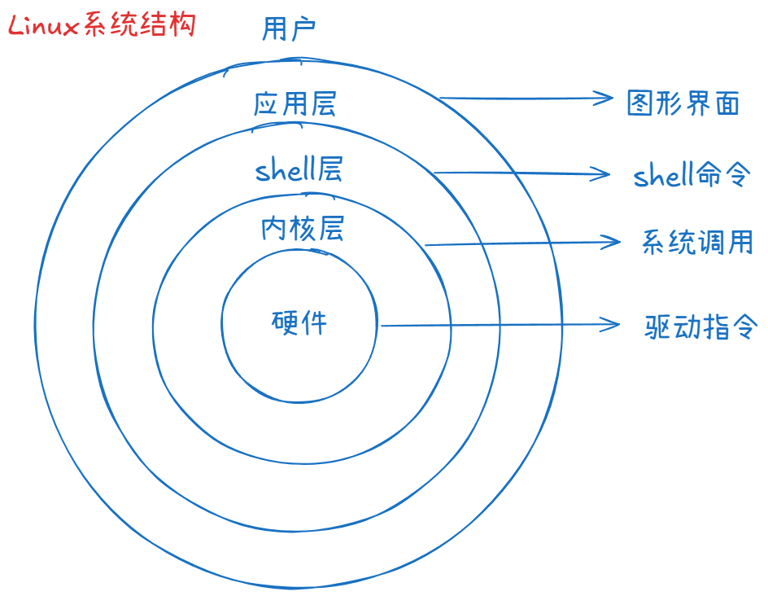

# Linux 基础

> 讲一下简单的 `Linux` 命令和编译器。

## Linux基础命令

### shell

1. `shell` 就是**命令解释器**，用户在终端输入命令，`shell` 将其解析成内核可以识别的指令，在内核执行命令，执行结果在终端显示。

2. `shell` 根据 `$PATH` 环境变量查找，查找不到就报错。可以根据 `echo $PATH` 查看 `PATH` 环境变量的值。



3. ```cpp
   // 查看系统当前shell
   echo $SHELL
       
   //当前系统支持的shell
   cat /etc/shells
   ```

   

### 常用快捷键

| 快捷键                 | 功能说明                               |
| ---------------------- | -------------------------------------- |
| **Ctrl + C**           | 终止当前命令（强制停止运行）           |
| **Ctrl + D**           | 退出当前终端 / 表示输入结束（EOF）     |
| **Ctrl + Z**           | 暂停当前任务并放到后台（用 `fg` 恢复） |
| **Ctrl + L**           | **清屏（等同于 `clear`）**             |
| **Ctrl + A**           | 光标移到行首                           |
| **Ctrl + E**           | 光标移到行尾                           |
| **Ctrl + U**           | 删除光标到行首的内容                   |
| **Ctrl + K**           | 删除光标到行尾的内容                   |
| **Ctrl + W**           | 删除光标前一个单词                     |
| **Ctrl + R**           | 搜索历史命令                           |
| **Tab**                | 自动补全命令或文件名                   |
| **↑ / ↓**              | 浏览命令历史记录                       |
| **!!**                 | 执行上一条命令                         |
| **sudo !!**            | 以 root 权限重新执行上一条命令         |
| **Ctrl + Shift + C**   | 复制选中的终端文本                     |
| **Ctrl + Shift + V**   | 粘贴到终端                             |
| **Ctrl + Alt + T**     | 打开新终端窗口                         |
| **Ctrl + Alt + F1~F6** | 切换到命令行界面（tty1~tty6）          |
| **Ctrl + Alt + F7**    | 返回图形界面                           |
| **Alt + .**            | 调用上一条命令的最后一个参数           |


### LInux目录结构

> `Linux` 一切皆文件，**只有一个根目录，呈现倒立树状。**


| 目录                 | 主要内容                 | 说明                                                         |
| -------------------- | ------------------------ | ------------------------------------------------------------ |
| **/**                | 根目录（Root）           | 所有文件和目录的起点。整个系统的最高层级。                   |
| **/bin**             | 可执行二进制文件         | 存放基本命令，如 `ls`、`cp`、`mv`、`cat`、`bash` 等，普通用户和 root 都能用。 |
| **/sbin**            | 系统管理命令             | 主要是系统管理员使用的命令，如 `reboot`、`ifconfig`、`fdisk` 等。 |
| **/boot**            | 启动文件                 | 存放内核（`vmlinuz`）、启动加载器（`grub`）等系统启动相关文件。 |
| **/dev**             | 设备文件                 | 系统中的设备以文件形式存在，如 `/dev/sda`（硬盘）、`/dev/tty`（终端）等。 |
| **/etc**             | 系统配置文件             | 各种配置文件都在这里，如 `/etc/passwd`、`/etc/fstab`、`/etc/hosts`。 |
| **/home**            | 用户主目录               | 普通用户的家目录，如 `/home/alice`、`/home/bob`。            |
| **/root**            | 超级用户主目录           | root 用户的家目录（不要与 `/` 混淆）。                       |
| **/lib**, **/lib64** | 系统库文件               | 程序运行所需的共享库，如 `/lib/x86_64-linux-gnu/libc.so.6`。 |
| **/media**           | 可移动设备挂载点         | 自动挂载的 U 盘、光盘等设备路径。                            |
| **/mnt**             | 临时挂载点               | 手动挂载外部设备时常用的挂载位置。                           |
| **/opt**             | 第三方软件包             | 可选安装的软件放这里（如 `/opt/google/chrome`）。            |
| **/proc**            | 内核与进程信息           | 虚拟文件系统，反映系统内核和进程状态，如 `/proc/cpuinfo`。   |
| **/run**             | 运行时数据               | 存放系统运行时生成的临时文件（如 PID、Socket）。             |
| **/srv**             | 服务数据                 | 系统服务的数据目录，如 Web、FTP 服务数据等。                 |
| **/sys**             | 内核设备信息             | 提供与内核交互的接口，类似 `/proc`。                         |
| **/tmp**             | 临时文件                 | 临时存放系统或程序运行时生成的文件，系统重启后可能清空。     |
| **/usr**             | 用户级程序和文件         | 大多数应用程序和库文件都在这里，类似 Windows 的“Program Files”。 |
| **/usr/bin**         | 普通用户可执行命令       |                                                              |
| **/usr/sbin**        | 管理命令（系统服务）     |                                                              |
| **/usr/lib**         | 程序运行所需的库         |                                                              |
| **/usr/share**       | 共享资源（文档、图标等） |                                                              |
| **/var**             | 可变数据文件             | 日志、邮件、缓存、临时文件等，如 `/var/log`、`/var/tmp`。    |


### Linux文件类型

> 使用 `ls - l` 可以看到文件类型。七种。

| 文件类型                         | 符号表示（ls -l首字符） | 描述                                         | 示例                                              |
| -------------------------------- | ----------------------- | -------------------------------------------- | ------------------------------------------------- |
| 普通文件（Regular File）         | `-`                     | 最常见的文件类型，用于存储数据、程序、文本等 | `/etc/passwd`, `/home/user/file.txt`              |
| 目录文件（Directory）            | `d`                     | 包含文件和子目录的目录                       | `/home`, `/usr`, `/var/log`                       |
| 符号链接（Symbolic Link）        | `l`                     | 指向另一个文件或目录的快捷方式               | `/bin/sh -> bash`                                 |
| 字符设备文件（Character Device） | `c`                     | 提供按字符访问的设备接口（如终端、串口）     | `/dev/tty`, `/dev/random`                         |
| 块设备文件（Block Device）       | `b`                     | 提供按块访问的设备接口（如硬盘、U盘）        | `/dev/sda`, `/dev/sdb1`                           |
| 套接字文件（Socket）             | `s`                     | 进程间通信（IPC）的一种方式                  | `/run/docker.sock`, `/var/run/mysqld/mysqld.sock` |
| 命名管道（FIFO）                 | `p`                     | 另一种进程间通信方式，先进先出               | `/tmp/myfifo`                                     |


### 相对路径和绝对路径

| 类型         | 定义                                 | 起点               | 示例                      | 说明               |
| ------------ | ------------------------------------ | ------------------ | ------------------------- | ------------------ |
| **绝对路径** | 从 **根目录 `/`** 开始写出的完整路径 | 固定起点 `/`       | `/home/user/doc/file.txt` | 不依赖当前所在目录 |
| **相对路径** | 从 **当前工作目录** 出发写的路径     | 起点是当前目录 `.` | `../images/pic.jpg`       | 依赖你当前的位置   |


| 符号 | 含义                               |
| ---- | ---------------------------------- |
| `.`  | 当前目录（current directory）      |
| `..` | 上一级目录（parent directory）     |
| `/`  | 根目录（root directory）           |
| `~`  | 当前用户的主目录（home directory） |


​	**示例：**

假设当前目录是：

```cpp
/home/alice/projects/
```

则：

| 目标                        | 绝对路径写法                    | 相对路径写法   | 解释                 |
| --------------------------- | ------------------------------- | -------------- | -------------------- |
| 当前目录下的文件 `main.cpp` | `/home/alice/projects/main.cpp` | `./main.cpp`   | `.` 表示当前目录     |
| 上一级目录中的 `README.md`  | `/home/alice/README.md`         | `../README.md` | `..` 表示上一级      |
| 家目录中的 `notes.txt`      | `/home/alice/notes.txt`         | `~/notes.txt`  | `~` 表示 `/home`     |
| 系统配置文件 `/etc/hosts`   | `/etc/hosts`                    | （无相对路径） | 根目录开始的绝对路径 |


### 常用命令

#### ls 看文件

> 用于查看指定目录下的文件信息


| 命令    | 效果                                                         |
| ------- | ------------------------------------------------------------ |
| `ls`    | 列出当前目录中的文件和目录名称                               |
| `ls -l` | 以长格式显示详细信息（文件类型、硬链接数、文件所有者、文件大小、最后修改时间等） |
| `ls -a` | 显示所有文件，包括以 `.` 开头的隐藏文件                      |
| `ls -R` | 递归列出目录及其子目录中的所有文件                           |
| `ls -h` | 以人类可读的格式显示文件大小（例如 KB, MB, GB）。            |
| `ls -S` | 按文件大小排序，最大的文件排在最前面                         |
| `ls -t` | 按文件修改时间排序，最新的文件排在最前面                     |

> 你可以将多个选项组合使用，**常用例如**：
>
> ```bash
> ls -al
> ```
>
> 这将列出包括隐藏文件的详细信息，并以人类可读的方式显示文件大小。


#### cd 换目录

> `cd` 是 Linux 中用来**切换目录**的命令。它的作用是改变当前工作目录。


| 命令                      | 效果                                            |
| ------------------------- | ----------------------------------------------- |
| `cd /home/user/Documents` | 这将把当前工作目录切换到 `/home/user/Documents` |
| `cd ..`                   | 返回上一级目录                                  |
| `cd ~` / `cd`             | 返回用户的主目录                                |
| `cd /`                    | 切换到根目录                                    |
| `cd -`                    | 切换到最近访问的目录                            |

> 多使用 `tab` 键补齐目录


​	**常搭配：**

1. `pwd` 命令会返回当前目录的**绝对路径**。

2. `which` 命令显示命令所在的目录。


#### touch 创建文件

> 创建空文件

| **命令**                       | **效果**                                                     |
| ------------------------------ | ------------------------------------------------------------ |
| `touch <文件名>`               | 创建一个空的文件，如果文件已存在，则更新文件的访问时间和修改时间。 |
| `touch -c <文件名>`            | 如果文件不存在，不创建新文件，**仅更新已存在文件的时间戳**。 |
| `touch -d <日期时间> <文件名>` | 将文件的时间戳设置为指定的日期时间（格式为 `YYYY-MM-DD HH:MM:SS`）。 |
| `touch -t <时间戳> <文件名>`   | 将文件的时间戳设置为指定的精确时间戳（格式为 `[[CC]YY]MMDDhhmm[.ss]`）。 |
| `touch -a <文件名>`            | 仅更新文件的访问时间。                                       |
| `touch -m <文件名>`            | 仅更新文件的修改时间。                                       |
| `touch -r <参照文件> <文件名>` | 将指定文件的时间戳复制到目标文件。                           |
| `touch -h <文件名>`            | 如果目标是符号链接，更新符号链接本身的时间戳，而非链接指向的文件。 |


#### mkdir  创建目录

> 创建空目录

| **命令**                   | **效果**                                                     |
| -------------------------- | ------------------------------------------------------------ |
| `mkdir <目录名>`           | 创建一个新的空目录。如果目录已存在，则会报错。               |
| `mkdir -p <目录路径>`      | 创建多层目录。如果某一部分目录不存在，则会自动创建该部分的父目录。 |
| `mkdir -m <权限> <目录名>` | 创建目录时，指定目录的权限。权限参数通常以八进制表示（例如 `755`）。 |
| `mkdir -v <目录名>`        | 显示创建目录的过程，输出目录创建成功的消息。                 |
| `mkdir --help`             | 显示 `mkdir` 命令的帮助信息，列出所有可用的选项和用法。      |


#### rm 删除

| **命令**          | **效果**                                                     |
| ----------------- | ------------------------------------------------------------ |
| `rm <文件名>`     | 删除指定文件。如果文件不可删除（如权限问题），则会报错。     |
| `rm -r <目录名>`  | 删除指定目录及其内容（递归删除）。如果目录中包含文件和子目录，会一并删除。 |
| `rm -f <文件名>`  | 强制删除文件，忽略不存在的文件且不显示错误消息。             |
| `rm -rf <目录名>` | **强制递归删除目录及其所有内容，且不报错。**                 |
| `rm -i <文件名>`  | 在删除每个文件之前提示确认。                                 |
| `rm -v <文件名>`  | 显示删除操作的详细信息，即列出被删除的文件。                 |
| `rm --help`       | 显示 `rm` 命令的帮助信息，列出所有可用选项和用法。           |


#### mv 移动

| **命令**                | **效果**                                                     |
| ----------------------- | ------------------------------------------------------------ |
| `mv <源文件> <目标>`    | 移动文件或将文件重命名。如果目标是一个目录，则文件会被移动到该目录。 |
| `mv <源文件> <目标>`    | 将文件移动到指定目录。                                       |
| `mv -i <源文件> <目标>` | 在覆盖目标文件之前提示确认（防止不小心覆盖现有文件）。       |
| `mv -f <源文件> <目标>` | 强制移动文件，覆盖目标文件时不进行提示。                     |
| `mv -v <源文件> <目标>` | 显示移动的详细过程，输出被移动的文件路径。                   |
| `mv --help`             | 显示 `mv` 命令的帮助信息，列出所有可用选项和用法。           |

> 目标可以是**路径**、**文件**、**目录**等。

  

#### cp 复制

| **命令**                | **效果**                                                     |
| ----------------------- | ------------------------------------------------------------ |
| `cp <源文件> <目标>`    | 复制一个文件到指定的目标路径（可以是另一个文件或目录）。     |
| `cp -r <源目录> <目标>` | 递归复制目录及其内容。                                       |
| `cp -i <源文件> <目标>` | 在覆盖文件之前提示确认（防止不小心覆盖现有文件）。           |
| `cp -u <源文件> <目标>` | 仅在源文件比目标文件新时才进行复制。                         |
| `cp -v <源文件> <目标>` | 显示复制的详细过程，输出被复制的文件路径。                   |
| `cp -a <源文件> <目标>` | 以归档方式复制文件和目录，保留文件属性（如权限、时间戳等）。 |
| `cp -f <源文件> <目标>` | 强制复制文件，覆盖目标文件时不进行提示。                     |
| `cp --help`             | 显示 `cp` 命令的帮助信息，列出所有可用选项和用法。           |

> 目标可以是**路径**、**文件**、**目录**等。


#### 查看文件内容

| **命令**                       | **效果说明**                                                 |
| ------------------------------ | ------------------------------------------------------------ |
| `cat <文件>`                   | **显示整个文件的内容**。可以用来快速查看小文件的内容。       |
| `cat <文件1> <文件2> > <目标>` | **将多个文件合并为一个文件**，并将输出保存到 `目标文件`。    |
| `more <文件>`                  | **逐屏显示文件内容**，支持上下翻页，适合查看大文件。滚动时可以用空格键向下滚动，`q` 退出。 |
| `less <文件>`                  | **逐屏显示文件内容**，支持双向滚动（向上和向下）。相较于 `more`，`less` 功能更强，可以滚动回上面查看。 |
| `head <文件>`                  | **显示文件的前 N 行**，默认显示前 10 行。                    |
| `head -n <N> <文件>`           | **显示文件的前 N 行**，可以自定义显示行数。                  |
| `tail <文件>`                  | **显示文件的最后 N 行**，默认显示最后 10 行。                |
| `tail -n <N> <文件>`           | **显示文件的最后 N 行**，可以自定义显示行数。                |
| `tail -f <文件>`               | **实时显示文件的新增内容**，通常用于查看日志文件。比如，查看日志文件的输出流，随着文件内容的增加动态显示。 |

---

| **命令**        | **效果说明**                                                 |
| --------------- | ------------------------------------------------------------ |
| `wc <文件>`     | **统计文件的行数、字数和字符数**。默认输出为行数、字数和字符数，分别以空格分隔。 |
| `wc -l <文件>`  | **统计文件的行数**。                                         |
| `wc -w <文件>`  | **统计文件的字数**。                                         |
| `wc -c <文件>`  | **统计文件的字符数**。                                       |
| `wc -m <文件>`  | **统计文件的字符数**（与 `-c` 类似，但按字符计数，支持多字节字符集，如 UTF-8）。 |
| `wc -L <文件>`  | **统计文件的最长行的长度**。                                 |
| `whoami`        | **显示当前用户的用户名**。                                   |
| `whoami --help` | 显示 `whoami` 命令的帮助信息。                               |


#### 修改用户权限

| **命令**                            | **效果说明**                                                 |
| ----------------------------------- | ------------------------------------------------------------ |
| `chmod <权限> <文件>`               | **修改文件的权限**。权限可以用数字或符号表示。               |
| `chmod 755 <文件>`                  | **设置文件的权限为 rwxr-xr-x**，即所有者有读写执行权限，用户组和其他用户有读和执行权限。 |
| `chmod u+x <文件>`                  | **给文件的所有者添加执行权限**。                             |
| `chmod g-w <文件>`                  | **从文件的用户组去掉写权限**。                               |
| `chmod o+r <文件>`                  | **给其他用户添加读权限**。                                   |
| `chmod -R <权限> <目录>`            | **递归修改目录及其子目录和文件的权限**。                     |
| `chown <用户名>:<用户组> <文件>`    | **更改文件的所有者和用户组**。例如 `chown zs:staff file.txt` 将 `file.txt` 的所有者改为 `zs`，用户组改为 `staff`。 |
| `chown <用户名> <文件>`             | **更改文件的所有者**，不修改用户组。                         |
| `chown :<用户组> <文件>`            | **更改文件的用户组**，不修改所有者。                         |
| `chown -R <用户名>:<用户组> <目录>` | **递归更改目录及其子目录和文件的所有者和用户组**。           |
| `chgrp <用户组> <文件>`             | **更改文件的用户组**，不修改所有者。                         |
| `chgrp -R <用户组> <目录>`          | **递归更改目录及其子目录和文件的用户组**。                   |


#### find&grep 查找

1. 纯 `find` 查找

| **命令**                         | **效果说明**                                                 |
| -------------------------------- | ------------------------------------------------------------ |
| `find <路径> -name <文件名>`     | **根据文件名查找文件**。支持通配符（如 `*`、`?`）。例如：**`find /home -name "*.txt"`** 查找所有 `.txt` 文件。 |
| `find <路径> -type <类型>`       | **根据文件类型查找文件**。常用类型有：`f`（普通文件），`d`（目录），`l`（符号链接）。 |
| `find <路径> -size <大小>`       | **根据文件大小查找文件**。例如，`-size +100M` 查找大于 100MB 的文件，`-size -1k` 查找小于 1KB 的文件。 |
| `find <路径> -mtime <天数>`      | **根据文件修改时间查找文件**。例如，`-mtime +7` 查找修改时间在 7 天之前的文件，`-mtime -1` 查找最近 1 天修改的文件。 |
| `find <路径> -user <用户名>`     | **根据文件的所有者查找文件**。例如：`find /home -user zs` 查找所有者是 `zs` 的文件。 |
| `find <路径> -group <用户组>`    | **根据文件的用户组查找文件**。例如：`find /home -group staff` 查找用户组为 `staff` 的文件。 |
| `find <路径> -exec <命令> {} \;` | **对查找到的文件执行命令**。`{}` 是占位符，表示当前查找到的文件。例如：`find . -name "*.txt" -exec cat {} \;` 执行 `cat` 命令查看所有 `.txt` 文件内容。 |
| `find <路径> -print`             | **显示查找到的文件路径**，默认行为，通常不需要显式使用。     |
| `find <路径> -empty`             | **查找空文件或空目录**。例如：`find . -empty` 查找当前目录下的空文件或空目录。 |
| `find <路径> -maxdepth <层数>`   | **限制查找的最大目录深度**。例如，`-maxdepth 2` 只查找       |


2.  `find` 结合 `grep` 查找

| **命令**                                                    | **效果说明**                                                 |
| ----------------------------------------------------------- | ------------------------------------------------------------ |
| `find <路径> -name <文件名> -exec grep <选项> <模式> {} \;` | **查找指定文件并在这些文件中使用 `grep` 搜索内容**。例如，查找所有 `.txt` 文件并在其中查找包含 `error` 的行。 |
| `find <路径> -type f -exec grep -l <模式> {} \;`            | **查找文件并显示匹配的文件名**，用于只显示包含特定模式的文件名（例如，查找包含 `pattern` 的文件）。 |
| `find <路径> -type f -exec grep -H <模式> {} \;`            | **查找文件并显示匹配的行内容及文件名**，输出文件名和匹配内容。 |
| `find <路径> -type f -exec grep -i <模式> {} \;`            | **查找文件并忽略大小写匹配内容**。例如，查找不区分大小写的 `pattern`。 |
| `find <路径> -type f -exec grep -r <模式> {} \;`            | **递归查找子目录中的文件并使用 `grep` 匹配内容**。通常用于查找目录下及子目录中的文件内容。 |
| `find <路径> -type f -exec grep -l <模式> {} ;              | xargs`                                                       |

> 示例：
>
> ```cpp
> find /var/log -name "*.txt" -exec grep "error" {} \;
> ```
>
> **效果**：查找 `/var/log` 目录下所有 `.txt` 文件并打印出所有包含 `error` 的行。


#### 软连接

1. **给文件创建软链接**

​	**命令：**

```cpp
ln -s /home/alice/test.txt link.txt
```

> - 修改 `link.txt` 相当于修改 `test.txt`
> - 删除 `test.txt` 后，`link.txt` 会变成**"死链接"**


2. **给目录创建软链接**

​	**命令：**

```cpp
ln -s /usr/local/nginx   /home/alice/nginx_link
```

> - 路径建议使用**绝对路径**。


#### 硬连接

> **硬连接 **是指多个文件名同时指向同一个文件的内容。**硬连接是同一个文件的 “另一个名字”**，不是副本，也不是快捷方式。

> 在`Linux`中，文件名只是指向 **inode（索引节点）** 的一个“标签”；inode 中存放了文件的实际数据位置。创建硬链接时会新建一个指向同一个 `inode` 的新文件名。


​	**基本语法：**

```cpp
ln 源文件 目标链接名
```

> 与软连接不同，不用加 `-s`


1. **给文件创建硬链接**

```cpp
ln file.txt link.txt
```

> - `file.txt` 和 `link.txt` 都指向相同的 inode；
>
> - 修改任意一个文件内容，另一个也会**同步变化**；
>
> - 删除其中一个文件，另一个**仍然可以访问**数据。


#### 软件的安装和卸载

> 不同系统命令不同，以 `Ubuntu` 为例：

| **方式**         | **命令**                                   | **效果说明**                               |
| ---------------- | ------------------------------------------ | ------------------------------------------ |
| **APT 安装**     | `sudo apt update`                          | 更新软件包列表，确保安装的软件是最新版本   |
|                  | `sudo apt install <软件包名称>`            | 安装软件包                                 |
| **APT 卸载**     | `sudo apt remove <软件包名称>`             | 卸载软件包，但保留配置文件                 |
|                  | `sudo apt purge <软件包名称>`              | 卸载软件包并删除配置文件                   |
|                  | `sudo apt autoremove`                      | 删除不再需要的依赖包                       |
| **Snap 安装**    | `sudo snap install <软件包名称>`           | 安装 Snap 软件包                           |
| **Snap 卸载**    | `sudo snap remove <软件包名称>`            | 卸载 Snap 软件包                           |
| **Flatpak 安装** | `sudo flatpak install <软件包名称>`        | 安装 Flatpak 软件包（需先添加 Flathub 源） |
| **Flatpak 卸载** | `sudo flatpak uninstall <软件包名称>`      | 卸载 Flatpak 软件包                        |
| **源码安装**     | `./configure && make && sudo make install` | 从源码编译并安装软件（需先解压源码包）     |
| **源码卸载**     | `sudo make uninstall`                      | 卸载源码安装的软件（前提是程序支持卸载）   |


#### 文件解压缩

| **压缩格式**       | **压缩命令**                            | **解压命令**               | **说明**              |
| ------------------ | --------------------------------------- | -------------------------- | --------------------- |
| **`.tar`**         | `tar -cvf <目标路径.tar> <源路径>`      | `tar -xvf <文件.tar>`      | 打包/解包，不压缩     |
| `.tar.gz` / `.tgz` | `tar -czvf <目标路径.tar.gz> <源路径>`  | `tar -xzvf <文件.tar.gz>`  | 打包并使用 gzip 压缩  |
| `.tar.bz2`         | `tar -cjvf <目标路径.tar.bz2> <源路径>` | `tar -xjvf <文件.tar.bz2>` | 打包并使用 bzip2 压缩 |
| `.tar.xz`          | `tar -cJvf <目标路径.tar.xz> <源路径>`  | `tar -xJvf <文件.tar.xz>`  | 打包并使用 xz 压缩    |
| `.zip`             | `zip -r <目标路径.zip> <源路径>`        | `unzip <文件.zip>`         | 支持递归压缩目录      |
| `.rar`             | `rar a <目标路径.rar> <源路径>`         | `unrar x <文件.rar>`       | 需安装 `rar/unrar`    |
| `.gz`              | `gzip <文件>`                           | `gunzip <文件.gz>`         | 仅压缩单个文件        |
| `.bz2`             | `bzip2 <文件>`                          | `bunzip2 <文件.bz2>`       | 仅压缩单个文件        |
| `.xz`              | `xz <文件>`                             | `unxz <文件.xz>`           | 仅压缩单个文件        |
| `.7z`              | `7z a <目标路径.7z> <源路径>`           | `7z x <文件.7z>`           | 需安装 `p7zip-full`   |

> **tar 命令常用参数**：
>
> - `c`：创建压缩包
> - `x`：解压
> - `v`：显示过程
> - `f`：指定文件名
> - `z`：gzip 压缩
> - `j`：bzip2 压缩
> - `J`：xz 


## Vim基本操作

> 全称 `Vi Improved ` , **`Vim`** 是一个面向程序员的、命令驱动的文本编辑器。


​	**注意：**

1. 不能用鼠标，纯键盘命令。

2. 三种主要模式：

   | 模式                   | 进入方式            | 用途                         |
   | ---------------------- | ------------------- | ---------------------------- |
   | **普通模式 (Normal)**  | 启动默认            | 移动光标、复制、删除、粘贴等 |
   | **插入模式 (Insert)**  | 按 `i`、`a`、`o` 等 | 输入文本内容                 |
   | **命令模式 (Command)** | 按 `:` 进入         | 保存、退出、替换、查找等操作 |

   > 其他模式到普通模式按 `Esc`

   

### 普通模式

#### 光标移动

| 命令       | 功能                                 |
| ---------- | ------------------------------------ |
| `h`        | 向左移动一个字符                     |
| `l`        | 向右移动一个字符                     |
| `j`        | 向下移动一行                         |
| `k`        | 向上移动一行                         |
| `0`        | 移动到行首                           |
| `$`        | 移动到行尾                           |
| `w`        | 跳到下一个单词开头                   |
| `b`        | 跳到上一个单词开头                   |
| `e`        | 跳到当前单词结尾                     |
| `gg`       | 跳到文件开头                         |
| `G`        | 跳到文件末尾                         |
| `nG`       | 跳到第 n 行（例：`10G`）             |
| `{` / `}`  | 跳到上/下一个段落                    |
| `Ctrl + f` | 向下翻页                             |
| `Ctrl + b` | 向上翻页                             |
| `Ctrl + d` | 向下半页                             |
| `Ctrl + u` | 向上半页                             |
| `%`        | 跳转到配对的括号（`()`、`{}`、`[]`） |


#### 删除操作

| 命令  | 功能                          |
| ----- | ----------------------------- |
| `x`   | 删除光标处字符                |
| `X`   | 删除光标前字符                |
| `dd`  | 删除当前行                    |
| `ndd` | 删除接下来的 n 行（如 `3dd`） |
| `d$`  | 删除到行尾                    |
| `d0`  | 删除到行首                    |
| `dw`  | 删除一个单词                  |
| `dG`  | 删除到文件末尾                |
| `dgg` | 删除到文件开头                |


#### 复制粘贴

| 命令  | 功能         |
| ----- | ------------ |
| `yy`  | 复制当前行   |
| `nyy` | 复制 n 行    |
| `yw`  | 复制一个单词 |
| `y$`  | 复制到行尾   |
| `p`   | 在光标后粘贴 |
| `P`   | 在光标前粘贴 |


#### 修改替换

| 命令      | 功能                               |
| --------- | ---------------------------------- |
| `r<字符>` | 用指定字符替换光标处字符           |
| `R`       | 进入替换模式（覆盖输入）           |
| `cw`      | 修改当前单词（删除并进入插入模式） |
| `cc`      | 修改整行（删除并进入插入模式）     |
| `c$`      | 修改到行尾                         |
| `s`       | 删除光标处字符并插入               |
| `S`       | 删除整行并插入                     |


#### 查找

| 命令      | 功能                     |
| --------- | ------------------------ |
| `/关键词` | 向下搜索关键词           |
| `?关键词` | 向上搜索关键词           |
| `n`       | 重复上一次搜索（同方向） |
| `N`       | 反向重复上一次搜索       |
| `*`       | 搜索光标所在单词（向下） |
| `#`       | 搜索光标所在单词（向上） |


#### 撤销

| 命令       | 功能               |
| ---------- | ------------------ |
| `u`        | 撤销上一步操作     |
| `Ctrl + r` | 重做被撤销的修改   |
| `.`        | 重复上一次编辑命令 |


#### 行与缩进

| 命令            | 功能               |
| --------------- | ------------------ |
| `>>`            | 当前行右缩进       |
| `<<`            | 当前行左缩进       |
| `==`            | 自动缩进当前行     |
| `gg=G`          | 自动缩进整个文件   |
| `J`             | 合并当前行与下一行 |
| `:set number`   | 显示行号           |
| `:set nonumber` | 关闭行号           |


### 插入模式

#### 常用快捷键

| 快捷键                  | 功能说明                                                     |
| ----------------------- | ------------------------------------------------------------ |
| `Esc`                   | 退出插入模式，返回普通模式                                   |
| `Ctrl + h`              | 删除前一个字符（等同退格）                                   |
| `Ctrl + w`              | 删除前一个单词                                               |
| `Ctrl + u`              | 删除当前行中光标前的所有内容                                 |
| `Ctrl + o`              | 临时执行一个普通模式命令后返回插入模式                       |
| `Ctrl + r` + *寄存器*   | 插入寄存器中的内容（如 `Ctrl + r + "` 插入默认寄存器）       |
| `Ctrl + t`              | 增加当前行缩进                                               |
| `Ctrl + d`              | 减少当前行缩进                                               |
| `Ctrl + n` / `Ctrl + p` | 自动补全（下一项 / 上一项）                                  |
| `Ctrl + x Ctrl + f`     | 文件名补全（很常用）                                         |
| `Ctrl + x Ctrl + o`     | 关键字/语义补全（需开启 omnicomplete）                       |
| `Ctrl + r + = `         | 计算表达式并插入结果（例如输入 `Ctrl + r + =5*6` → 插入 30） |


### 命令模式

#### 文件操作命令

| 命令             | 功能说明                     | 备注                            |
| ---------------- | ---------------------------- | ------------------------------- |
| `:w`             | 保存文件（write）            | 若文件只读，可用 `:w!` 强制保存 |
| `:w 文件名`      | 另存为指定文件名 add。哦     | 类似 “另存为” 功能              |
| `:q`             | 退出当前文件                 | 若文件有修改，Vim 会阻止退出    |
| `:q!`            | 强制退出，不保存             | “放弃修改退出”                  |
| `:wq`            | **保存并退出**               | 常用组合命令                    |
| `:x`             | 与 `:wq` 类似                | 若文件未修改则不写入磁盘        |
| `:wq!`           | 强制保存并退出人民           | 可用于只读文件                  |
| `:e 文件名`      | **打开一个文件**             | 会替换当前缓冲区内容            |
| `:e!`            | 放弃当前修改并重新加载文件   | 恢复原始内容                    |
| `:saveas 文件名` | 另存为一个新文件             | 保存副本                        |
| `:r 文件名`      | 读取文件内容插入到当前光标处 |                                 |


#### 查看文件信息

| 命令          | 功能说明                               |
| ------------- | -------------------------------------- |
| `:f`          | 显示当前文件名、行号、总行数等信息     |
| `:f 新文件名` | 修改当前缓冲区文件名                   |
| `:pwd`        | 显示当前工作目录                       |
| `:cd 路径`    | 切换工作目录                           |
| `:!pwd`       | 执行外部命令（此处示例为显示当前路径） |


#### 查找与替换

| 命令             | 功能说明               |
| ---------------- | ---------------------- |
| `:/关键字`       | 向下搜索               |
| `:?关键字`       | 向上搜索               |
| `:s/旧/新/`      | 替换当前行第一个匹配   |
| `:s/旧/新/g`     | 替换当前行所有匹配     |
| `:%s/旧/新/g`    | 替换整个文件中所有匹配 |
| `:%s/旧/新/gc`   | 全文件替换并逐一确认   |
| `:.,$s/旧/新/g`  | 从当前行到文件结尾替换 |
| `:1,10s/旧/新/g` | 替换第 1～10 行内容    |


#### 格式视图

| 命令                | 功能说明                     |
| ------------------- | ---------------------------- |
| `:set number`       | 显示行号                     |
| `:set nonumber`     | 关闭行号                     |
| `:set autoindent`   | 自动缩进                     |
| `:set tabstop=4`    | 设置 Tab 宽度为 4 空格       |
| `:set shiftwidth=4` | 设置自动缩进宽度             |
| `:set expandtab`    | 将 Tab 转为空格              |
| `:set noexpandtab`  | 使用真实的 Tab 字符          |
| `:syntax on`        | 开启语法高亮                 |
| `:syntax off`       | 关闭语法高亮                 |
| `:set paste`        | 启用粘贴模式（防止缩进错乱） |
| `:set nopaste`      | 关闭粘贴模式                 |


#### 窗口与分屏

| 命令             | 功能说明               |
| ---------------- | ---------------------- |
| `:split`         | 水平分屏               |
| `:vsplit`        | 垂直分屏               |
| `:split 文件名`  | 水平分屏打开文件       |
| `:vsplit 文件名` | 垂直分屏打开文件       |
| `:close`         | 关闭当前分屏           |
| `:only`          | 关闭除当前外的所有分屏 |
| `:new`           | 新建空白窗口（水平）   |
| `:vnew`          | 新建空白窗口（垂直）   |
| `Ctrl + w + w`   | 在分屏间循环切换       |
| `Ctrl + w + q`   | 关闭当前窗口           |


##  gcc编译器

>  **Linux/Unix 系统上最常用的 C/C++ 编译器**，几乎所有开源软件的编译都依赖它。


### 编译过程

| 阶段     | 命令选项 | 功能说明                          | 输出文件                        |
| -------- | -------- | --------------------------------- | ------------------------------- |
| 1️⃣ 预处理 | `-E`     | 展开宏、处理 `#include`、删除注释 | `.i` 文件                       |
| 2️⃣ 编译   | `-S`     | 将预处理结果编译成汇编代码        | `.s` 文件                       |
| 3️⃣ 汇编   | `-c`     | 将汇编代码转为目标文件            | `.o` 文件                       |
| 4️⃣ 链接   | （默认） | 将目标文件与库链接生成可执行文件  | 无扩展名（如 `a.out` 或指定名） |


​	**示例：**

**假设此时有一个源文件 `main.c`**

1️⃣ 预处理

```cpp
gcc -E main.c -o main.i
```

2️⃣ 编译为汇编代码

```cpp
gcc -S main.i -o main.s
```

3️⃣ 汇编生成目标文件

```cpp
gcc -c main.s -o main.o
```

4️⃣ 链接生成可执行文件

```cpp
gcc main.o -o main
```


**如上太麻烦了，代码一步到位：**

```cpp
gcc main.c -o xxx
    
./xxx
```

> 两步命令，xxx随便取个名字就行。


**更简单的：**

```cpp
gcc main.c
    
./a.out
```

> 但是输出就是指定的 `a.out`


### gcc命令参数

#### 常用命令参数

| 分类           | 参数                                 | 功能说明                                 |
| -------------- | ------------------------------------ | ---------------------------------------- |
| **输出控制**   | `-o <文件名>`                        | 指定输出文件名（默认是 `a.out`）         |
|                | `-v`                                 | 显示编译的详细过程（verbose）            |
|                | `-save-temps`                        | 保存中间文件（`.i`, `.s`, `.o`）         |
|                | `-pipe`                              | 使用管道传递临时文件（加快编译）         |
| **阶段控制**   | `-E`                                 | 只进行**预处理**（输出到标准输出）       |
|                | `-S`                                 | 预处理 + 编译，生成汇编代码（`.s` 文件） |
|                | `-c`                                 | 编译但不链接，生成目标文件（`.o`）       |
|                | *(无参数)*                           | 预处理 + 编译 + 汇编 + 链接（完整编译）  |
| **调试相关**   | `-g`                                 | 生成调试信息（供 `gdb` 使用）            |
|                | `-ggdb`                              | 生成适合 gdb 的完整调试信息              |
| **优化控制**   | `-O0`                                | 不优化（默认）                           |
|                | `-O1`                                | 基本优化（安全且较快）                   |
|                | `-O2`                                | 中级优化（推荐）                         |
|                | `-O3`                                | 高级优化（可能改变行为）                 |
|                | `-Os`                                | 为减小文件体积优化                       |
|                | `-Ofast`                             | 极致优化，可能违反标准                   |
| **警告控制**   | `-Wall`                              | 启用大多数警告（非常常用）               |
|                | `-Wextra`                            | 开启额外警告                             |
|                | `-Werror`                            | 将所有警告视为错误                       |
|                | `-pedantic`                          | 严格遵循 C 标准                          |
|                | `-w`                                 | 禁止所有警告                             |
| **语言标准**   | `-std=c89` / `c99` / `c11` / `gnu11` | 指定使用的 C 语言标准                    |
|                | `-ansi`                              | 等价于 `-std=c89 -pedantic`              |
| **包含路径**   | `-I<目录>`                           | 添加头文件搜索路径（include）            |
| **库与链接**   | `-L<目录>`                           | 添加库文件搜索路径                       |
|                | `-l<库名>`                           | 链接指定库（例如 `-lm` 链接数学库）      |
|                | `-static`                            | 生成静态链接程序                         |
|                | `-shared`                            | 生成共享库（`.so` 文件）                 |
|                | `-fPIC`                              | 生成与位置无关的代码（用于共享库）       |
| **输出依赖**   | `-M` / `-MM`                         | 生成头文件依赖（供 Makefile 使用）       |
| **诊断与检查** | `-fsyntax-only`                      | 只检查语法错误，不生成文件               |
|                | `-ftime-report`                      | 输出编译阶段耗时报告                     |
| **目标架构**   | `-m32`                               | 生成 32 位程序                           |
|                | `-m64`                               | 生成 64 位程序                           |
| **运行控制**   | `-D宏名`                             | 定义一个宏（等价于 `#define 宏名`）      |
|                | `-U宏名`                             | 取消宏定义（等价于 `#undef`）            |


#### 常用组合命令

| 场景           | 命令                              | 说明                 |
| -------------- | --------------------------------- | -------------------- |
| 最简单的编译   | `gcc main.c -o main`              | 一步生成可执行文件   |
| 开启警告       | `gcc -Wall main.c -o main`        | 显示潜在问题         |
| 调试版         | `gcc -g -Wall main.c -o main`     | 含调试信息           |
| 优化版         | `gcc -O2 main.c -o main`          | 编译优化             |
| 指定 C 标准    | `gcc -std=c11 main.c -o main`     | 使用 C11 语法        |
| 链接数学库     | `gcc main.c -lm -o main`          | 用于 `sqrt()` 等函数 |
| 指定头文件路径 | `gcc -I ./include main.c -o main` | 头文件在自定义目录   |
| 指定库文件路径 | `gcc -L ./lib -lmylib -o main`    | 链接自定义库         |
| 保存中间文件   | `gcc -save-temps main.c -o main`  | 保留 `.i` `.s` `.o`  |
| 查看详细过程   | `gcc -v main.c -o main`           | 显示编译细节         |


## 动静态库

> 库是已经编译好的、可被其他程序调用的一组函数或对象的集合。
>
> 库就是别人写好的工具包，你只要链接进自己的程序，就能直接使用。提高复用性，减少开发时长。

| 类型                 | 文件后缀                           | 链接阶段       | 特点                             |
| -------------------- | ---------------------------------- | -------------- | -------------------------------- |
| **静态库**           | `.a`（Linux） / `.lib`（Windows）  | **编译时**链接 | 程序体积大，会被编译进目标代码中 |
| **动态库（共享库）** | `.so`（Linux） / `.dll`（Windows） | **运行时**加载 | 程序体积小，可共用库文件         |


### 静态库打包流程

> 多个 `.o` 文件的集合，一个 `.o` 也算是一个库文件。


**流程如下：**

 **1️⃣ 书写源代码**

```cpp
// add.c
int add(int a,int b)
{
return a+b;
}
```

```cpp
// sub.c
int sub(int a,int b)
{
return a*b;
}
```

---

```cpp
// main.c
#include <stdio.h>
int add(int a, int b);
int sub(int a, int b);

int main() 
{
    printf("%d\n", add(3, 2));
    printf("%d\n", sub(3, 2));
}
```

> 将 `add.c` 和 `sub.c` 打包成静态库给 `main.c` 调用。


**2️⃣ 生成目标文件**

```cpp
gcc -c add.c sub.c
```

生成：

```cpp
add.o  sub.o
```


**3️⃣ 打包成静态库**

```cpp
ar rcs libmath.a add.o sub.o
```

> 会生成`libmath.a`，它就是静态库，命名规则为：
>
> ```cpp
> lib + 库名 + .a //严格遵守命名规则
> ```


**4️⃣在程序中使用**

编译并链接静态库：

```cpp
gcc main.c -L. -lmath -o main
```

> **`-L.` 是指静态库所在目录**，如在当前目录下的lib，则应写为 `-L./lib` 。`-l` 后紧跟库名。

运行：

```
./main
```


### 动态库打包流程

> 以 `.so` 结尾，相比于静态库，其运行时才加载，多个使用只要有一个实体，是共享的。有更新也只要更新一次实体。


**1️⃣ 生成位置无关的目标文件**

```cpp
gcc -fPIC -c add.c sub.c
```


**2️⃣ 生成共享库**

```cpp
gcc -shared add.o sub.o -o libmath.so
```

> 命名要求和静态库一样


**3️⃣ 链接共享库**

```cpp
gcc main.c -L. -lmath -o main
```

> 路径要求等和静态库相同。


 **4️⃣运行时动态加载**

```cpp
./main
```


**⚠️ 如果提示“找不到库”，可以：**

```
export LD_LIBRARY_PATH=.:$LD_LIBRARY_PATH
```


### 对比

| 比较项         | 静态库 `.a`          | 动态库 `.so`                 |
| -------------- | -------------------- | ---------------------------- |
| 链接时机       | 编译时               | 运行时                       |
| 可执行文件体积 | 大（包含库代码）     | 小（只存引用）               |
| 更新库的影响   | 需重新编译           | 可直接替换 `.so`             |
| 加载速度       | 快（已嵌入），好移植 | 稍慢（运行时加载），不好移植 |
| 共享性         | 不可共享             | 多程序共享内存               |
| 版本控制       | 不灵活               | 需管理 `.so` 版本            |


## makefile

> `makefile` 是一份“编译规则说明书”，让你只需输入 `make`，就能自动完成所有编译步骤。

> `make` 就是一个编译自动化工具，用来执行 `makefile` 中的指令。


### mkefile作用

假设你有 10 个 `.cpp` 文件组成的项目：

```cpp
g++ -c main.cpp
g++ -c foo.cpp
g++ -c bar.cpp
g++ main.o foo.o bar.o -o app
```

如果你手动编译，非常麻烦。

而 Makefile 可以：

- 只重新编译 **被修改的文件**；
- 自动推导编译命令；
- 定义各种快捷命令（`make run`, `make clean` 等）；
- 管理复杂的依赖关系。

> **`makefile`里面就是你自己指定的编译规则，使得你只需要一个 `make` 命令，整个工程就可以自动编译，提高开发效率。** 


### makefile 基本结构

`makefile` 由一系列规则组成：

```makefile
目标: 依赖
<Tab> 命令
```

解释：

- **目标（target）**：要生成的文件（如可执行文件、目标文件）。
- **依赖（dependencies）**：生成目标文件所需的依赖文件。
- **命令（command）**：具体想执行的 Shell 命令**（前面必须是 `Tab` ，不能以空格代替）**。

> 之后**输入 `make`** 就可以执行 `makefile` 文件了。


​	**示例：**

```makefile
app: main.o foo.o
	g++ main.o foo.o -o app
```


## Cmake

> CMake 是一个 **跨平台的构建系统生成工具**，它不直接编译代码，而是根据项目配置文件（`CMakeLists.txt`）生成对应平台的构建文件（如 Linux 下的 Makefile、Windows 下的 Visual Studio 工程等）。


### 核心优势

1. **管理项目构建**：自动处理依赖、编译选项、链接等。

2. **跨平台支持**：支持 Windows、Linux、macOS。

3. **与多种编译器兼容**：如 GCC、Clang、MSVC。

4. **支持外部库集成**：通过 `find_package()`、`target_link_libraries()`。


### 项目结构示例

```bash
MyProject/
├── CMakeLists.txt       # 主配置文件
├── include/
│   └── mylib.h          # 头文件
├── src/
│   ├── main.cpp         # 主程序
│   ├── util.cpp         # 工具函数
│   └── lib.cpp          # 库实现
└── build/               # 构建目录（手动创建）
```


### 基本使用流程

1. **编写 `CMakeLists.txt`**：定义项目名称、版本、依赖库、编译选项、目标文件（可执行程序 / 库）等。
2. **生成构建文件**：通过 `cmake` 命令解析 `CMakeLists.txt`，在指定目录生成对应平台的构建文件（如 `Makefile`）。
3. **编译项目**：使用生成的构建文件（`如makefile` 对应的 `make` 命令）编译代码，生成可执行程序或库。


### 核心语法和命令

#### 基础配置

```cmake
# 声明 CMake 最低版本要求（必须）
cmake_minimum_required(VERSION 3.10)

# 定义项目名称、版本（可选）、编程语言（默认 C/C++）
project(MyProject 
    VERSION 1.0 
    LANGUAGES C CXX
)

# 设置 C++ 标准（如 C++11）
set(CMAKE_CXX_STANDARD 11)
set(CMAKE_CXX_STANDARD_REQUIRED ON)  # 强制使用指定标准
```


#### 定义目标

```cmake
# 生成可执行程序（目标名：myapp，源文件：main.cpp、util.cpp）
add_executable(myapp 
    src/main.cpp 
    src/util.cpp
)

# 生成静态库（目标名：mylib，源文件：lib.cpp）
add_library(mylib STATIC 
    src/lib.cpp
)

# 生成动态库（SHARED）
add_library(mydylib SHARED 
    src/dylib.cpp
)
```


#### 头文件和库依赖

```cmake
# 指定头文件搜索路径（对所有目标生效）
include_directories(include)

# 仅对 myapp 目标添加头文件路径
target_include_directories(myapp PRIVATE 
    include/internal
)

# 链接库（myapp 依赖 mylib 和系统库 pthread）
target_link_libraries(myapp 
    PRIVATE mylib  # 链接自定义静态库
    PRIVATE pthread  # 链接系统库
)
```


#### 编译选项与定义

```cpp
# 添加编译选项（如警告级别、优化等级）
add_compile_options(-Wall -O2)  # 对所有目标生效

# 仅对 myapp 添加编译选项
target_compile_options(myapp PRIVATE -Wextra)

# 添加宏定义（如 DEBUG 宏）
add_definitions(-DDEBUG)  # 全局生效

# 仅对 mylib 添加宏定义
target_compile_definitions(mylib PRIVATE ENABLE_LOG)
```


#### 安装配置（可选）

```cmake
# 安装可执行程序到 ${CMAKE_INSTALL_PREFIX}/bin
install(TARGETS myapp 
    RUNTIME DESTINATION bin
)

# 安装静态库到 ${CMAKE_INSTALL_PREFIX}/lib
install(TARGETS mylib 
    ARCHIVE DESTINATION lib
)

# 安装头文件到 ${CMAKE_INSTALL_PREFIX}/include
install(FILES include/mylib.h 
    DESTINATION include
)
```


### 常用命令流程

#### **生成构建文件**

在项目根目录创建 `build` 目录（推荐_out-of-source_构建，避免污染源码），并生成构建文件：

```bash
mkdir build && cd build
cmake ..  # .. 表示 CMakeLists.txt 所在目录
```

- 如需指定编译器：

  ```bash
  cmake .. -DCMAKE_C_COMPILER=gcc -DCMAKE_CXX_COMPILER=g++
  ```

- 如需生成 Debug 版本（带调试信息）：

  ```bash
  cmake .. -DCMAKE_BUILD_TYPE=Debug
  ```

  

#### 编译项目

例如：生成 `Makefile` 后，使用 `make` 编译：

```bash
make  # 编译所有目标
make myapp  # 仅编译 myapp 目标
make -j4  # 并行编译（4 线程，加速）
```


#### 安装项目

编译完成后，安装到系统目录（默认 `/usr/local`，可通过 `-DCMAKE_INSTALL_PREFIX` 指定）：

```bash
make install  # 可能需要 sudo 权限
```


#### **清理构建文件**

```bash
make clean  # 清理编译产物
# 如需完全重新构建，可删除 build 目录后重新 cmake
```


