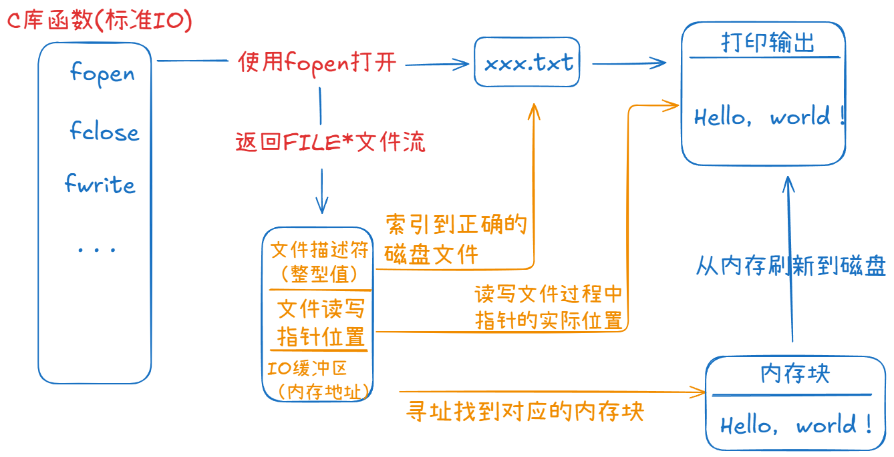
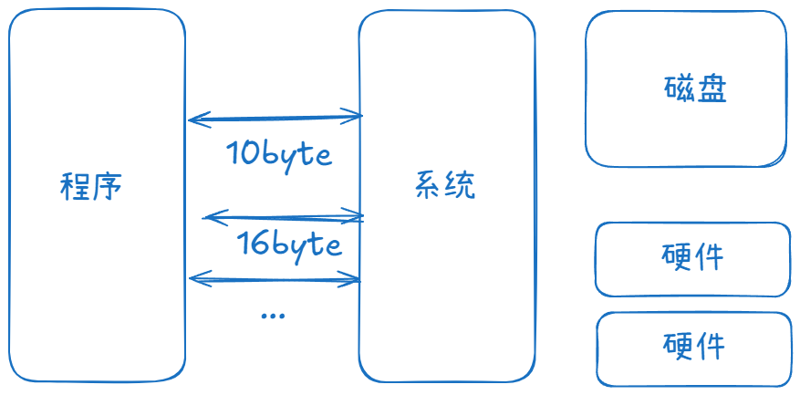
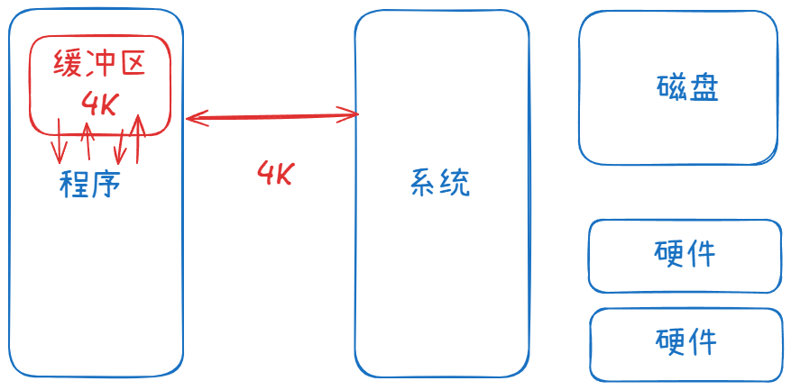
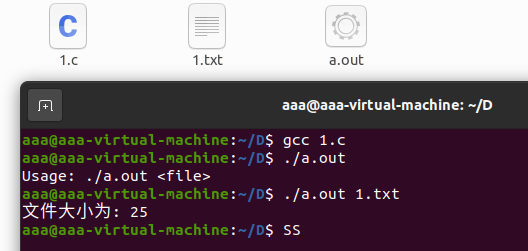
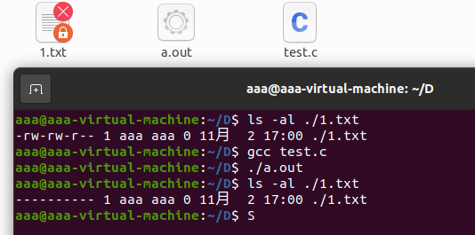

# Linux系统编程

> Linux系统编程将使用 C/C++ 调用 **Linux 提供的系统调用** 与 **库函数** 来完成操作系统级任务。是直接与操作系统内核打交道的编程。


​	**与普通编程的区别：**

| 项目     | 普通编程                     | 系统编程                                    |
| -------- | ---------------------------- | ------------------------------------------- |
| 操作层级 | 仅使用语言库（如 `stdio.h`） | 直接调用内核接口（如 `open()`, `fork()`）   |
| 功能范围 | 算法、逻辑、应用层           | 文件、进程、内存、通信、设备等              |
| 运行权限 | 用户态                       | 用户态 ↔ 内核态切换                         |
| 典型示例 | printf、fopen、for循环       | open、read、write、fork、pipe、mmap         |
| 学习目标 | 写程序                       | 写“系统级”程序（Shell、守护进程、服务器等） |


​	**学习内容：**

| 模块                     | 主要内容                         | 关键函数 / 系统调用                                          |
| ------------------------ | -------------------------------- | ------------------------------------------------------------ |
| **1️⃣ IO**                 | 文件IO、标准IO                   | `open`, `read`, `write`, `lseek`, `close`, `stat`, `chmod`, `mkdir`, `unlink` |
| **2️⃣ 并发程序**           | 进程创建、退出、替换、等待       | `fork`, `exec`, `wait`, `exit`, `getpid`, `getppid`          |
| **3️⃣ 内存管理**           | 动态分配、映射文件、虚拟内存     | `malloc`, `brk`, `mmap`, `munmap`                            |
| **4️⃣ 网络编程（Socket）** | TCP/UDP 通信、服务器与客户端模型 | `socket`, `bind`, `listen`, `accept`, `connect`, `send`, `recv` |

> 由于Linux网络编程部分较为重要，会单独列一笔记出来讲，并为之后的 C++网络编程打基础。


## Linux IO

> IO即 `input` 和 `output` ，在操作系统中IO是**基于文件**实现的，**文件就是一堆相关数据的有序集合**。

> 以下讲到的操作都是基于C语言。


### Linux文件权限

> `Linux` 一切皆文件，无论讲 **标准IO** 还是 **文件IO** 都离不开对文件权限的解读。算是开头吧。

| 文件类型     | 简称 | 说明                                                         |
| ------------ | ---- | ------------------------------------------------------------ |
| 常规文件     | -    | 普通的文本文件或二进制文件，常用于保存用户数据、系统配置文件、日志文件等 |
| 目录文件     | d    | 文件夹，用于组织和管理文件系统中的文件和子目录               |
| 字符设备文件 | c    | 字符设备文件代表字符设备，如键盘、鼠标、串口等。它们提供按字符进行的数据访问。 |
| 块设备文件   | b    | 块设备文件代表块设备，如硬盘、光驱等。它们以固定大小的块进行数据传输。 |
| 管道文件     | p    | 管道文件用于进程间通信，允许一个进程将数据流传递给另一个进程。 |
| 套接字文件   | s    | 套接字文件也是用于进程间通信，但主要用于网络通信。它们支持本地和远程通信。 |
| 符号链接文件 | l    | 符号链接文件类似于快捷方式，它们指向其他文件或目录。         |


#### 权限位

​	每个文件或目录都有以下三种用户，每个用户有三种权限，因此会**表现为9种权限位：**

| 属性                   | 说明                               |
| ---------------------- | ---------------------------------- |
| **所有者（Owner）**    | 文件的创建者，通常是文件的拥有用户 |
| **所属组（Group）**    | 文件所属的用户组                   |
| **其他用户（Others）** | 除了所有者和组内用户之外的所有用户 |

---

| 权限字符 | 对文件的含义             | 对目录的含义          |
| -------- | ------------------------ | --------------------- |
| `r`      | 读取文件内容             | 列出目录内容          |
| `w`      | 修改文件内容             | 在目录中创建/删除文件 |
| `x`      | 运行该文件（如果是程序） | 进入该目录（cd）      |

> `-` 在文件表示普通文件，在权限表示为无权限。


​	**示例（`- r w x r - x r - - `）：**

```bash
// 输入命令
ls -l

// 输出权限
- r w x r - x r - -
```

> 三位为一组，**可能有十位，那么第一位代表文件类型。**


| 部分  | 含义                           |
| ----- | ------------------------------ |
| `-`   | 文件类型（`-`普通文件）        |
| `rwx` | 文件所有者的权限：读、写、执行 |
| `r-x` | 所属组的权限：读、执行         |
| `r--` | 其他用户的权限：只读           |


#### 八进制表示法

> 权限也可以用数字表示，每种权限有一个数值：

| 权限   | 数值 |
| ------ | ---- |
| `r`    | 4    |
| `w`    | 2    |
| `x`    | 1    |
| 无权限 | 0    |


​	三位数字相加组成一个数字来代表一个用户的权限，示例：

| 权限字符串  | 数字表示 | 含义                       |
| ----------- | -------- | -------------------------- |
| `rwxr-xr--` | 754      | owner=7, group=5, others=4 |
| `rw-r--r--` | 644      | owner可读写，组和其他只读  |
| `rwx------` | 700      | 仅所有者完全访问           |
| `rwxrwxrwx` | 777      | 所有人可读写执行（不安全） |


### 标准IO介绍

> 标准IO就是C语言库函数的文件操作部分，讲的内容一样。

​	**注意：**

1. `Linux` 提供了很多库函数供C语言使用，即 **标准IO** 

2. **C语言标准库 I/O** 是基于操作系统文件系统调用的一层高层封装，其基于 **缓冲机制** 减少了系统调用次数，提高了效率。

| 标准 IO                         | 文件 IO                |
| ------------------------------- | ---------------------- |
| 对系统调用IO（即文件 IO）的封装 | 操作系统内部的底层接口 |
| 通过系统调用间接与底层交互      | 直接与底层交互         |

​	**标准IO工作流程：**



- **文件描述符：** 通过这个找到文件的 `inode` ，通过 `inode` 找到对应的数据块
- **文 件  指 针：** 读和写共享一个文件指针。
- **文件缓冲区：** 先进缓冲，减少系统调用次数。


3. **缓冲机制：**

- 无缓冲



- 有缓冲



> 缓存一次性读完，减少系统调用


### 标准IO的打开关闭

#### 打开和关闭

1. **使用 `fopen` 打开标准IO流：**

```cpp
FILE* fopen
(
    //被打开的文件名称
    char const* _FileName,
    //打开模式
    char const* _Mode
);
```

> 打开成功返回 **流指针（FILE结构体指针）**，失败返回NULL


| 打开模式(mode) | 含义         | 文件是否存在的要求                                   |
| -------------- | ------------ | ---------------------------------------------------- |
| “r”或“rb”      | 只读打开     | 文件必须存在                                         |
| “r+”或“r+b”    | 可读可写打开 | 文件必须存在，从文件起始位置写入                     |
| “w”或“wb”      | 仅写打开     | 不存在则创建；存在会清空原有内容                     |
| “w+”或“w+b”    | 可读可写打开 | 不存在则创建；存在会清空原有内容                     |
| “a”或“ab”      | 仅写打开     | 不存在则创建；如已存在且有内容，在文件末尾追加新内容 |


2. **使用 `fclose` 关闭流：**

```cpp
int fclose(FILE* _Stream);
```

> 传入要被关闭的 **流指针（FILE结构体指针）**


| 返回值      | 含义     |
| ----------- | -------- |
| 0           | 关闭成功 |
| EOF（ -1 ） | 关闭失败 |

> 关闭成功自动刷新缓存区


​	**示例：**

```cpp
#include <stdio.h>
int main(void) 
{
    FILE *fp = fopen("test.txt", "w");	//只写打开
    fclose(fp);
    return 0;
}
```

```cpp
#include <stdio.h>
int main()
{
    FILE * fp = fopen("test.txt", "r");	//只读打开，并使用fgets获取每一行
    char line[1024] = "";
    while(fgets(line, 1024, fp) != NULL)
    {
        printf("%s",line);
    }

    fclose(fp);
    return 0;
}
```


#### 处理错误信息

> 打开流的过程中可能会出现错误，标准IO提供了三个可操作对象处理错误信息

| 对象                         | 备注                                        | 头文件     |
| ---------------------------- | ------------------------------------------- | ---------- |
| `extern int errno`           | 错误号                                      | `error.h`  |
| `void perror(const char *s)` | 打印错误信息，输出用户提供字符串s和当前错误 | `stdio.h`  |
| `char * strerror(int errno)` | 根据错误号，返回错误信息字符串              | `string.h` |


​	**示例1，基于perror：**

```cpp
#include <stdio.h>
int main(void)
{
FILE * fp= fopen("test.txt", "r");// 此文件不存在

if (fp == NULL)
{
perror("错误信息是：");
return -1;
}

fclose(fp);
return 0;
}
```


​	**示例2，基于strerror：**

```cpp
#define _CRT_SECURE_NO_WARNINGS
#include <stdio.h>
#include <errno.h>
#include <string.h>

int main(void)
{
    FILE *fp = fopen("test.txt", "r"); // 此文件不存在
    if (fp == NULL)
    {
        printf("错误号是：%d\n", errno);
        printf("错误信息是：%s\n", strerror(errno));
        return -1;
    }
    fclose(fp);
    return 0;
}
```


​	**示例三，对strerror的补充：**

> 为了避免`strerror`的C4996警告，可以使用`strerror_s`函数，需包含 `string.h` 头文件

> 注意`strerror_s`不是c标准库的内容，需要编译器支持c11标准, 所以我们在代码之前打开c11标准扩展, 需提前定义
>
> `#define __STDC_WANT_LIB_EXT1__ 1`, 在使用的时候通过宏`__STDC_LIB_EXT1__`判断，我们的编译器是否支持c11标准扩展

```cpp
int strerror_s (
    //存放错误信息字符串
    char*  _Buffer,
    //大小（bytes），和字符串数组长度一致即可
    unsigned long long _SizeInBytes,
    //错误号
    int    _ErrorNumber
);
```

```cpp
#define __STDC_WANT_LIB_EXT1__ 1
#include <locale.h>
#include <stdio.h>
#include <errno.h>
#include <string.h>

int main(void)
{
    FILE *fp = fopen("test.txt", "r"); // 此文件不存在
    if (fp == NULL)
    {
        printf("错误号是：%d\n", errno);
        char err_msg[1024] = "";
#ifdef __STDC_LIB_EXT1__
        strerror_s(err_msg, 1024, errno);
        printf("错误信息是：%s", err_msg);
#endif
        return -1;
    }
    fclose(fp);
    return 0;
}
```


### 标准IO的输入输出

> 标准IO支持按字符、按行、按对象的方式进行输入和输出。


​	**注意：**

**输入输出的主体对象是程序**

- 如输入就是从键盘或文件获取内容给到程序，是向程序输入内容。
- 输出则是将程序的内容输出到控制台或文件中，是从程序向外输出。


#### 按字符输入

> 常用的三个输入对象

| 函数                       | 作用                                          |
| -------------------------- | --------------------------------------------- |
| `int getchar(void)`        | 从键盘**读取一个**字符，失败返回EOF（-1）     |
| `int fgetc(FILE * stream)` | 从流(各类文件)读取一个字符，失败返回EOF（-1） |
| `int getc(FILE * stream)`  | 从流(各类文件)读取一个字符，失败返回EOF（-1） |


​	**示例：**

1. **`getchar`**

```cpp
#include <stdio.h>
int main(void)
{
    char ch;
    ch = getchar();
    printf("%c\n",ch);
    return 0;
}
```


2. **`fgetc`**

- 从标准输入流读取一个字符

```cpp
#include<stdio.h>
int main(void)
{
    char ch;
    ch = fgetc(stdin);	
    //注意要写换行符号,因为
    printf("%c\n", ch);
}
```


- 从文件循环读取完

```cpp
#include<stdio.h>
int main()
{
    FILE* fp = fopen("ddd.txt","r");
    if(fp == NULL)
    {
        perror("读取文件出错: ");
        return -1;
    }

    char ch = 0;
    //循环读取直到末尾
    while( (ch = fgetc(fp)) != EOF)
    {
        printf("%c", ch);
    }

    fclose(fp);
    return 0;
}
```


3. **`getc`**

​	**`fgetc` 和 `getc`的区别：**

|          | `fgetc`                        | `getc`                           |
| -------- | ------------------------------ | -------------------------------- |
| 功能     | 完全一致                       | 完全一致                         |
| 函数类别 | 库函数（stdio.h）              | 宏函数                           |
| 性能     |                                | 避免堆栈操作，极限性能较高       |
| 主要区别 |                                | 宏函数不能接受带有副作用的表达式 |
| 使用建议 | **无特殊要求建议使用 `fgetc`** |                                  |


#### 按字符输出

| 函数                             | 作用                                                         |
| -------------------------------- | ------------------------------------------------------------ |
| `int putchar(int c)`             | `puchar`函数可以将一个字符输出到`stdout`（标准输出、默认就是控制台） |
| `int fputc(int c, FILE *stream)` | fputc函数可以将一个字符输出到指定流中                        |
| `int putc(int c, FILE *stream)`  |                                                              |


​	**示例：**

1. **`putchar`**

```cpp
#include<stdio.h>
int main(void)
{
    char c = 'a';
    putchar(c);
    putchar('\n');
    return 0;
}
```


2. **`fputc`**

```cpp
#include <stdio.h>
int main(void){
    FILE* fp = fopen("test.txt","w");
    fputc('i',fp);
    fputc('t',fp);
    fputc('h',fp);
    fputc('e',fp);
    fputc('i',fp);
    fputc('m',fp);
    fputc('a',fp);
    fputc('\n',fp);
    fclose(fp);
    return 0;
}
```


3. **`putc`**

​	类比 `fgetc` 和 `getc` 的区别。


#### 按行输入

> 按行输入有两个函数，成功返回指针，失败返回 `NULL`

| 函数                                               | 作用                                          |
| -------------------------------------------------- | --------------------------------------------- |
| `char* gets(char *s)`                              | **不推荐使用 `gets`**，大小严格限制，容易溢出 |
| `char* fgets(char *s, int buf_size, FILE *stream)` |                                               |


1. **`fgets`**

> 读取一行，以换行符号为界限

```cpp
char* fgets(char *s, int buf_size, FILE *stream)
```

参数列表：

- 字符数组
- 缓存区大小
- 文件流


​	**示例：**

```cpp
#include <stdio.h>
int main(void)
{
    char s[5];
    char* p = fgets(s,5,stdin);
    printf("%s\n",s);
    return 0;
}
```

> 输入 `abcde` 也不会出错，只是不读取 `e`


#### 按行输出

> 也是两个函数，失败返回EOF（-1）

| 函数                                     | 作用                                   |
| ---------------------------------------- | -------------------------------------- |
| `int puts(const char *s)`                | `puts`函数用以将指定字符串输出到控制台 |
| `int fputs(const char *s, FILE *stream)` | `fputs`  不会自动添加 `\n`             |


1. **`puts`**

```cpp
#include <stdio.h>
int main(void)
{
    puts("Hello");
    char* s = "itheima";
    puts(s);
    return 0;
}
```


2. **`fputs`**

```cpp
#include <stdio.h>
int main(void)
{
    //输出到标准输出，不自动添加\n
    fputs("Hello\n", stdout);
    FILE * fp = fopen("test.txt","w");
    if(fp == NULL){
        perror("open file: ");
        return -1;
    }

    const char s[] = "Hello \nWorld!!!";
    //返回值非-1表示成功，否则返回EOF(-1)
    int d = fputs(s, fp);
    printf("返回值: %d\n", d);
    if(d == -1){
        perror("写入文件错误：");
    }
    fclose(fp);
    return 0;
}
```


#### 按对象输入输出

> 可以输出输出任意类型的文件

| 函数                                                         | 作用                 |
| ------------------------------------------------------------ | -------------------- |
| `size_t fread(void* ptr,  size_t  size, size_t  n, FILE * fp)` | 从外界读取数据到程序 |
| `size_t fwrite(const void * ptr,  size_t size, size_t n,  FILE * fp)` | 从程序输出数据到外界 |

> size_t 是类型重定义，本体是 unsigned long long


1. **`fread`**

> 程序从外部获得数据

```cpp
size_t fread(void* ptr, size_t size,  size_t n, FILE* fp);
```

**参数列表：**

1. 缓存区指针
2. 一个对象的大小
3. 本次读取多少文件
4. 文件流指针


**工作流程：**

读取指定文件流指针 -  > 本次调用读取n个对象 - > 大小为 `size` - > 将读取的内容存入缓冲区指针


2. **`fwrite`**

> 程序向外输出数据


**参数列表同上**


**工作流程：**

输出内容到指定的文件流指针 -  > 本次调用输出n个对象，每个对象大小为size


​	**示例1，读取文本文件并输出：**

```cpp
#include <stdio.h>
int main(void){
    //缓冲区
    char buf[5];
    //记录fread返回值读取了多少对象
    int bytes_read;
    FILE * fp = fopen("test.txt","r");
    if(fp == NULL){
        perror("打开文件失败: ");
        return -1;
    }

    //读取5个字节
    while((bytes_read = fread(buf,1,5, fp)) > 0){
        //将读取的字节数目输出到标准输出
        fwrite(buf, 1, bytes_read, stdout);
    }

    fclose(fp);
    return 0;
}
```


​	**示例2，输入输出二进制文件：**

```cpp
#include <stdio.h>
int main(void)
{
    FILE* fp = fopen("outfile","w");
    if(fp == NULL){ perror("创建文件失败: "); return -1;}
    //学生结构体类型
    struct Student
    {
        int no;
        char name[10];
        float score;
    };

    struct Student s[] = {{1,"haha", 99}, {2, "lala", 99}};
    fwrite(s, sizeof(struct Student),2, fp);
    fclose(fp);
    return 0;
}
```

> 此时会生成一个二进制文件，再用 `fread` 读取二进制输出到控制台


```cpp
#include <stdio.h>
int main(void){
    int element_num;
    FILE* fp = fopen("outfile", "r");
    if(fp == NULL){
        perror("打开文件失败:");
        return -1;
    }

    struct Student{
        int no;
        char name[10];
        float score;
    };

    struct Student s[5];
    while((element_num = fread(s, sizeof(struct Student), 5, fp)) > 0 ){
        for( int i = 0; i < element_num; i++){
            printf("%d\t%s\t%f\n", s[i].no, s[i].name, s[i].score);
        }
    }

    fclose(fp);
    return 0;
}
```


### 流的操作

> 流就是数据传输的一种抽象概念， 标准IO的操作都是基于 `FILE` 结构体对象进行的 。**是标准IO专属的概念**

```cpp
#ifndef _FILE_DEFINED
	#define _FILE_DEFINED
	typedef struct _iobuf
    {
        void* _Placeholder;
	} FILE;
#endif
```


#### 流的缓冲区

> 流的输入输出信息一般在缓冲区内，当达到某种条件时才会从缓冲区行动。

| 缓冲模式 | 代码     | 备注                                 |
| -------- | -------- | ------------------------------------ |
| 全缓冲   | `_IOFBF` | 缓冲区满了，进行IO操作               |
| 行缓冲   | `_IOLBF` | 在输入和输出中遇到换行符，进行IO操作 |
| 无缓冲   | `_IONBF` | 流不进行缓冲，立刻IO操作             |

​	**默认情况下：**

1. `stdin`行刷新，`stdout` 行刷新（`Windows`无刷新）。

2. 文件的输入输出一般是全刷新。


​	**示例：**

如下测试代码，在Linux系统执行：

```cpp
#include <stdio.h>
#include <unistd.h>

int main(){
    fprintf(stdout,"1\n");
    sleep(3);
    fprintf(stdout,"2, ");
    sleep(3);
    fprintf(stdout,"3\n");
    return 0;
}
```


上述代码，字符1，是立刻输出, 字符2和3等待6秒后一起输出：

```cpp
zack@ubuntu:~/code/01_file$ ./01_out_line_buffer 
1
2, 3
```


#### 设置流的缓冲区模式

> 可以使用 `setvbuf` 函数设置流的缓冲区模式：

```cpp
int setvbuf (FILE* stream, char * buffer, int mode, size_t size)
```

​	**参数列表：**

- `stream`：文件流
- `buffer`：用户提供的缓冲区（设置为NULL系统自动分配内存空间做缓冲区）
- `mode`：缓冲区模式，**见上流的缓冲区处**
- `size`：缓冲区大小（bytes），2 <= size <= INT_MAX(2147483647)


​	**示例：**

```cpp
#include <stdio.h>
int main()
{
    char buff[1024];
    //设置流为无缓冲模式
    int r = setvbuf(stdout, buff, _IOFBF, 1024);
    printf("setvbuf返回值:%d\n", r);
    fputs("haha", stdout);
    printf("test......");
    fgetc(stdin);
    return 0;
}
```

> 设置成行和全缓冲是不会立即输出内容，会在程序关闭输出缓冲流才输出内容，无缓冲就会直接输出。


#### 流的定位

> 在对流进行读写的时候，都会有一个内置的offset，用来记录当前读取或写入的文件位置。

> `offset` 用于确定当前应对对文件的哪个位置进行输入或输出操作。


| 函数                                                  | 作用                                       |
| ----------------------------------------------------- | ------------------------------------------ |
| `long  ftell(FILE *stream);`                          | 返回指定流当前的offset值;失败返回EOF       |
| `long  fseek(FILE *stream, long offset, int whence);` | 设置指定流的offset值;成功返回0;失败返回EOF |
| `void  rewind(FILE* stream);`                         | 将流的offset重置到开头;无返回值            |


1. **`ftell` 函数**

```cpp
#include <stdlib.h>
#include <stdio.h>
int main(void)
{
    // 打开文件
    FILE * fp = fopen("test.txt","w");
    if(fp == NULL)
    {
        perror("");
        return -1;
    }

    printf("写入之前offset: %ld\n", ftell(fp));
    for(int i = 65; i < 65+26; i++)
    {
        fputc(i, fp);
        printf("写入: %c之后, offset： %ld\n", i, ftell(fp));
    }

    fclose(fp);
    return 0;
}
```

> 每次写入，输出值就 +1


2. **`fseek` 函数**

```cpp
long fseek(FILE* stream, long offset, int whence);
```

- whence表示起始位置，可用：**SEEK_SET(开头)** / **SEEK_CUR(当前)** / **SEEK_END(结尾)**
- offset表示基于whence所示位置的偏移量，正数向后负数向前


​	**示例，whence + offset，小于文件开头和超出文件末尾，均回到开头：**

```cpp
#include <stdio.h>
int main(void)
{
    FILE *fp = fopen("test2.txt", "r");
    if(fp == NULL)
    {
        perror("");
        return -1;
    }

    char line[1024];
    fgets(line, 1024, fp);
    printf("%s", line);
    fgets(line,1024, fp);
    printf("%s", line);
    //重置为开头
    fseek(fp,0,SEEK_SET);
    //再次读取文件
    fgets(line, 1024, fp);
    printf("%s",line);
    fseek(fp,2,SEEK_SET);
    fgets(line,1024,fp);
    printf("%s",line);
    fclose(fp);
    return 0;
}
```


3. **`rewind` 函数**

​	**等价于：**

```cpp
fseek(fp,0,SEEK_SET);
```


​	**示例：**

```cpp
#include <stdio.h>
int main(void){
    FILE *fp = fopen("test2.txt","r");
    if(fp == NULL)
    {
        perror("");
        return -1;
    }

    char line[1024];
    fgets(line,1024,fp);
    printf("%s", line);
    rewind(fp);
    fgets(line,1024,fp);
    printf("%s",line);
    fclose(fp);
    return 0;
}
```


#### 流的错误判断

> 标准IO提供了几个函数用于判断流是否出错和结束

| 函数                        | 作用                                                         |
| --------------------------- | ------------------------------------------------------------ |
| `int ferror(FILE* stream);` | `ferror`判断流是否出错，返回值0表示逻辑假，返回值1表示逻辑真 |
| `int feof(FILE* stream);`   | `feof`判断流是否到达文件末尾，返回值0表示逻辑假，返回值1表示逻辑真 |


1. **`ferror` 函数**

```cpp
#include <stdio.h>
int main(void)
{
    FILE* fp = fopen("test2.txt", "r");
    if(fp == NULL)
    {
        perror("");
        return -1;
    }

    if(ferror(fp))
    {
        perror("流出错，错误: ");
    }else
    {
        printf("流一切正常\n");
    }

    fclose(fp);
    return 0;
}
```


2. **`feof` 函数**

```cpp
#include <stdio.h>
int main(void)
{
    FILE* fp = fopen("test2.txt","r");
    if(fp == NULL)
    {
        perror("");
        return -1;
    }

    char line[1024];
    fgets(line,1024,fp);
    printf("流是否达到末尾: %s\n", feof(fp)?"是":"否");
    fgets(line,1024,fp);
    printf("流是否到达末尾: %s\n", feof(fp)?"是":"否");
    fgets(line,1024,fp);
    printf("流是否到达末尾: %s\n", feof(fp)?"是":"否");
    fgets(line,1024,fp);
    printf("流是否到达末尾: %s\n", feof(fp)?"是":"否");
    return 0;
}
```


#### 流的格式化输出

| 函数                                                         | 作用                                                         |
| ------------------------------------------------------------ | ------------------------------------------------------------ |
| `int printf(const char* fmt, ...);`                          | 可以格式化输出字符串到`stdout`文件中                         |
| `int fprintf(FILE*fp, const char* fmt, ...);`                | 用法和`printf`一样，可以将格式化字符串输出到指定文件中       |
| `int sprint(char* buf, const char* fmt, ...);`               | 用法和`printf`一样，可以将格式化字符串输出到指定字符数组中，注意避免缓冲区溢出 |
| `int snprint(char* buf, size_t size, const char* fmt, ...);` | 用法`sprintf`基本一致，参数2可以指定缓冲区大小，避免缓冲区溢出更安全 |
| `(Windows) int sprint_s(char* buf, size_t size, const char* fmt, ...);` | 用法和`snprintf`一致（仅限Windows系统）                      |


​	**示例：**

```cpp
#include <stdio.h>
int main(void)
{
    int year = 2024, month = 6, day = 1;
    FILE* fp = fopen("test3.txt","w");
    if(fp == NULL)
    {
        perror("");
        return -1;
    }

    char buf[1024];
    //月份和日期宽度为2，如果不满足2则用0补充
    fprintf(fp,"%d-%02d-%02d\n",year, month, day);
    //数据输出到buf中
    snprintf(buf,1024,"%d-%02d-%02d\n",year,month,day);
    printf("buf: %s\n", buf);
    fclose(fp);
}
```


###   文件IO介绍

>  **`Linux` 下标准IO基于文件IO实现。** 文件IO就是底层调用，标准IO通过文件IO实现间接调用。

| 标准IO               | 文件IO                         |
| -------------------- | ------------------------------ |
| ANSI C标准           | POSIX标准                      |
| 带缓冲               | 无缓冲                         |
| 流FILE管理打开的文件 | 通过**文件描述符**管理打开文件 |


#### 文件描述符

> 是操作系统为每一个**打开的文件、管道、网络连接等 I/O 资源**分配的一个**非负整数**，用来标识并管理这些资源。

> **文件描述符是 Linux 内核中用于指向已打开文件的索引。**


​	**默认描述符**：每个进程启动时会默认打开 3 个文件描述符：

| 名称               | 文件描述符编号 | 默认连接的对象 | 头文件常量      |
| ------------------ | -------------- | -------------- | --------------- |
| 标准输入（stdin）  | 0              | 键盘           | `STDIN_FILENO`  |
| 标准输出（stdout） | 1              | 终端屏幕       | `STDOUT_FILENO` |
| 标准错误（stderr） | 2              | 终端屏幕       | `STDERR_FILENO` |


### 文件IO的打开关闭

#### open打开/创建

```cpp
#include <fcntl.h>
int open(const char* path, int oflag, ...);
```

- 成功时返回文件描述符，出错时返回EOF
- **打开文件**时使用两个参数
- **创建文件**时使用第三个参数指定新文件的权限
- 设备文件只能通过open打开，而不能通过open创建


```cpp
int open(const char * pathname, int flags, mode_t mode);
```

| 参数        | 作用                                                         |
| ----------- | ------------------------------------------------------------ |
| `pathname`  | 被打开的文件名(可包括路径名)                                 |
| **`flags`** | **O_RDONLY**：只读方式和打开文件                             |
|             | **O_WRONLY**: 只写方式打开文件                               |
|             | **O_RDWR**: 以读写方式打开文件  **（前三者互斥，不能同时出现）** |
|             | **O_CREAT**：如果该文件不存在，就创建一个新的文件，并用第三个参数为其设置权限。<br/>如果文件存在，则打开。 |
|             | **O_EXCL**: 如果使用**O_CREAT**时文件存在，则返回错误消息。这一参数可测试文件是否存在。 |
|             | **O_NOCTTY**：使用本参数时，如文件为终端，那么终端不可以作为调用open()系统调用的那个进程的控制终端。<br/>简单理解，该参数不会为打开的文件成为该进程的控制终端。 |
|             | **O_TRUNC**：如果文件已经存在，那么打开文件时先删除文件中原有数据 |
|             | **O_APPEND**: 以追加的方式打开文件，所以对文件的写操作都在文件的末尾进行。 |
| **mode**    | 被打开文件的存取权限，为8进制表示法。**详见[Linux文件权限](#八进制表示法)** |


​	**示例：**

以读写方式打开文件test.txt，如果文件不存在则创建，如果文件存在则报错。

```cpp
#include <stdio.h>
#include <fcntl.h>
#include <errno.h>

int main(void)
{
    int fd;
    if((fd = open("test.txt", O_RDWR|O_CREAT|O_EXCL, 0666)) < 0)
    {
        if(errno == EEXIST)
        {
            perror("exist error!");
        }
        else
        {
            perror("other error!");
        }
    }
}
```

> `0006` : `0` 表示八进制，`6 6 6` 分别表示三个用户权限，`4 + 2` 即读写权限。


#### close关闭文件

```c
#include <unistd.h>
int close(int fd);
```

- 成功时返回0； 出错时返回EOF；
- 程序结束时自动关闭所有打开的文件
- 文件关闭后，文件描述符不再代表文件，不要使用。


### 文件IO的输入输出

#### 从文件读取

read函数用来从文件中读取数据：

```cpp
#include <unistd.h>
ssize_t read(int fd, void * buf, size_t count);
```

- 成功时返回实际读取的字节数，出错时返回EOF
- 读到文件末尾时返回0
- `buf` 是接受数据的缓冲区
- `count` 不应超过buf大小


​	**示例：**

先创建一个文件，内容是 hello world ！\n hello aaa !

然后读取内容，统计大小。

```cpp
#include <stdio.h>
#include <unistd.h>
#include <fcntl.h>

int main(int argc, char* argv[]){
    //fd为文件描述符, n为读取字节数,total为总字节数
    int fd , n, total = 0;
    char buf[64];
    if(argc < 2){
        printf("Usage: %s <file> \n", argv[0]);
        return -1;
    }

    if((fd = open(argv[1], O_RDONLY)) < 0){
        perror("open");
        return -1;
    }

    while((n = read(fd, buf, 64)) > 0){
        total += n;
    }

    printf("文件大小为: %d\n", total);
}
```




####  输出到文件

write函数用来向文件写入数据：

```cpp
#include <unistd.h>
ssize_t write(int fd, void* buf, size_t count);
```

- 成功时返回实际写入的字节数，出错时返回EOF
- buf是发送数据的缓冲区
- count不应超过`buf`大小


### 文件IO定位

lseek函数用来定位文件

```cpp
#include <unistd.h>
off_t  lseek(int fd, off_t offset, int whence);
```

- 成功时返回当前文件读写位置，出错时返回EOF
- 参数 `offset` 和参数 `whence` 同 [`fseek`](#流的定位) 完全一样
- whence包括 `SEEK_SET`, `SEEK_CUR`,`SEEK_END`


### 文件IO文件属性

#### 修改文件权限

`chmod/fchmod`函数用来修改文件的访问权限：

```cpp
#include <sys/stat.h>
int chmod(const char* path, mode_t mode);
int fchmod(int fd, mode_t mode);
```

- 成功时返回0；出错时返回EOF；
- root和文件所有者能修改文件的访问权限


​	**示例：**

先创建一个文件test.txt，然后写代码将其权限修改为0000

```cpp
#include <stdio.h>
#include <sys/stat.h>

int main(void)
{
    chmod("1.txt",0000);
    return 0;
}
```



​    

#### 获取文件属性

`stat/lstat/fstat`函数用来获取文件属性：

```cpp
#include <sys/stat.h>
int stat(const char* path, struct stat* buf);
int lstat(const char* path, struct stat* buf);
int fstat(int fd, struct stat* buf);
```

- 成功时返回0，出错时返回EOF
- 如果path是符号链接stat获取的是目标文件的属性；而 `lstat` 获取的是链接文件的属性


可以通过 `man 2 stat` 查看 `stat` 结构体内容，即文件属性结构

| 成员                    | 解释           |
| ----------------------- | -------------- |
| **mode_t**  st_mode;    | 类型和访问权限 |
| **uid_t**  st_uid;      | 所有者id       |
| **uid_t**   st_gid;     | 用户组id       |
| **off_t**     st_size;  | 文件大小       |
| **time_t**    st_mtime; | 最后修改时间   |


### 文件IO目录操作

1. **打开目录**

opendir函数用来打开一个目录文件：

```cpp
#include <dirent.h>
DIR * opendir(const char* name);
```

- DIR是用来描述一个打开的目录文件的结构体类型
- 成功时返回目录流指针；出错时返回NULL


2. **读取目录**

readdir函数用来读取目录流中的内容:

```cpp
#include <dirent.h>
struct dirent* readdir(DIR* dirp);
```

- struct dirent是用来描述目录流中一个目录项的结构体类型
- 包含成员char  d_name[256] 参考帮助文档
- 成功时返回目录流dirp中下一个目录项
- 出错或者到末尾时返回NULL


3. **关闭目录**

closedir函数用来关闭一个目录文件：

```cpp
#include <dirent.h>
int closedir(DIR* dirp);
```

- 成功返回0，失败返回EOF


​	**示例，读取指定目录下所有文件名称：**

```cpp
#include <stdio.h>
#include <unistd.h>
#include <errno.h>
#include <string.h>
#include <dirent.h>

int main(int argc, char* argv[])
{
    if(argc < 2)
    {
        printf("Usage : %s <directory>\n", argv[0]);
        return -1;
    }
    DIR * dir_stream;
    struct dirent* dip;
    if((dir_stream = opendir(argv[1])) == NULL)
    {
        perror("open dir failed: ");
        return -1;
    }
    while((dip = readdir(dir_stream)) != NULL)
    {
        printf("%s\n", dip->d_name);
    }

    closedir(dir_stream);
}
```


## Linux并发程序

> 即同时执行多个任务，`Linux` 提供了多种实现并发的机制：**进程并发**、**线程并发**、**IO多路复用** 等...


### 进程介绍

> 进程是操作系统资源调度的基本单位。

#### 进程和程序

| 程序                                     | 进程                                                         |
| ---------------------------------------- | ------------------------------------------------------------ |
| 存放在磁盘上的指令和数据的有效集合(文件) | 执行一个程序所分配的资源的总称，**进程是程序的一次执行过程** |
| 静态的                                   | 动态的，包括创建、调度、执行和消亡                           |


- **正文段：**也称为**代码段（Code Segment）**，主要用于存放程序的机器指令（即可执行的二进制代码）。这是程序的核心部分，包含了程序在运行时需要执行的所有指令。

- **用户数据段：**主要用于存储程序中定义的全局变量和静态变量。这些变量在程序的整个生命周期内都存在，并且可以被多个函数或模块访问。

- **系统数据段：**通常指的是程序运行过程中用于管理和支持程序执行的内存区域。这不仅包括动态分配的内存（如堆和栈），还可能包括由操作系统管理的其他数据结构。**（程序没有系统数据段）**


#### 进程基本结构

​		每个进程都有一系列的控制信息，用来跟踪和管理进程的状态。这些信息通常存储在“进程控制块”（Process Control Block，PCB）中，PCB包含以下内容：

- **进程ID（PID）**：唯一标识进程的标识符。
- **程序计数器（PC）**：指示进程下一条执行指令的位置。
- **进程状态**：记录进程当前的状态（如运行、就绪、阻塞等）。
- **寄存器内容**：存储进程执行时的寄存器状态。
- **内存管理信息**：进程的内存分配、栈、堆等。
- **I/O状态信息**：进程使用的文件描述符、输入输出设备等。
- **优先级**：用于调度的优先级信息。


#### 进程类型

| 前台进程                                                     | 后台进程                                                     | 守护进程                                               |
| ------------------------------------------------------------ | ------------------------------------------------------------ | ------------------------------------------------------ |
| 通常是用户直接启动的应用程序，交互性较强（如图形界面应用）。 | 一般在系统启动时启动，持续在后台运行，提供系统服务（如打印服务、网络服务等）。 | 类似后台进程，一般不会终止，并且通常不与用户直接交互。 |


#### 进程状态/生命周期

进程的状态反映了它当前的执行情况。常见的进程状态有：

- **就绪状态（Ready）**：进程已经准备好，可以执行，但等待CPU的分配。
- **运行状态（Running）**：进程正在执行指令。
- **阻塞状态（Blocked/Waiting）**：进程因某些原因（如I/O等待）而不能继续执行。
- **终止状态（Terminated/Dead）**：进程执行完毕或异常终止，资源将被释放。


进程有从创建到终止的生命周期，具体的生命周期包括：

- **创建（Creation）**：进程由操作系统或父进程通过系统调用（如 `fork()`）创建。
- **就绪（Ready）**：进程被创建后，等待CPU的分配以执行。
- **运行（Running）**：进程获得CPU并开始执行指令。
- **阻塞（Blocked）**：进程由于等待某个事件（如I/O操作完成）被暂停执行。
- **终止（Termination）**：进程执行完毕或遇到错误时结束，释放资源。


### 常用进程命令

#### ps查看进程状态

> 用于查看**静态进程状态** ，**一般搭配 `grep` 使用。**

| 命令 | 选项               | 作用               |
| ---- | ------------------ | ------------------ |
| `ps` | `ps aux`           | 显示所有进程       |
|      | **`ps -ef`**       | 格式化输出所有进程 |
|      | `ps -u <username>` | 查看指定用户进程   |
|      | `ps -p <pid>`      | 查看指定PID的进程  |


​	**示例：**

1. 编写一个死循环程序，编译运行

```cpp
// test.c
#include <stdio.h>
int main()
{
   while(1);
   return 0;
}
```

---

```cpp
gcc test.c
./a.out &
```

> 加上 `&` 让程序后台运行，不会堵塞终端。**也可以不加 `&`，按 `ctrl + z` 手动调度到后台。**


2. `ps`  结合 **`grep 文件名`** 可以更精准的定位目标进程信息。当然可以不搭配输出所有进程。

```cpp
ps -ef | grep test
```


#### top查看进程状态

> 用于查看**动态进程状态**，更偏向于监控

​	**注意：**

- 使用和 `ps` 命令差不多，但是是实时监控
- **交互式工具**，启动后可以进入一个可操作界面：

| 命令 | 作用                                                  |
| ---- | ----------------------------------------------------- |
| `k`  | 终止指定 PID 的进程（类似`kill`）                     |
| `p`  | 按 CPU 使用率排序（默认）                             |
| `M`  | 按内存使用率排序                                      |
| `q`  | 退出`top`                                             |
| `s`  | 修改刷新间隔（如输入`s`后按`5`，设置为 5 秒刷新一次） |


#### nice/renice指定优先级

1. **nice命令**

> 按用户指定的优先级运行进程。

```bash
nice -n 2 ./test
```

​	**注意：**

- 优先级范围从-20到19
- **数值越低优先级越高**
- 普通用户能设置的最低的数值为0，管理员可以设置负数值。


2. **renice命令**

> 改变一个正在运行的进程的优先级

```bahs
renice -n 4 23275
```

​	**注意：**

- 普通用户只能增加数值，不能减少数值，也就是普通用户只能降低优先级。

- 管理员可以减少数值。


#### jobs查看后台进程

> 查看后台进程

```bash
jobs
```

​	**常用：**

| 命令          | 作用                                                       |
| ------------- | ---------------------------------------------------------- |
| **`jobs -l`** | 显示作业 ID 的同时，额外显示进程 PID（方便结合`kill`命令） |
| **`jobs -p`** | 只输出作业对应的 PID（适合管道传递给`kill`等命令）         |
| **`jobs -r`** | 只显示**正在运行**的后台作业                               |
| **`jobs -s`** | 只显示**已暂停**的作业                                     |


​	**示例：**

```bash
# 后台运行一个sleep命令（&表示后台）
sleep 1000 &
# 输出：[1] 12345 （[1]是作业ID，12345是PID）

# 暂停一个前台命令（先运行，再按Ctrl+Z）
sleep 2000
# 按Ctrl+Z后输出：
# [2]+  已停止               sleep 2000

# 查看所有作业
jobs
```

---

输出类似：

```bash
[1]   运行中               sleep 1000 &
[2]+  已停止               sleep 2000
```


#### fg/bg转移进程位置

| 命令 | 作用                                   | 场景示例                                 |
| ---- | -------------------------------------- | ---------------------------------------- |
| `fg` | 将后台作业或暂停的作业切换到**前台**   | 需与进程交互（如输入数据）时，调回前台   |
| `bg` | 将**暂停的作业**切换到**后台**继续运行 | 暂停的进程无需交互，希望在后台继续执行时 |


​	**示例：**

1. 创建作业

- 后台启动一个：

```bash
sleep 1000 &  # 后台运行sleep，输出[1] 12345（[1]是作业ID，12345是PID）
```


- 前台暂停：前台运行命令时按**`Ctrl+Z`**，进程会暂停并进入后台

```bash
sleep 2000  # 前台运行，按Ctrl+Z暂停
# 输出：[2]+  已停止               sleep 2000
```


2. 此时 `jobs` 查看

```bash
jobs
# 输出：
# [1]   运行中               sleep 1000 &
# [2]+  已停止               sleep 2000
```


3. **fg切换到前台**

> 将指定作业从后台或暂停状态切换到前台，此时终端会被该进程占用，**需等待其结束或再次按`Ctrl+Z`暂停。**

```bash
# 将作业2（暂停的sleep 2000）切换到前台
fg 2
# 终端会显示：sleep 2000（此时进程在前台运行，按Ctrl+C可终止，按Ctrl+Z可再次暂停）
```


4. **bg切换到后台**

> 仅对**暂停的作业**有效，使其在后台恢复运行（不再需要前台交互）。

```bash
# 将作业2（暂停的sleep 2000）切换到后台继续运行
bg 2
# 输出：[2]+ sleep 2000 &（此时用jobs查看，状态变为“运行中”）
jobs
# 输出：
# [1]   运行中               sleep 1000 &
# [2]+  运行中               sleep 2000 &
```


#### /proc目录

> 用户和系统管理员可以通过查看 /proc 目录下的文件，获取系统的各种信息，如硬件配置、进程状态、系统负载等，这对于系统监控和性能分析非常有帮助。

1. **还是执行test程序，使用 `top`查看进程 `id`**

2. **`q``退出top`，进入 `/proc` 目录查看相关信息**

```bash
cd /proc
cd 23145 //终端id
```

3. 

```bash
ls //查看文件

cat status //查看文件状态

ls -al fd //查看文件内容
```

 

### 进程创建和结束

#### fork函数

> `fork()` 的作用是**创建子进程**：调用一次，返回两次（父进程和子进程各返回一次），从而实现 “一分为二” 的进程复制。


使用 `fork` 函数创建进程：

```bash
#include <unistd.h>
#include <sys/types.h>	// 注意包含以上两个头文件
#include <stdio.h>

int main()
{
    pid_t pid;	//进程号
    if((pid = fork()) < 0)
    {
        perror("fork");
        return -1;
    }
    else if(pid == 0)
    {
        //获取自进程id
        printf("Child process : my pid is %d\n", getpid());
    }
    else
    {
        //获取父进程id
        printf("Parent process: my pid is %d\n", getpid());
    }
    return 0;
}
```

- **父进程中**：返回子进程的 PID（一个正整数），用于标识新创建的子进程。
- **子进程中**：返回 `0`，表示当前进程是子进程。
- **出错时**：返回 `-1`（如内存不足、进程数达到上限），此时不会创建子进程。


#### 父子进程

> 系统中所有进程的祖先都是 `init` 进程

| 特性          | 父进程                                                       | 子进程                                                       |
| ------------- | ------------------------------------------------------------ | ------------------------------------------------------------ |
| 创建方式      |                                                              | 继承父进程，但有独立的地址空间，**互不影响**                 |
| PID           | 自己的PID                                                    | 新分配的 PID（与父进程不同）                                 |
| PPID          | 自己的 PPID（即祖父进程的 PID）                              | 等于父进程的 PID                                             |
| fork() 返回值 | 返回子进程的 PID（正整数）                                   | 返回 0                                                       |
| **结束时间**  | 若父进程先结束，子进程变成孤儿进程，被 `init` 收养，变成后台进程 | 若子进程先结束，父进程如果没有及时回收，子进程变成僵尸进程。 |
| **执行时间**  | **父子进程在 `fork` 语句后开始独立执行**                     |                                                              |
| **执行顺序**  | **取决于内核调度，无法预测**                                 |                                                              |


#### 结束进程

```bash
#include <stdlib.h>
#include <unistd.h>
void exit(int status);
void _exit(int status);
```

​	**注意：**

- 结束当前的进程并将status返回
- `exit` 结束进程时会刷新(流)缓冲区
- `_exit` 结束进程时不会刷新(流)缓冲区


​	**示例：**

```bash
#include <stdio.h>
#include <stdlib.h>
int main(){
    printf("using exit...\n");
    printf("This is the end");
    exit(0);
}
```

---

```bash
// 输出
using exit...
This is the end
```

> `exit(0)` 强制输出缓冲


```bash
#include <stdio.h>
#include <stdlib.h>
#include <unistd.h>

int main(){
    printf("using exit...\n");
    printf("This is the end");
    _exit(0);
}
```

---

```bash
// 输出
using exit...
```

> `_exit(0)` 不会强制刷新缓冲区


### exec函数族

> `exec` 函数族用于在当前进程中加载并执行新的程序，替换当前进程。
>
> 它是实现进程功能替换的核心工具，常与 `fork()` 配合使用（先创建子进程，再在子进程中执行新程序）。

 

#### execl和execlp

```cpp
#include <unistd.h>
int execl(const char *path, const char* arg,...);
int execlp(const char * file, const char* arg, ...);
```

- 成功时执行指定的程序，失败时返回EOF；
- path 执行的程序名称，包含路径
- arg...  传递给执行的程序的参数列表
- file 执行的程序的名称，在PATH中查找


​	**示例：**

执行ls命令，显示/etc目录下所有文件的详细信息

```cpp
#include <unistd.h>
#include <stdio.h>
int main(void){
    if(execl("/bin/ls","ls","-a","-l","/etc",NULL) < 0){
        perror("execl");
        return -1;
    }

    if(execlp("ls","ls","-a","-l","/etc",NULL) < 0){
        perror("execlp");
        return -1;
    }
    return 0;
}
```


#### execv和execvp

```cpp
#include <unistd.h>
int execv(const char* path, char* const argv[]);
int execvp(const char* file, char* const argv[]);
```

- 成功时执行指定的程序，失败时返回EOF
- arg... 封装成指针数组的形式


​	**示例：**

执行ls命令，显示/etc目录下所有文件的详细信息

```cpp
#include <unistd.h>
#include <stdio.h>

int main(void)
{
    char* arg[] = {"ls","-a","-l","/etc",NULL};
    if(execv("/bin/ls",arg) < 0)
    {
        perror("execv");
        return -1;
    }

    if(execvp("ls",arg) < 0)
    {
        perror("execvp");
        return -1;
    }

    return 0;
}
```


#### system

```cpp
#include <stdlib.h>
int system(const char* command);
```

- 成功时，返回命令command的返回值;失败时返回EOF；
- 当前进程等待command执行结束后才能继续执行


### 进程回收
