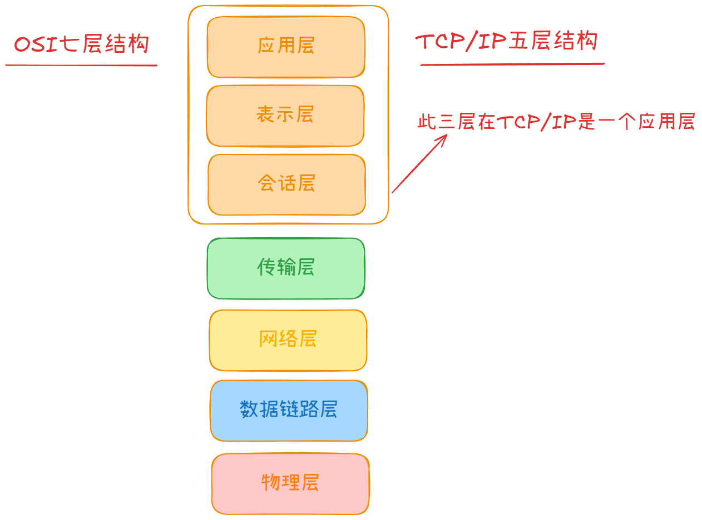
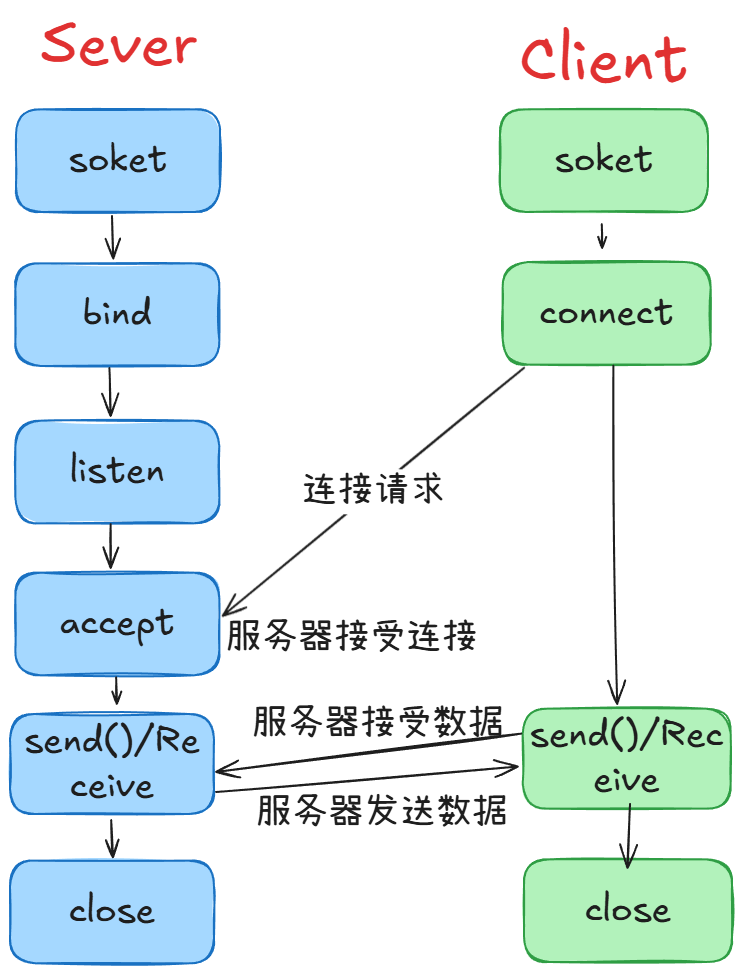
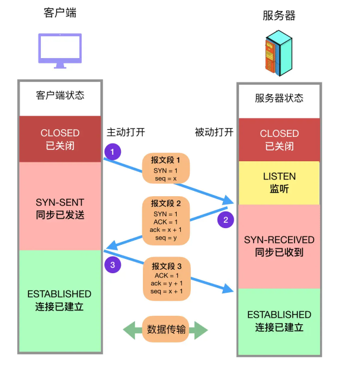
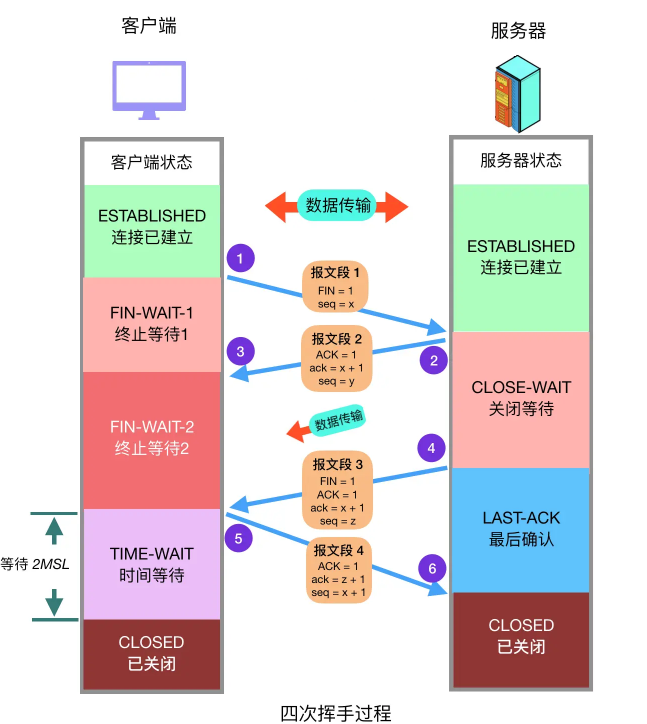
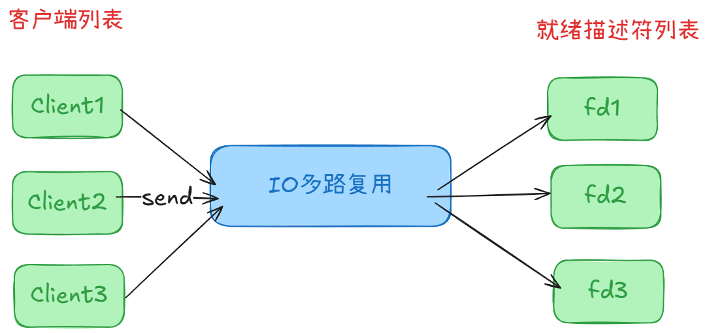

# Linux网络编程

> `Linux` 环境下的网络编程，为C++网络编程打基础。

| 阶段               | 目标                            | 关键词                           |
| ------------------ | ------------------------------- | -------------------------------- |
| 1️⃣ 基础准备         | 能在Linux下熟练开发、编译、调试 | Linux命令、Makefile、gcc、gdb    |
| 2️⃣ 网络基础         | 理解网络通信原理与协议          | OSI、TCP/IP、Socket模型          |
| 3️⃣ Socket编程       | 能写出客户端与服务器通信程序    | TCP、UDP、阻塞与非阻塞IO         |
| 4️⃣ 多路复用与高并发 | 掌握高性能I/O模型               | select、poll、epoll、线程池      |
| 5️⃣ 进阶框架与实践   | 能实现或理解常见网络框架        | Reactor模式、C/S架构、HTTP服务器 |
| 6️⃣ 工程化与安全     | 掌握调优、日志、安全            | 网络安全、性能调优、封装模块化   |


## 网络基础

> 互联网有各种协议以保证数据传输。协议就是互相的约定。


### 两种网络结构

​	**互联网协议体系结构**主要有两种模型：

- **OSI 七层模型**（理论标准）
- **TCP/IP 四层或五层模型**（实际应用）

> 每一层都有其**对应的协议**来完成其功能。


| 对比项   | **OSI 七层模型**      | **TCP/IP 四/五层模型** | 说明                                               |
| -------- | --------------------- | ---------------------- | -------------------------------------------------- |
| 层数     | 7 层                  | 4 或 5 层（视分法）    | TCP/IP 有时把“网络接口层”拆成“数据链路层 + 物理层” |
| 主要用途 | 理论指导、教学标准    | 实际网络协议的实现基础 | TCP/IP 实际用于互联网                              |
| 制定机构 | ISO（国际标准化组织） | 美国国防部（DARPA）    | TCP/IP 是互联网起源体系                            |
| 代表协议 | 各层定义丰富协议      | 以 TCP、IP 为核心      | 实际使用的协议几乎都源于 TCP/IP                    |



> 网络传输过程中，发送端和接受端刚好相反，发送端转换成物理层发出，接受端接受再一步步转换到应用层。


### 各层次协议

> 按层次展示各协议及其作用，以 **TCP/IP** 五层展示：


#### 应用层

> 面向用户的各种网络服务协议，是我们最常接触的一层。

| 协议                   | 端口号         | 功能说明                       |
| ---------------------- | -------------- | ------------------------------ |
| **HTTP / HTTPS**       | 80 / 443       | 网页访问、API通信（HTTPS加密） |
| **FTP / SFTP**         | 21 / 22        | 文件传输协议（SFTP基于SSH）    |
| **SMTP / POP3 / IMAP** | 25 / 110 / 143 | 邮件发送与接收                 |
| **DNS**                | 53             | 域名解析                       |
| **SSH / Telnet**       | 22 / 23        | 远程登录（SSH加密）            |
| **SNMP**               | 161            | 网络设备管理                   |
| **NTP**                | 123            | 网络时间同步                   |
| **DHCP**               | 67 / 68        | 自动分配IP地址                 |
| **LDAP**               | 389            | 目录服务、身份验证             |
| **MQTT**               | 1883           | 物联网消息通信协议             |
| **WebSocket**          | 80 / 443       | 浏览器与服务器的实时通信       |
| **RDP / VNC**          | 3389 / 5900    | 远程桌面控制                   |
| **TLS/SSL**            | -              | 应用层安全协议，HTTPS基础      |


#### 传输层

> （MAC地址 + IP地址 + 端口号）

​	**意义：**

1. **端口号：** 用于标识目标主机上的具体进程（因为一台主机可能同时运行多个网络程序，**端口号用于区分它们**）。

1. **MAC地址(物理地址) + IP地址(网络地址) + 端口号：** 精准在网络中传输数据。

1. **IP地址 + 端口号就是Socket**


| 协议     | 全称                                 | 特点                                            |
| -------- | ------------------------------------ | ----------------------------------------------- |
| **TCP**  | Transmission Control Protocol        | 面向连接，可靠的数据流传输协议（如HTTP、FTP）   |
| **UDP**  | User Datagram Protocol               | 无连接，高速不可靠的数据报传输（如DNS、视频流） |
| **SCTP** | Stream Control Transmission Protocol | 支持多流与多宿主（少见）                        |


#### 网络层

> （MAC地址 + IP地址）

​	**意义：**

1. 引进新的 **IP地址（网络地址）** ，让我们知道不同的计算机是不是属于一个子网络。
2. 负责**寻址与路由选择**，核心协议是 **IP**。负责 **主机到主机通信**。

| 协议                 | 全称                               | 功能                          |
| -------------------- | ---------------------------------- | ----------------------------- |
| **IP (IPv4 / IPv6)** | Internet Protocol                  | 逻辑寻址与分组转发            |
| **ICMP**             | Internet Control Message Protocol  | 网络诊断与错误报告（如 ping） |
| **IGMP**             | Internet Group Management Protocol | 多播组成员管理                |
| **NAT**              | Network Address Translation        | 地址转换（私网 ↔ 公网）       |
| **IPsec**            | IP Security                        | 提供网络层加密与认证          |


#### 数据链路层

> （MAC地址）

​	**意义：**

1. 负责**帧的封装、差错检测、介质访问控制**。
2. 单纯的0/1数据集没意义，此层规定了数据集解读方式。

| 协议     | 全称                         | 功能                               |
| -------- | ---------------------------- | ---------------------------------- |
| **ARP**  | Address Resolution Protocol  | IP 地址 → MAC 地址映射             |
| **RARP** | Reverse ARP                  | MAC 地址 → IP 地址映射（较少使用） |
| **PPP**  | Point-to-Point Protocol      | 用于拨号上网等点对点链路           |
| **HDLC** | High-Level Data Link Control | 面向比特的数据链路控制协议         |


#### 物理层

> 负责**比特传输**，定义电气特性、接口标准。

| 协议/标准                                | 说明                                                        |
| ---------------------------------------- | ----------------------------------------------------------- |
| **Ethernet（以太网）**                   | 局域网常用标准，规定了**MAC地址(物理地址)**、帧结构、速率等 |
| **Wi-Fi（IEEE 802.11）**                 | 无线局域网标准                                              |
| **Bluetooth（蓝牙）**                    | 短距离无线通信                                              |
| **DSL / 光纤 / 光猫**                    | 宽带接入技术                                                |
| **USB / PPP（Point-to-Point Protocol）** | 点对点链路传输协议                                          |


### MAC/IP/端口

> 在网络通信中，数据要从“某个应用程序”传到“另一台主机的某个应用程序”，需要经过三个层次的寻址：

| 概念        | 作用层级       | 比喻                        | 功能                                     |
| :---------- | :------------- | :-------------------------- | :--------------------------------------- |
| **MAC地址** | **数据链路层** | **幸福小区5栋302室**        | **本地局域网**内设备到设备的**物理寻址** |
| **IP地址**  | **网络层**     | **北京市朝阳区幸福路123号** | **跨网络**端到端的**逻辑寻址**           |
| **端口号**  | **传输层**     | **张三 收**                 | **区分同一设备上的不同应用程序**         |

通信流程就是：

```
应用程序（端口） -> 发出请求 -> 操作系统（IP地址） -> 网络接口卡（MAC地址） -> 本地网络 -> 互联网 -> 目标网络 ->
目标设备（MAC地址） -> 目标操作系统（IP地址）-> 目标应用程序（端口）
```


## Socket编程

**Socket（套接字）** 是应用层与传输层之间的**编程接口（API）**，提供了一组函数用于创建和操作Socket 。
它让我们可以像“读写文件”一样，通过网络发送和接收数据。

​	 可以理解为：

> “Socket = 网络通信的文件描述符”

在Linux中，一切皆文件。网络通信用到的 socket，本质上也是一个文件描述符（fd）。


​	传输层和应用层的接口，因此 **Socket 主要讲 TCP和UDP** 。

|              | TCP（传输控制协议）                                          | UDP（用户数据报协议）                                        |
| ------------ | ------------------------------------------------------------ | ------------------------------------------------------------ |
| **核心特点** | 1. 面向连接（需三次握手建立连接）<br />2. 提供可靠性（ACK 确认 + 重传机制）<br />3. 支持流量控制（滑动窗口）<br />4. 支持拥塞控制<br />5. 面向字节流传输 | 1. 无连接（直接发送数据报）<br />2. 不保证可靠性（可能丢包、乱序）<br />3. 低延迟（无连接 / 确认开销）<br />4. 面向数据报传输（单包最大 65507 字节） |
| **优点**     | - 可靠性高，数据传输有保障<br />- 保证数据包按发送顺序到达   | - 协议开销小，传输效率高<br />- 实时性强，延迟低             |
| **缺点**     | - 协议开销大（连接 / 状态维护等）<br />- 延迟较高（连接建立 + 确认机制） | - 可靠性低，无丢包恢复机制<br />- 无顺序保证，需接收方自行处理 |
| **适用场景** | 网页浏览（HTTP/HTTPS）、文件传输（FTP）、电子邮件（SMTP）    | 视频流（流媒体）、语音通话（VoIP）、在线游戏                 |
| **Socket**   | 流式Socket（SOCK_STREAM）：基于TCP协议，面向连接             | 数据报Socket（SOCK_DGRAM）：基于UDP协议，无连接              |


## TCP

### TCP服务器与客户端通信流程

​	**TCP通信的生命周期大体主要有三个阶段：**

| 阶段            | 关键机制                                 | 作用                       |
| --------------- | ---------------------------------------- | -------------------------- |
| **1. 建立连接** | 三次握手                                 | 确立可靠的通信通道         |
| **2. 数据传输** | 确认与重传、滑动窗口、流量控制、拥塞控制 | 保证数据可靠、有序、无丢失 |
| **3. 断开连接** | 四次挥手                                 | 可靠地释放连接资源         |

​	

​	**服务器端和客户端通信各自详细流程对比如下：**

| 角色         | 流程步骤 | 核心操作                             | 说明                                                         |            |      |                        |                                                              |
| ------------ | -------- | ------------------------------------ | ------------------------------------------------------------ | ---------- | ---- | ---------------------- | ------------------------------------------------------------ |
| **服务器端** | 1        | 创建 Socket                          | 使用`socket()`函数，指定协议族（如`AF_INET`）、套接字类型（如`SOCK_STREAM`）和协议（通常为 0）。 | **客户端** | 1    | 创建 Socket            | 使用`socket()`函数，参数与服务器一致（如`AF_INET`+`SOCK_STREAM`）。 |
|              | 2        | 连接服务器（Connect）绑定（Bind）    | 使用`connect()`函数，向服务器的 IP 和端口发起 TCP 连接请求。使用`bind()`函数，将 Socket 与服务器 IP 地址和端口号绑定，确保监听特定地址和端口。 |            | 2    | 连接服务器（Connect）  | 使用`connect()`函数，向服务器的 IP 和端口发起 TCP 连接请求。 |
|              | 3        | 通信（Send & Receive）监听（Listen） | 连接成功后，使用`send()`发送数据、`recv()`接收数据。使用`listen()`函数，将 Socket 设为监听模式，指定挂起连接队列的最大长度。 |            | 3    | 通信（Send & Receive） | 连接成功后，使用`send()`发送数据、`recv()`接收数据。         |
|              | 4        | 关闭连接接受连接（Accept）           | 使用`close()`函数关闭 Socket，释放资源。使用`accept()`函数，阻塞等待并接受客户端连接，返回新的 Socket 描述符用于与该客户端通信。 |            | 4    | 关闭连接               | 使用`close()`函数关闭 Socket，释放资源。                     |
|              | 5        | 通信（Send & Receive）               | 通过新的 Socket 描述符，使用`send()`发送数据、`recv()`接收数据。 |            |      |                        |                                                              |
|              | 6        | 关闭连接                             | 使用`close()`函数关闭与客户端的连接，可继续监听新请求。      |            |      |                        |                                                              |

> 服务器需要经过绑定、监听、接受连接三个额外步骤以建立被动连接，而客户端通过主动发起连接请求直接与服务器建立通信。




#### 三次握手(建立连接)

| 步骤                      | 客户端动作                                                   | 服务器动作                                                   | 说明                                                         |
| ------------------------- | ------------------------------------------------------------ | ------------------------------------------------------------ | ------------------------------------------------------------ |
| **1️⃣ 第一次握手(SYN)**     | 发送报文1 **`SYN=1`、`seq=x`**                               | 等待                                                         | `SYN` 不包含应用层数据<br />x 是客户端随机选择的初始序列号<br />客户端发送报文后从 `CLOSED` 进入 `SYN-SENT` |
| **2️⃣ 第二次握手(SYN+ACK)** | 等待                                                         | 服务器接收客户端报文后同意连接<br />回复报文2： **`SYN=1`、`ACK=1`、`ack=x+1`、seq=y** | **`ack = x+1`**,也就是从客户读端收到报文段序号+1，也代表服务器期望下次收到的客户端数据的序号。<br />        **`seq = y`**表示服务器初始序号为y，发送完报文段2后，服务器从 `LISTEN` 进入 `SYN-RCVD`。 |
| **3️⃣ 第三次握手(ACK)**     | 客户端在收到报文段2后，向服务器发送报文段3：**`ACK = 1`、`ack=y+1`、seq=x+1** | 服务器接收后从 `SYN-RCVD` 进入 `ESTABLISHED`。               | 双方都进入  `ESTABLISHED`，表示连接成功，可以开始全双工数据传输。 |



​	**注意：**

1. **状态变化**

```bash
Client:  CLOSED → SYN_SENT → ESTABLISHED
Server:  CLOSED → LISTEN → SYN_RCVD → ESTABLISHED
```


3. **常见面试题**

| 问                                  | 答                                                           |
| ----------------------------------- | ------------------------------------------------------------ |
| **TCP为什么是三次握手而不是两次？** | 1. **防止已过期的连接请求报文突然又传送到服务器，因而产生错误**。假设双方两次握手即可建立连接的情况下，假设客户端发送A报文段请求建立连接，由于网络原因造成A暂时无法到达服务器，服务器接收不到请求报文段就不会返回确认报文段，客户端在长时间得不到应答的情况下重新发送请求报文段B，这次B顺利到达服务器，服务器随机返回确认报文并进入ESTABLISHED状态，客户端在收到确认报文后，也进入ESTABLISHED状态，双方建立连接并传输数据。之后正常断开连接，此时A报文段才到达服务器，服务器随机返回确认报文并进入ESTABLISHED状态。但是客户端已经进入CLOSED状态，无法再接受确认报文段，更无法进入ESTABLISHED状态，这将导致服务器长时间单方面等待，造成浪费。 |
|                                     | 2. 为了避免第一种情况产生，所以**双方的收发要通过序号保证顺序**，这也是TCP实现可靠传输原因。TCP 报文段中维护了序号字段和确认序号字段，也就是图中的 seq 和 ack，通过这两个字段双方都可以知道在自己发出的数据中，哪些是已经被对方确认接收的。这两个字段的值会在初始序号值得基础递增，如果是两次握手，只有发起方的初始序号可以得到确认，而另一方的初始序号则得不到确认。 |
|                                     | 3. **三次握手才能让双方均确认自己和对方的发送和接收能力都正常**第一次握手：客户端只是发送处请求报文段，什么都无法确认，而服务器可以确认自己的接收能力和对方的发送能力正常；第二次握手：客户端可以确认自己发送能力和接收能力正常，对方发送能力和接收能力正常；第三次握手：服务器可以确认自己发送能力和接收能力正常，对方发送能力和接收能力正常；可见三次握手才能让双方都确认自己和对方的发送和接收能力全部正常，这样就可以愉快地进行通信了。 |

---

| 问                                           | 答                                                           |
| -------------------------------------------- | ------------------------------------------------------------ |
| **TCP 建立连接为什么要三次握手而不是四次？** | 因为三次握手已经可以确认双方的发送接收能力正常，双方都知道彼此已经准备好，而且也可以完成对双方初始序号值得确认，也就无需再第四次握手了 |

---

| 问                       | 答                                                           |
| ------------------------ | ------------------------------------------------------------ |
| **什么是SYN洪泛攻击 ？** | 在三次握手过程中，服务器在收到了客户端的 SYN 报文段后，会分配并初始化连接变量和缓存，并向客户端发送 SYN + ACK 报文段，这相当于是打开了一个“半开连接 (half-open connection)”，会消耗服务器资源。如果客户端正常返回了 ACK 报文段，那么双方可以正常建立连接，否则，服务器在等待一分钟后会终止这个“半开连接”并回收资源。这样的机制为 SYN洪泛攻击 (SYN flood attack)提供了机会，这是一种经典的 DoS攻击 (Denial of Service，拒绝服务攻击)，所谓的拒绝服务攻击就是通过进行攻击，使受害主机或网络不能提供良好的服务，从而间接达到攻击的目的。在 SYN 洪泛攻击中，攻击者发送大量的 SYN 报文段到服务器请求建立连接，但是却不进行第三次握手，这会导致服务器打开大量的半开连接，消耗大量的资源，最终无法进行正常的服务。 |
|                          | 解决方法：SYN Cookies，现在大多数主流操作系统都有这种防御系统。SYN Cookies 是对 TCP 服务器端的三次握手做一些修改，专门用来防范 SYN 洪泛攻击的一种手段。它的原理是，在服务器接收到 SYN 报文段并返回 SYN + ACK 报文段时，不再打开一个半开连接，也不分配资源，而是根据这个 SYN 报文段的重要信息 (包括源和目的 IP 地址，端口号可一个秘密数)，利用特定散列函数计算出一个 cookie 值。这个 cookie 作为将要返回的SYN + ACK 报文段的初始序列号(ISN)。当客户端返回一个 ACK 报文段时，服务器根据首部字段信息计算 cookie，与返回的确认序号(初始序列号 + 1)进行对比，如果相同，则是一个正常连接，然后分配资源并建立连接，否则拒绝建立连接。 |

 

#### 数据传输

> 建立连接后，双方进入 **ESTABLISHED** 状态，此时即可开始数据收发。

| 机制                           | 功能             | 说明                                         |
| ------------------------------ | ---------------- | -------------------------------------------- |
| **序列号（Sequence Number）**  | 保证数据有序     | 每个字节都有唯一编号                         |
| **确认号（ACK Number）**       | 确认已收到的数据 | 表示“期望接收的下一个字节序号”               |
| **滑动窗口（Sliding Window）** | 流量控制         | 根据窗口大小决定一次可发送多少数据           |
| **超时重传（Retransmission）** | 保证可靠性       | 若在超时时间内未收到ACK，重发数据            |
| **拥塞控制**                   | 防止网络过载     | 使用慢启动、拥塞避免、快速重传、快速恢复算法 |


#### 四次挥手(断开连接)

> TCP关闭连接时采用 **四次挥手（Four-way Handshake）** 机制，确保双方都能安全释放资源。**假设由客户端发起关闭：**

| 步骤                  | 客户端                                                       | 服务器                                                       | 说明                                                         |
| --------------------- | ------------------------------------------------------------ | ------------------------------------------------------------ | ------------------------------------------------------------ |
| **1️⃣ 第一次挥手(FIN)** | 客户端发送 **`FIN=1`、`seq=u`** 报文,表示自己不再发送数据。  |                                                              | 客户端从 `ESTABLISHED` 进入 `FIN-WAIT-1`。**客户端表示自己不发了。** |
| **2️⃣ 第二次挥手(ACK)** | 收到服务器发送的 `ACK` 后，从 `FIN-WAIT-1` 进入 `FIN-WAIT-2`。 | 收到客户端的`FIN`后回复一个`ACK`进行确认，从 `ESTABLISHED` 进入 `CLOSE-WAIT`。 | **服务器知道客户端不发了**，但服务器可能还有数据要发送给客户端。 |
| **3️⃣ 第三次挥手(FIN)** |                                                              | 服务器处理完待发数据后(发给客户端)，发送一个 **`FIN`** 给客户端 | 服务器从 `CLOSE-WAIT` 进入 `LAST-ACK`。**表示“我也不再发送数据了”** |
| **4️⃣ 第四次挥手(ACK)** | 客户端收到服务器的 `FIN` 后，发送一个 `ACK` 进行确认。<br />客户端从 `FIN-WAIT-2` 进入 `TIME-WAIT`，等待 **2MSL**（最长报文段寿命的两倍时间）后，状态变为 `CLOSED`。 | 服务器收到 ACK 后，**服务器状态**：从 `LAST-ACK` 进入 `CLOSED`。 | 连接彻底关闭                                                 |




​	**注意：**

1. **状态变化**

```bash
Client:  ESTABLISHED → FIN_WAIT_1 → FIN_WAIT_2 → TIME_WAIT → CLOSED
Server:  ESTABLISHED → CLOSE_WAIT → LAST_ACK → CLOSED
```


2. **为什么要握手四次：**

-  TCP 连接是全双工 (即数据在两个方向上能同时传递)， 因此每个方向必须单独地进行关闭。
-  每一方都需要单独发送一个 `FIN` 来表示自己不再发送数据。当一端收到一个 FIN，它必须通知应用层另一端已经终止了数据传送。
- 理论上客户端和服务器都可以发起主动关闭，但是更多的情况下是客户端主动发起。


3. **常见面试题**

| 问                                          | 答                                                           |
| ------------------------------------------- | ------------------------------------------------------------ |
| **为什么TCP关闭连接要四次挥手而不是三次？** | 1. 服务器在收到客户端的FIN报文段后，可能还有一些数据要传输(TCP全双工)，所以不能马上关闭连接，但是会做出应答。 |
|                                             | 2. 返回ACK报文段，接下来可能会继续发送数据，在数据发送完后，服务器会向客户端发送FIN报文，表示会数据发送完毕， |
|                                             | 3. 请求关闭连接，然后客户端做出应答，所以一共要四次握手。    |

---

| 问                                                           | 答                                                           |
| ------------------------------------------------------------ | ------------------------------------------------------------ |
| **为什么客户端要在TIME-WAIT 状态等待2MSL时间才能进入CLOSED状态？** | 1. 按照常理，在网络正常的情况下，四个报文段发送完后，双方就可以关闭连接进入CLOSED状态了，但是网络并不总是可靠。 |
|                                                              | 2.   **确保最后一个ACK被接收**如果客户端发送的ACK报文段丢失，服务器在接受不到ACK的情况下会重发FIN报文段。主动关闭方在TIME_WAIT状态下若接收到这样的重复FIN包，可以再次发送ACK包，确保连接最终正确关闭。 |
|                                                              | 3.   **清理网络中的遗留数据包**TCP是一个面向字节流的协议，数据包在网络中传输可能会存在延迟或重传的情况。等待2MSL时间可以确保：<br />        **消除网络中滞留的数据包**：确保所有与该连接相关的滞留数据包（如延迟的FIN或ACK包）在TIME_WAIT状态结束前已经从网络中消失。<br />        **防止旧的数据包干扰新的连接**：在同一对端之间，新的TCP连接可能会复用相同的五元组（源IP、源端口、目的IP、目的端口、协议）。如果旧的连接的某些数据包迟到了，新连接可能会错误地处理这些数据包。2MSL的等待时间确保旧连接的所有数据包都已过期，不会影响新连接。 |


### TCP网络编程API

> 以下讲的都是 **C 语言（基于 POSIX 标准，Linux/Unix）** ，核心依赖 `<sys/socket.h>` 等头文件，主要 API 如下：
>
> API流程和 [通信流程](#TCP服务器与客户端通信流程) 相同。
>


#### 创建socket

```cpp
int socket(int domain, int type, int protocol);
```

- `domain`：地址族（如 `AF_INET` 表示 IPv4，`AF_INET6` 表示 IPv6）。
- `type`：套接字类型（`SOCK_STREAM` 默认表示 TCP，`SOCK_DGRAM` 默认表示 UDP）。
- `protocol`：协议类型（通常为 0，自动选择与 `type` 对应的协议）。
- 返回值：成功返回**套接字描述符（非负整数）**，失败返回 - 1。


​	**示例：**

```cpp
int sockfd = socket(AF_INET, SOCK_STREAM, 0);
if (sockfd < 0)
{
    perror("socket creation failed");
    exit(EXIT_FAILURE);
}
```


#### 服务器绑定地址和端口

> 将Socket绑定到一个本地的IP地址和端口，用于服务器端。

```cpp
int bind(int sockfd, const struct sockaddr *addr, socklen_t addrlen);
```

- `sockfd`：`socket()` 返回的套接字描述符。
- `addr`：指向包含 IP 地址和端口的结构体（如 `struct sockaddr_in` 用于 IPv4）。
- `addrlen`：`addr` 结构体的长度。
- 返回值：成功返回 0，失败返回 - 1。


服务器绑定地址和端口还需要更多方面的知识点补充如下：

##### sockaddr结构体

> 分为 `struct sockaddr` 和 `struct sockaddr`_in ,  是 TCP/IP 协议族中用于 **表示网络地址信息** 的关键结构。

​	**作用：**

​		在网络编程中，套接字（socket）需要与具体的 **IP 地址** 和 **端口号** 绑定（服务器端 `bind` 操作），或通过地址信息连接远程服务器（客户端 `connect` 操作）。这两个结构体的核心作用就是 **标准化地存储和传递网络地址信息**，让操作系统能够识别 “数据要发送到哪里” 或 “从哪里接收数据”。


1. **`struct sockaddr` **

> 一个通用的地址结构体，用于兼容不同的地址族（如 IPv4、IPv6、本地套接字等），定义如下：

```cpp
struct sockaddr 
{
    sa_family_t sa_family;  // 地址族（如AF_INET表示IPv4，AF_UNIX表示本地套接字）
    char        sa_data[14]; // 地址数据（具体内容取决于地址族，长度固定为14字节）
};
```

- **特点**：通用性强，但不直观，因为 `sa_data` 是一个混合存储 IP 和端口的字节数组，不方便直接操作。
- **用途**：作为系统调用（如 `bind`、`connect`、`accept`）的参数类型，因为这些函数需要接收 “任意类型的地址”，通过 `sa_family` 区分具体地址族。


2. **`struct sockaddr_in`**

> 专门用于存储 **IPv4 地址和端口号**，定义如下：

```cpp
struct sockaddr_in 
{
    sa_family_t    sin_family;  // 地址族（必须为AF_INET，表示IPv4）
    in_port_t      sin_port;    // 端口号（网络字节序，需用htons()转换）
    struct in_addr sin_addr;    // IPv4地址（网络字节序，需用inet_addr()等转换）
    unsigned char  sin_zero[8]; // 填充字段（为了与struct sockaddr大小一致，通常设为0）
};

// 其中struct in_addr用于存储IPv4地址（32位整数）：
struct in_addr 
{
    in_addr_t s_addr;  // IPv4地址（网络字节序，如192.168.1.1对应0xc0a80101）
};
```

- **特点**：结构化设计，直观区分端口和 IP 地址，方便程序员操作。
- **用途**：实际编程中用于存储 IPv4 地址信息，**使用时需强制转换为 `struct sockaddr*` 传给系统调用**（因为系统调用只认通用结构体）。


3. **为什么需要两种结构体？**

- **兼容性**：`struct sockaddr` 作为通用接口，让同一套系统调用（`bind`、`connect` 等）可以支持不同的地址族（如 IPv4、IPv6），无需为每种地址族单独设计函数。
- **易用性**：`struct sockaddr_in` 针对 IPv4 场景优化，将端口和 IP 地址分开存储，便于程序员设置和读取（避免直接操作字节数组）。


##### 大端和小端

> 网络字节序，TCP 数据的 “格式约定”。

​	**作用：**

​		TCP 协议运行在不同架构的计算机之间（如 x86 小端、PowerPC 大端），而多字节数据（如端口号、IP 地址）在内存中的存储方式可能不同。为了避免数据解析错误，TCP 必须遵循 **统一的字节序标准**，这就是大端（网络字节序）的作用。


1. **对比**

| 特性           | 大端（Big Endian）           | 小端（Little Endian）                  |
| -------------- | ---------------------------- | -------------------------------------- |
| **存储顺序**   | 高位字节在前，低位字节在后   | 低位字节在前，高位字节在后             |
| **直观性**     | 更符合人类阅读习惯           | 不符合人类直观阅读习惯                 |
| **常见应用**   | 网络协议（如TCP/IP采用大端） | x86架构的CPU（如Intel、AMD等）采用小端 |
| **调试易读性** | 高位字节优先，调试时更直观   | 需要逆序查看，调试时不太直观           |


2. **网络通信（最常见）**

   网络协议（如 TCP/IP）规定：**网络字节序必须为大端**。

​		因此，当主机（可能是大端或小端）向网络发送数据时，需先将数据从 “主机字节序” 转换为 “网络字节序”；接收数据时，再从 “网络字节序” 转换为 “主机字节序”。

POSIX 标准提供了转换函数（定义在 `<arpa/inet.h>`）：

| `htons()` | 主机字节序 → 网络字节序（16 位，用于端口号）。   |
| --------- | ------------------------------------------------ |
| `htonl()` | 主机字节序 → 网络字节序（32 位，用于 IP 地址）。 |
| `ntohs()` | 网络字节序 → 主机字节序（16 位）。               |
| `ntohl()` | 网络字节序 → 主机字节序（32 位）。               |

​	**示例：**

```cpp
struct sockaddr_in addr;
addr.sin_port = htons(8080); // 绑定端口时将主机字节序的8080转换为网络字节序
```


3. **如何判断主机字节序？**

> 代码检验

```cpp
#include <stdio.h>
int main() 
{
    int num = 0x12345678;
    char *p = (char*)&num; // 取首地址（低地址）
    if (*p == 0x78) {
        printf("小端（Little-Endian）\n");
    } else if (*p == 0x12) {
        printf("大端（Big-Endian）\n");
    }
    return 0;
}
```


#### 服务器监听

> 将Socket设为监听模式，准备接受连接请求。

```cpp
int listen(int sockfd, int backlog);
```

- `sockfd`：已绑定的Socket文件描述符。
- `backlog`：挂起连接请求队列的最大长度。
- 返回值：成功返回 0，失败返回 - 1。


​	**示例：**

```cpp
if (listen(sockfd, 5) < 0) 
{ // 队列长度设为5
    perror("listen failed");
    close(sockfd);
    exit(EXIT_FAILURE);
}
```


#### 服务器接受连接

> 接受一个进入的连接请求，并返回一个新的Socket用于与该客户端通信。

```cpp
int accept(int sockfd, struct sockaddr *addr, socklen_t *addrlen);
```

- `sockfd`：监听状态的Socket文件描述符。
- `addr`：指向`sockaddr`结构体，用于存储客户端地址信息（可选）。
- `addrlen`：`addr`结构体的大小（可选）。
- 返回值：成功返回新的用于通信的Socket文件描述符。，失败返回 - 1，并设置 `errno`。


​	**实例：**

```cpp
struct sockaddr_in client_addr;
socklen_t client_len = sizeof(client_addr);
int new_sock = accept(sockfd, (struct sockaddr *)&client_addr, &client_len);
if (new_sock < 0) 
{
    perror("accept failed");
    close(sockfd);
    exit(EXIT_FAILURE);
}
```


#### 客户端发起连接

> 客户端发起与服务器的连接请求。

```cpp
int connect(int sockfd, const struct sockaddr *addr, socklen_t addrlen);
```

- `sockfd`：未连接的Socket文件描述符。
- `addr`：指向包含服务器地址信息的`sockaddr`结构体。
- `addrlen`：`addr`结构体的大小。
- 返回值：成功返回 0 ，失败返回 -1 ，并设置 `errno`


​	**示例：**

```cpp
struct sockaddr_in server_addr;
memset(&server_addr, 0, sizeof(server_addr));
server_addr.sin_family = AF_INET;
server_addr.sin_port = htons(8080);
inet_pton(AF_INET, "127.0.0.1", &server_addr.sin_addr); // 服务器IP地址

if (connect(sockfd, (struct sockaddr *)&server_addr, sizeof(server_addr)) < 0) 
{
    perror("connect failed");
    close(sockfd);
    exit(EXIT_FAILURE);
}
```


​	**`inet_pton` 函数简介**

```cpp
int inet_pton(int af, const char *src, void *dst);
```

> 函数用于将 IP 地址从**文本字符串格式转换为二进制格式**。它支持 IPv4 和 IPv6 地址。

- `af`：地址族（Address Family），指定使用的协议族。常用值包括：

- - `AF_INET`：用于 IPv4 地址。
  - `AF_INET6`：用于 IPv6 地址。

- `src`：指向包含 IP 地址文本字符串的指针。例如 `"127.0.0.1"`。
- `dst`：指向存储转换后二进制地址的缓冲区的指针。对于 IPv4，通常是 `struct in_addr` 结构体的地址；对于 IPv6，则是 `struct in6_addr` 结构体的地址。

- 成功时，返回 `1` ；如果输入的 IP 地址字符串无效，返回 `0` ；出错时，返回 `-1`，并设置 `errno`。


#### 发送和接受

> 也可使用通用 I/O 函数 `read()`/`write()`。

```cpp
ssize_t send(int sockfd, const void *buf, size_t len, int flags);
```

---

```cpp
ssize_t recv(int sockfd, void *buf, size_t len, int flags);
```

- `sockfd`：已连接的Socket文件描述符。
- `buf`：指向发送或接收数据的缓冲区。
- `len`：缓冲区大小（字节数）。
- `flags`：通常设为`0`，可使用特定标志（如`MSG_WAITALL`等）。

- 成功：

- - `send()`：返回发送的字节数。
  - `recv()`：返回接收的字节数。

- 失败：返回`-1`，并设置`errno`。

- 连接关闭：`recv()`返回`0`。


**示例：**

```cpp
// 发送数据
const char *message = "Hello, Server!";
ssize_t bytes_sent = send(new_sock, message, strlen(message), 0);
if (bytes_sent < 0)
{
    perror("send failed");
}
```

---

```cpp
// 接收数据
char buffer[1024];
ssize_t bytes_received = recv(new_sock, buffer, sizeof(buffer) - 1, 0);
if (bytes_received < 0) 
{
    perror("recv failed");
} else if (bytes_received == 0) 
{
    printf("Connection closed by peer\n");
} else 
{
    buffer[bytes_received] = '\0';
    printf("Received: %s\n", buffer);
}
```


#### close()

> 关闭一个Socket，释放资源。

```cpp
int close(int sockfd);
```

- `sockfd`：要关闭的Socket文件描述符。
- 成功：返回`0`。失败：返回`-1`，并设置`errno`。


​	**示例：**

```cpp
if (close(new_sock) < 0) 
{
    perror("close failed");
}
```

 

### 实战

> 展示阻塞和非阻塞的写法，

#### TCP阻塞实战示例

1. 基于上诉API完成的一个阻塞模型的**服务器**

```c
// server.c
#include <stdio.h>
#include <stdlib.h>
#include <string.h>
#include <unistd.h> // close()
#include <arpa/inet.h> // inet_pton()
#include <sys/socket.h>
#include <netinet/in.h>

#define PORT 8080
#define BUFFER_SIZE 1024

int main() 
{
    int server_fd, new_socket;
    struct sockaddr_in address;
    char buffer[BUFFER_SIZE] = {0};
    const char *response = "Hello, Client!";
    socklen_t addr_len = sizeof(address);

    // 创建Socket
    if ((server_fd = socket(AF_INET, SOCK_STREAM, 0)) == 0) {
        perror("socket failed");
        exit(EXIT_FAILURE);
    }

    // 绑定
    address.sin_family = AF_INET;
    address.sin_addr.s_addr = INADDR_ANY; // 监听所有接口
    address.sin_port = htons(PORT);

    if (bind(server_fd, (struct sockaddr *)&address, sizeof(address)) < 0) {
        perror("bind failed");
        close(server_fd);
        exit(EXIT_FAILURE);
    }

    // 监听
    if (listen(server_fd, 3) < 0) { // 队列长度设为3
        perror("listen failed");
        close(server_fd);
        exit(EXIT_FAILURE);
    }

    printf("Server is listening on port %d...\n", PORT);

    // 接受连接
    if ((new_socket = accept(server_fd, (struct sockaddr *)&address, &addr_len)) < 0) {
        perror("accept failed");
        close(server_fd);
        exit(EXIT_FAILURE);
    }

    // 接收数据
    ssize_t bytes_received = recv(new_socket, buffer, BUFFER_SIZE - 1, 0);
    if (bytes_received < 0) {
        perror("recv failed");
    } else {
        buffer[bytes_received] = '\0';
        printf("Received from client: %s\n", buffer);
    }

    // 发送数据
    if (send(new_socket, response, strlen(response), 0) < 0) {
        perror("send failed");
    } else {
        printf("Response sent to client.\n");
    }

    // 关闭连接
    close(new_socket);
    close(server_fd);
    return 0;
}
```

---

2. 基于上诉API完成的一个阻塞模型的**客户端**

```cpp
// client.c
#include <stdio.h>
#include <stdlib.h>
#include <string.h>
#include <unistd.h> // close()
#include <arpa/inet.h> // inet_pton()
#include <sys/socket.h>
#include <netinet/in.h>

#define PORT 8080
#define BUFFER_SIZE 1024

int main() 
{
    int sockfd;
    struct sockaddr_in server_addr;
    char buffer[BUFFER_SIZE] = {0};
    const char *message = "Hello, Server!";

    // 创建Socket
    if ((sockfd = socket(AF_INET, SOCK_STREAM, 0)) < 0) {
        perror("socket creation failed");
        exit(EXIT_FAILURE);
    }

    // 定义服务器地址
    server_addr.sin_family = AF_INET;
    server_addr.sin_port = htons(PORT);

    // 将IPv4地址从文本转换为二进制
    if (inet_pton(AF_INET, "127.0.0.1", &server_addr.sin_addr) <= 0) {
        perror("invalid address");
        close(sockfd);
        exit(EXIT_FAILURE);
    }

    // 连接服务器
    if (connect(sockfd, (struct sockaddr *)&server_addr, sizeof(server_addr)) < 0) {
        perror("connection failed");
        close(sockfd);
        exit(EXIT_FAILURE);
    }

    // 发送数据
    if (send(sockfd, message, strlen(message), 0) < 0) {
        perror("send failed");
    } else {
        printf("Message sent to server.\n");
    }

    // 接收数据
    ssize_t bytes_received = recv(sockfd, buffer, BUFFER_SIZE - 1, 0);
    if (bytes_received < 0) {
        perror("recv failed");
    } else if (bytes_received == 0) {
        printf("Connection closed by server.\n");
    } else {
        buffer[bytes_received] = '\0';
        printf("Received from server: %s\n", buffer);
    }

    // 关闭连接
    close(sockfd);
    return 0;
}
```


3. **操作流程：**

- 分别编译客户端和服务器

```cpp
gcc block_tcp_client.c -o block_tcp_client
gcc block_tcp_server.c -o block_tcp_server
```


- 先启动服务器， `&` 后台运行 或 新建窗口后再启动客户端

```cpp
./block_tcp_server
    
./block_tcp_client
```

 

4. **弊端**

因为采用的是阻塞模型的服务器，所以一个操作没有完成是无法开展另一个操作的。


## UDP

### UDP网络编程API

#### 创建socket

```cpp
int socket(int domain, int type, int protocol);
```

- `domain`：地址族（如 `AF_INET` 表示 IPv4，`AF_INET6` 表示 IPv6）。
- `type`：套接字类型（`SOCK_STREAM` 默认表示 TCP，**`SOCK_DGRAM` 默认表示 UDP**）。
- `protocol`：协议类型（通常为 0，自动选择与 `type` 对应的协议）。
- 返回值：成功返回**套接字描述符（非负整数）**，失败返回 - 1。


#### 绑定

```cpp
int bind(int sockfd, const struct sockaddr *addr, socklen_t addrlen);
```

- `sockfd`：`socket()` 返回的套接字描述符。
- `addr`：指向包含 IP 地址和端口的结构体（如 `struct sockaddr_in` 用于 IPv4）。
- `addrlen`：`addr` 结构体的长度。
- 返回值：成功返回 0，失败返回 - 1。


#### 发送数据(无连接)

> 向指定的目标地址发送数据，无需连接。

```cpp
ssize_t sendto(int sockfd, const void *buf, size_t len, int flags,
               const struct sockaddr *dest_addr, socklen_t addrlen);
```

- `sockfd`：套接字描述符。
- `buf`：待发送数据的缓冲区。
- `len`：数据长度。
- 
- `dest_addr`：目标主机的地址结构(`sockaddr`)。
- `addrlen`：地址结构的长度。
- 返回值：成功返回发送的字节数，失败返回 `-1`。


#### 接收数据

> 从套接字接收数据，并获取发送方的地址信息。

```cpp
ssize_t recvfrom(int sockfd, void *buf, size_t len, int flags,
                struct sockaddr *src_addr, socklen_t *addrlen);
```

- `sockfd`：套接字描述符。
- `buf`：接收数据的缓冲区。
- `len`：缓冲区长度。
- `flags`：发送标志（通常为 `0`）。
- `src_addr`：用于存储发送方地址的 `sockaddr` 结构（可设为 `NULL`）。
- `addrlen`：输入时为 `src_addr` 缓冲区长度，输出时为实际地址长度。
- 返回值：成功返回接收的字节数，失败返回 `-1`。


#### 其他相关函数

- `inet_pton()` 和 `inet_ntop()`：用于地址转换，IPv4和IPv6。
- `htons()` 和 `ntohs()`：主机字节序与网络字节序转换。
- `close()`：关闭套接字描述符。


### 实战

```cpp
// udp_server.c
#include <stdio.h>
#include <stdlib.h>
#include <string.h>
#include <unistd.h>        // close()
#include <arpa/inet.h>     // inet_ntoa()
#include <sys/socket.h>
#include <netinet/in.h>

#define PORT 8080
#define BUFFER_SIZE 1024

int main()
{
    int sockfd;
    struct sockaddr_in server_addr, client_addr;
    char buffer[BUFFER_SIZE];
    const char *response = "Hello, UDP Client!";
    socklen_t addr_len = sizeof(client_addr);
    ssize_t bytes_received, bytes_sent;

    // 创建UDP套接字
    if ((sockfd = socket(AF_INET, SOCK_DGRAM, 0)) < 0)
    {
        perror("socket creation failed");
        exit(EXIT_FAILURE);
    }

    // 填充服务器信息
    memset(&server_addr, 0, sizeof(server_addr));        // 清零
    server_addr.sin_family = AF_INET;                    // IPv4
    server_addr.sin_addr.s_addr = INADDR_ANY;            // 监听所有接口
    server_addr.sin_port = htons(PORT);                  // 端口

    // 绑定套接字到指定IP和端口
    if (bind(sockfd, (const struct sockaddr *)&server_addr, sizeof(server_addr)) < 0)
    {
        perror("bind failed");
        close(sockfd);
        exit(EXIT_FAILURE);
    }

    printf("UDP Server is listening on port %d...\n", PORT);

    while (1)
    {
        // 接收数据
        bytes_received = recvfrom(sockfd, buffer, BUFFER_SIZE - 1, 0,
                                  (struct sockaddr *)&client_addr, &addr_len);
        if (bytes_received < 0)
        {
            perror("recvfrom failed");
            continue;   // 继续接收下一个数据包
        }

        buffer[bytes_received] = '\0';    // null终止
        printf("Received from %s:%d: %s\n",
               inet_ntoa(client_addr.sin_addr),
               ntohs(client_addr.sin_port),
               buffer);

        // 发送响应
        bytes_sent = sendto(sockfd, response, strlen(response), 0,
                            (struct sockaddr *)&client_addr, addr_len);
        if (bytes_sent < 0)
        {
            perror("sendto failed");
            continue;
        }

        printf("Sent response to %s:%d\n",
               inet_ntoa(client_addr.sin_addr),
               ntohs(client_addr.sin_port));
    }

    // 关闭套接字（实际上，此处不会被执行到）
    close(sockfd);
    return 0;
}
```

---

```cpp
// udp_client.c
#include <stdio.h>
#include <stdlib.h>
#include <string.h>
#include <unistd.h>        // close()
#include <arpa/inet.h>     // inet_pton()
#include <sys/socket.h>
#include <netinet/in.h>

#define SERVER_PORT 8080
#define BUFFER_SIZE 1024
#define SERVER_IP "127.0.0.1"    // 本地服务器

int main()
{
    int sockfd;
    struct sockaddr_in server_addr;
    char buffer[BUFFER_SIZE];
    const char *message = "Hello, UDP Server!";
    socklen_t addr_len = sizeof(server_addr);
    ssize_t bytes_sent, bytes_received;

    // 创建UDP套接字
    if ((sockfd = socket(AF_INET, SOCK_DGRAM, 0)) < 0)
    {
        perror("socket creation failed");
        exit(EXIT_FAILURE);
    }

    // 填充服务器信息
    memset(&server_addr, 0, sizeof(server_addr));
    server_addr.sin_family = AF_INET;
    server_addr.sin_port = htons(SERVER_PORT);

    // 转换服务器IP地址
    if (inet_pton(AF_INET, SERVER_IP, &server_addr.sin_addr) <= 0)
    {
        perror("Invalid address/ Address not supported");
        close(sockfd);
        exit(EXIT_FAILURE);
    }

    // 发送消息到服务器
    bytes_sent = sendto(sockfd, message, strlen(message), 0,
                        (const struct sockaddr *)&server_addr, sizeof(server_addr));
    if (bytes_sent < 0)
    {
        perror("sendto failed");
        close(sockfd);
        exit(EXIT_FAILURE);
    }

    printf("Sent to server: %s\n", message);

    // 接收服务器的响应
    bytes_received = recvfrom(sockfd, buffer, BUFFER_SIZE - 1, 0,
                              NULL, NULL);    // 不关心源地址信息
    if (bytes_received < 0)
    {
        perror("recvfrom failed");
        close(sockfd);
        exit(EXIT_FAILURE);
    }

    buffer[bytes_received] = '\0';    // null终止
    printf("Received from server: %s\n", buffer);

    // 关闭套接字
    close(sockfd);
    return 0;
}
```


## 阻塞解决方法

1. **单个IO阻塞的解决方法，两者结合：**

| 方法                                                         | 本质                                                         |
| ------------------------------------------------------------ | ------------------------------------------------------------ |
| 非阻塞 (轮询) IO模型                                         | 是 “非阻塞 IO 就绪前的等待策略”，**依赖标志位存在**，用于处理 “非阻塞 I/O 暂时未就绪” 的情况，但本身不解决阻塞问题。**对标志位方法的补充，共同实现真正的非阻塞IO** |
| [**标志位 (`fcntl` 函数)**](#非阻塞IO + IO多路复用的select 模型) | 是 “让单个 I/O 不阻塞” 的**根本手段**，通过修改 I/O 操作的属性，使其在未就绪时立即返回。 |


2. **多IO阻塞的解决方法**

​	就是下节讲的 IO多路复用技术


## IO多路复用

> 解决 “单线程处理多个 I/O 时的等待效率问题”。

​                                                                                                                                                                                                                                                                                                                                                                                                                                                                                                                                                                                                                                                                                                                                                                                                                                                                                                                                                                                                                                                                                                                                                                                                                                                                                                                                               



​	**注意：**

1. 单个IO是不是阻塞取决于其本质属性
2. IO多路复用技术只是**为了解决  “多 I/O 场景下的等待效率问题”**


### 传统IO模型

| 模型               | 特点                                                         | 问题                      | 针对对象   |
| ------------------ | ------------------------------------------------------------ | ------------------------- | ---------- |
| **阻塞 I/O**       | 每次 `read()` 阻塞直到数据到来                               | 无法同时处理多个连接      | 单个IO     |
| **非阻塞 I/O**     | `fcntl` 函数修改文件属性为非阻塞后，调用 `read()` 立即返回，需不断轮询 | CPU 占用高（忙等）        | 单个IO     |
| **I/O 多路复用**   | 一个进程监听多个 `fd`，通过内核通知哪个就绪                  | 高效且单线程可管理多连接  | **多个IO** |
| **信号驱动 I/O**   | 通过信号通知 I/O 事件                                        | 实现复杂，少用            |            |
| **异步 I/O (AIO)** | 操作系统完成 I/O 后通知进程                                  | 实现复杂，Linux支持不完备 |            |

> **IO多路复用更多像是一种方法**，减少多个IO等待时间的一种方法

> 常见组合方式：非阻塞IO + IO多路复用的经典组合。


### select()

#### 工作流程

**创建文件描述符集合**：使用 `fd_set` 结构，将需要监视的文件描述符添加到集合中。

**调用** `select` **函数**：`select` 会阻塞，直到至少有一个文件描述符变为就绪状态，或者达到指定的超时时间。

**检测就绪文件描述符**：`select` 返回后，程序遍历文件描述符集合，处理那些就绪的文件描述符。

**重复上述过程**：持续监视和处理I/O事件，实现并发处理。


#### 函数原型

```cpp
int select(int nfds, fd_set *readfds, fd_set *writefds, fd_set *exceptfds, struct timeval *timeout);
```

- `nfds`：监视的文件描述符范围，通常设为最大的文件描述符加1。

- `readfds`：需要监视可读事件的文件描述符集合。

- `writefds`：需要监视可写事件的文件描述符集合。

- `exceptfds`：需要监视异常事件的文件描述符集合。

- `timeout`：等待的超时时间，可以为 `NULL`（无限等待）、零时间（非阻塞）或指定的时间。

---

- 成功时，返回就绪的文件描述符数量。
- 失败时，返回 `-1`，并设置 `errno`。


### poll()

> 克服了`select`的一些限制。


#### 工作流程

> `poll`通过轮询机制监视一组文件描述符上的I/O事件。当调用`poll`时，内核会检查每个文件描述符是否发生了指定的事件，并将结果返回给应用程序。应用程序随后可以根据这些结果进行相应的I/O操作。

1. 创建并初始化文件描述符集合：为每个需要监视的文件描述符设置相应的事件（如`POLLIN`、`POLLOUT`）。

2. **调用**`poll`**函数等待事件发生**。\
3. **遍历返回的文件描述符集合**，处理发生的事件。
4. **根据需要，重复上述步骤**。

- 

#### 函数原型

```cpp
int poll(struct pollfd *fds, nfds_t nfds, int timeout);
```

- **`fds`**：指向 `struct pollfd` 数组的指针，每个元素描述一个要监控的文件描述符及其关注的事件。
- **`nfds`**：`fds` 数组的长度（即要监控的文件描述符数量）。
- **`timeout`**：超时时间（毫秒）：
  - 若为 **0**：`poll()` 立即返回，不阻塞。
  - 若为 **-1**：`poll()` 一直阻塞，直到有事件发生。
  - 若
  - 为 **正数**：阻塞指定毫秒数后返回（若期间无事件发生）。

---

- 成功：返回触发事件的文件描述符数量（`revents` 非 0 的元素数）。
- 失败：返回 -1，并设置 `errno`（如 `EINTR` 表示被信号中断）。
- 超时：返回 0（无事件发生且超时）。


#### **常用事件标志(`events` 和 `revents`**)

| 标志       | 含义                                                      |
| ---------- | --------------------------------------------------------- |
| `POLLIN`   | 有数据可读（如套接字收到数据、管道有输入等）              |
| `POLLOUT`  | 可以写入数据（如套接字发送缓冲区空闲）                    |
| `POLLERR`  | 发生错误（仅在 `revents` 中返回，无需在 `events` 中设置） |
| `POLLHUP`  | 挂起（如对方关闭连接，仅在 `revents` 中返回）             |
| `POLLNVAL` | 文件描述符无效（如未打开，仅在 `revents` 中返回）         |


#### 主要特点

- **没有文件描述符上限的固定限制**：与`select`相比，`poll`能够处理更多的文件描述符。
- **使用结构数组**：通过结构数组传递文件描述符和事件信息，比`select`的位图更灵活。
- **轮询机制**：每次调用`poll`时，应用程序需要重新设置需要监视的文件描述符集合。


### expoll()

> `epoll`在性能和可扩展性方面有显著优势，特别是在处理数以万计的文件描述符时。

- - 

#### 工作流程

1. 调用 `epoll_create` 创建 epoll 实例（`epfd`）。
2. 调用 `epoll_ctl` 向事件表添加要监控的 fd 及事件（如 `EPOLLIN`）。
3. 循环调用 `epoll_wait` 等待事件，获取发生事件的 fd 列表。
4. 遍历事件列表，根据事件类型（`events`）处理 fd（如读 / 写数据）。
5. （可选）处理完成后，如需继续监控，可通过 `epoll_ctl` 重新设置事件（如 ET 模式下需再次添加）。
6. 退出时，关闭 `epfd` 和相关 fd。


#### 核心函数

1. **`epoll_create`：创建 `epoll` 实例**

```cpp
#include <sys/epoll.h>
int epoll_create(int size);
```

- **作用**：创建一个 epoll 实例（内核中的事件表），返回该实例的文件描述符（`epfd`）。
- **参数**：`size` 是早期版本的建议值（表示预计监控的 fd 数量），现代 Linux 已忽略，但需传入大于 0 的值。
- **返回值**：成功返回 `epfd`，失败返回 -1 并设置 `errno`。


2.  **`epoll_ctl`：管理事件表（添加 / 修改 / 删除 fd）**

```cpp
int epoll_ctl(int epfd, int op, int fd, struct epoll_event *event);
```

- **作用**：操作 epoll 实例的事件表（添加、修改或删除要监控的 fd 及其事件）。

- **参数：**

  - `epfd`：`epoll_create` 返回的 epoll 实例描述符。

  - ```
    op
    ```

    ：操作类型：

    - `EPOLL_CTL_ADD`：添加 fd 到事件表。
    - `EPOLL_CTL_MOD`：修改已添加 fd 的监控事件。
    - `EPOLL_CTL_DEL`：从事件表中删除 fd。

  - `fd`：要操作的文件描述符（如套接字）。

  - `event`：指向 `struct epoll_event` 的指针，描述监控的事件及附加数据：

    ```cpp
    struct epoll_event {
        uint32_t     events;  // 监控的事件（如 EPOLLIN、EPOLLOUT）
        epoll_data_t data;    // 附加数据（可关联 fd 或自定义指针）
    };
    
    typedef union epoll_data {
        void    *ptr;  // 自定义指针（如指向连接上下文）
        int      fd;   // 关联的文件描述符
        uint32_t u32;
        uint64_t u64;
    } epoll_data_t;
    ```

- **返回值**：成功返回 0，失败返回 -1 并设置 `errno`。


3. **`epoll_wait`：等待事件发生**

```cpp
int epoll_wait(int epfd, struct epoll_event *events, int maxevents, int timeout);
```

- **作用**：阻塞等待 epoll 实例中监控的 fd 发生事件，返回事件数量并填充事件列表。

- **参数：**

  - `epfd`：epoll 实例描述符。

  - `events`：用户态数组，用于接收内核返回的事件（输出参数）。

  - `maxevents`：`events` 数组的最大长度（必须大于 0）。

  - ```
    timeout
    ```

    ：超时时间（毫秒）：

    - `-1`：永久阻塞，直到有事件发生。
    - `0`：立即返回，不阻塞。
    - 正数：阻塞指定毫秒数后返回。

- **返回值：**

  - 成功：返回发生事件的 fd 数量（`>0`）。
  - 超时：返回 0（无事件发生）。
  - 失败：返回 -1 并设置 `errno`（如被信号中断返回 `EINTR`）。


#### 常用事件标志(`events`)

| 标志           | 含义                                                       |
| -------------- | ---------------------------------------------------------- |
| `EPOLLIN`      | fd 可读（如套接字收到数据、管道有输入）                    |
| `EPOLLOUT`     | fd 可写（如套接字发送缓冲区空闲）                          |
| `EPOLLERR`     | fd 发生错误（无需主动设置，内核自动返回）                  |
| `EPOLLHUP`     | fd 挂起（如对方关闭连接，内核自动返回）                    |
| `EPOLLET`      | 边缘触发模式（Edge Triggered，仅在事件状态变化时通知一次） |
| `EPOLLONESHOT` | 一次性监控（事件触发后，该 fd 不再被监控，需重新添加）     |


#### 两种工作模式

> `epoll` 支持两种事件触发模式，核心区别在于事件通知的时机：

| 水平触发                                                     | 边缘触发                                                     |
| ------------------------------------------------------------ | ------------------------------------------------------------ |
| 默认模式。当 `fd` 满足可读 / 可写条件时，`epoll_wait` 会持续返回该事件，直到事件被处理（如数据被读完）。 | 仅在 fd 的事件状态从 “无” 变为 “有” 时通知一次（如从不可读变为可读）。即使数据未读完，也不会再次通知，需一次性处理完所有数据。 |
| **优点**：编程简单，无需一次性处理完所有数据。               | **优点**：减少事件通知次数，效率更高（适合高并发场景）。     |
|                                                              |                                                              |


#### 核心优势

- **高效性**：`epoll`的性能与监视的文件描述符数量无关，适合大规模连接。
- **水平触发（Level-Triggered）和边缘触发（Edge-Triggered）**：提供两种不同的事件触发方式，以适应不同的应用需求。
- **事件驱动**：仅通知发生变化的文件描述符，避免了不必要的重复处理。
- **支持持久化事件**：在文件描述符未处理完之前，事件会持续触发，适合高效的事件处理。


### 三者对比

| **对比维度**               | **select**                                            | **poll**                                            | **epoll（Linux 特有）**                                   |
| -------------------------- | ----------------------------------------------------- | --------------------------------------------------- | --------------------------------------------------------- |
| **核心功能**               | 监控多个文件描述符（fd）的可读 / 可写 / 异常事件      | 监控多个文件描述符的可读 / 可写 / 异常事件          | 高效监控多个文件描述符的事件，内核维护事件表              |
| **文件描述符数量限制**     | 受 `FD_SETSIZE` 限制（通常 1024），需重新编译内核突破 | 无固定限制（仅受系统内存和打开文件数限制）          | 无固定限制（仅受系统内存和内核参数限制）                  |
| **事件集合传递方式**       | 通过 `fd_set` 结构体（位图）传递，用户态→内核态拷贝   | 通过 `struct pollfd` 数组传递，用户态→内核态拷贝    | 内核维护事件表，仅初始化时拷贝一次（`epoll_ctl`）         |
| **事件通知方式**           | 返回后需遍历所有监控的 fd 检查是否触发事件            | 返回后需遍历所有 `pollfd` 检查 `revents`            | 直接返回触发事件的 fd 列表（无需遍历全部）                |
| **时间复杂度（事件处理）** | O (n)（n 为监控的 fd 总数）                           | O(n)                                                | O (1)（仅处理触发事件的 fd）                              |
| **触发模式**               | 仅水平触发（LT）                                      | 仅水平触发（LT）                                    | 支持水平触发（LT，默认）和边缘触发（ET）                  |
| **超时时间单位**           | 微秒（`struct timeval`，精度较低）                    | 毫秒（`int`，精度中等）                             | 毫秒（`int`，精度中等）                                   |
| **接口函数**               | 单个函数 `select()`                                   | 单个函数 `poll()`                                   | 三个函数：`epoll_create()`、`epoll_ctl()`、`epoll_wait()` |
| **可移植性**               | 高（POSIX 标准，支持所有类 Unix 系统）                | 较高（POSIX 标准，多数系统支持）                    | 低（仅 Linux 系统支持）                                   |
| **内存开销**               | 固定大小（`FD_SETSIZE` 相关）                         | 随监控 fd 数量线性增长（数组大小）                  | 随监控 fd 数量动态增长（内核事件表）                      |
| **重入性**                 | 每次调用需重新初始化 `fd_set`（事件集被内核修改）     | 无需重置事件集（`events` 是输入，`revents` 是输出） | 无需重置（事件表由内核维护）                              |
| **异常处理**               | 异常事件需单独通过 `exceptfds` 监控                   | 异常事件通过 `revents` 自动返回（如 `POLLERR`）     | 异常事件通过 `events` 自动返回（如 `EPOLLERR`）           |
| **适用场景**               | 监控 fd 数量少、简单场景（如小型服务）                | 监控 fd 数量中等，需要突破 1024 限制的场景          | 高并发场景（如 Nginx、Redis），监控 fd 数量大             |
| **典型缺陷**               | 数量限制、效率低、需重复初始化事件集                  | 仍需遍历全部 fd 检查事件，高并发下效率不足          | 仅 Linux 支持，ET 模式编程复杂（需非阻塞 fd）             |

### 补充说明：

1. **水平触发（LT）**：只要 fd 满足事件条件（如可读），每次调用接口都会返回该事件，直到事件被处理（如数据读完）。`select`/`poll` 仅支持此模式，`epoll` 默认使用。
2. **边缘触发（ET）**：仅在 fd 事件状态从 “无” 变为 “有” 时通知一次（如从不可读变为可读），即使数据未处理完也不再通知。`epoll` 特有，需配合非阻塞 fd 使用，效率更高但编程复杂。
3. **性能差异核心**：`select`/`poll` 每次调用需将所有监控的 fd 从用户态拷贝到内核态，且返回后需遍历全部 fd 检查事件；`epoll` 仅在初始化时拷贝一次 fd，内核直接记录触发事件的 fd，避免了重复拷贝和全量遍历，因此高并发下性能优势显著。


### 实战

#### 非阻塞IO + IO多路复用的select 模型

> 非阻塞模式通常与I/O多路复用机制结合使用，**实现单个IO和多个IO都快**

```cpp
#include <stdio.h>
#include <stdlib.h>
#include <unistd.h>
#include <fcntl.h>
#include <sys/select.h>
#include <sys/socket.h>
#include <arpa/inet.h>
#include <errno.h>

#define PORT 8080
#define BUFFER_SIZE 1024
#define MAX_CLIENTS 1024

int set_nonblocking(int sockfd) {
    int flags;
    if ((flags = fcntl(sockfd, F_GETFL, 0)) < 0) {
        perror("fcntl F_GETFL");
        return -1;
    }
    flags |= O_NONBLOCK;
    if (fcntl(sockfd, F_SETFL, flags) < 0) {
        perror("fcntl F_SETFL");
        return -1;
    }
    return 0;
}

int main() {
    int server_fd, new_socket, client_socket[MAX_CLIENTS];
    struct sockaddr_in address;
    char buffer[BUFFER_SIZE];
    fd_set read_fds, write_fds;
    int max_sd, sd, activity, i, valread;
    socklen_t addr_len = sizeof(address);

    // 初始化所有客户端套接字为0
    for (i = 0; i < MAX_CLIENTS; i++)
        client_socket[i] = 0;

    // 创建服务器Socket
    if ((server_fd = socket(AF_INET, SOCK_STREAM, 0)) == 0) {
        perror("socket failed");
        exit(EXIT_FAILURE);
    }

    // 设置非阻塞模式
    if (set_nonblocking(server_fd) < 0) {
        close(server_fd);
        exit(EXIT_FAILURE);
    }

    // 设置Socket选项
    int opt = 1;
    if (setsockopt(server_fd, SOL_SOCKET, SO_REUSEADDR, &opt, sizeof(opt)) < 0) {
        perror("setsockopt");
        close(server_fd);
        exit(EXIT_FAILURE);
    }

    // 绑定Socket
    address.sin_family = AF_INET;
    address.sin_addr.s_addr = INADDR_ANY;
    address.sin_port = htons(PORT);

    if (bind(server_fd, (struct sockaddr *)&address, sizeof(address)) < 0) {
        perror("bind failed");
        close(server_fd);
        exit(EXIT_FAILURE);
    }

    // 监听
    if (listen(server_fd, 3) < 0) {
        perror("listen");
        close(server_fd);
        exit(EXIT_FAILURE);
    }

    printf("Server listening on port %d...\n", PORT);

    while (1) {
        // 清空文件描述符集合
        FD_ZERO(&read_fds);
        FD_ZERO(&write_fds);

        // 添加服务器Socket到读集合
        FD_SET(server_fd, &read_fds);
        max_sd = server_fd;

        // 添加客户端Socket到集合
        for (i = 0; i < MAX_CLIENTS; i++) {
            sd = client_socket[i];

            if (sd > 0) {
                FD_SET(sd, &read_fds);
                // 可选：根据需要添加写集合
                // FD_SET(sd, &write_fds);
            }

            if (sd > max_sd)
                max_sd = sd;
        }

        // 等待I/O事件
        activity = select(max_sd + 1, &read_fds, NULL, NULL, NULL);

        if ((activity < 0) && (errno != EINTR)) {
            perror("select error");
        }

        // 如果有新连接
        if (FD_ISSET(server_fd, &read_fds)) {
            while ((new_socket = accept(server_fd, (struct sockaddr *)&address, &addr_len)) >= 0) {
                printf("New connection: socket fd %d, IP %s, Port %d\n",
                        new_socket,
                        inet_ntoa(address.sin_addr),
                        ntohs(address.sin_port));

                // 设置新套接字为非阻塞
                if (set_nonblocking(new_socket) < 0) {
                    close(new_socket);
                    continue;
                }

                // 添加到客户端列表
                for (i = 0; i < MAX_CLIENTS; i++) {
                    if (client_socket[i] == 0) {
                        client_socket[i] = new_socket;
                        printf("Added to list of clients at index %d\n", i);
                        break;
                    }
                }

                // 如果未找到空位，关闭连接
                if (i == MAX_CLIENTS) {
                    printf("Too many clients. Connection refused.\n");
                    close(new_socket);
                }
            }

            if (new_socket == -1 && errno != EAGAIN && errno != EWOULDBLOCK) {
                perror("accept");
            }
        }

        // 处理客户端Socket的I/O
        for (i = 0; i < MAX_CLIENTS; i++) {
            sd = client_socket[i];

            if (sd <= 0)
                continue;

            // 检查是否有数据可读
            if (FD_ISSET(sd, &read_fds)) {
                valread = recv(sd, buffer, BUFFER_SIZE, 0);
                if (valread > 0) {
                    buffer[valread] = '\0';
                    printf("Received from client [%d]: %s\n", sd, buffer);

                    // 回显数据
                    send(sd, buffer, valread, 0);
                } else if (valread == 0) {
                    // 客户端断开连接
                    getpeername(sd, (struct sockaddr *)&address, &addr_len);
                    printf("Host disconnected: IP %s, Port %d\n",
                           inet_ntoa(address.sin_addr),
                           ntohs(address.sin_port));
                    close(sd);
                    client_socket[i] = 0;
                } else {
                    if (errno != EAGAIN && errno != EWOULDBLOCK) {
                        perror("recv failed");
                        close(sd);
                        client_socket[i] = 0;
                    }
                }
            }
        }
    }

    close(server_fd);
    return 0;
}
```


​	**注意：**

1. 在C/C++中，单IO非阻塞，常用的方式是利用 [`fcntl` 函数](#阻塞和非阻塞解决方法)修改套接字的文件描述符属性。
2. 关键点：

- **非阻塞** `accept()` **和** `recv()`：即使没有新的连接或数据，函数不会阻塞，而是立即返回。
- `select` **用于检测I/O事件**：监视多个套接字的事件，避免阻塞。
- **错误处理**：对 `EAGAIN` 和 `EWOULDBLOCK` 错误进行特殊处理，忽略这些非致命错误。
